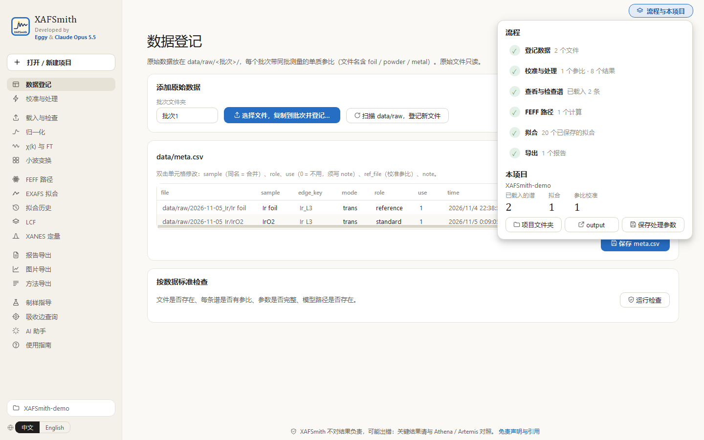
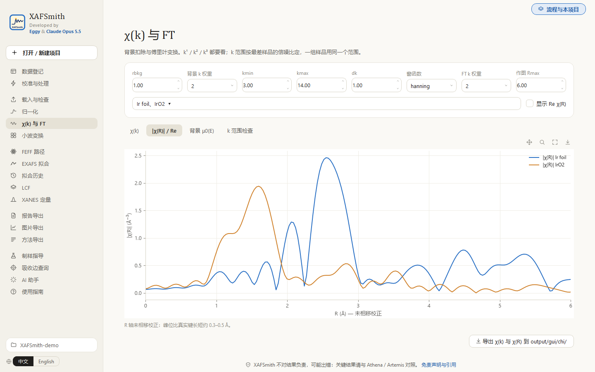
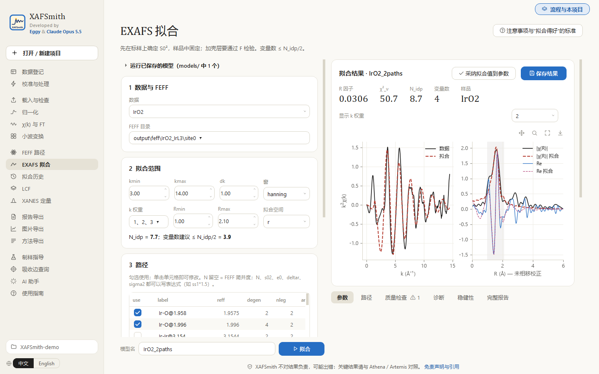
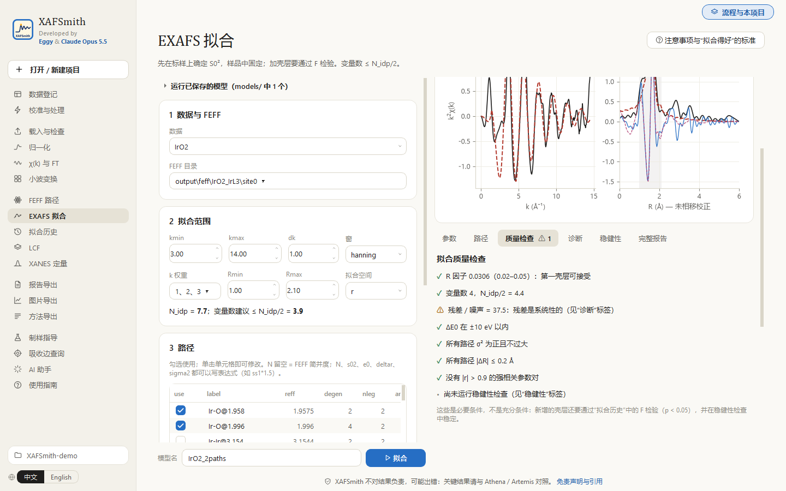
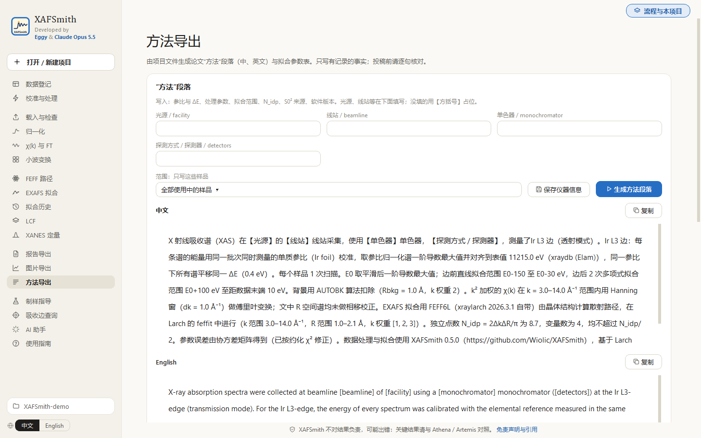
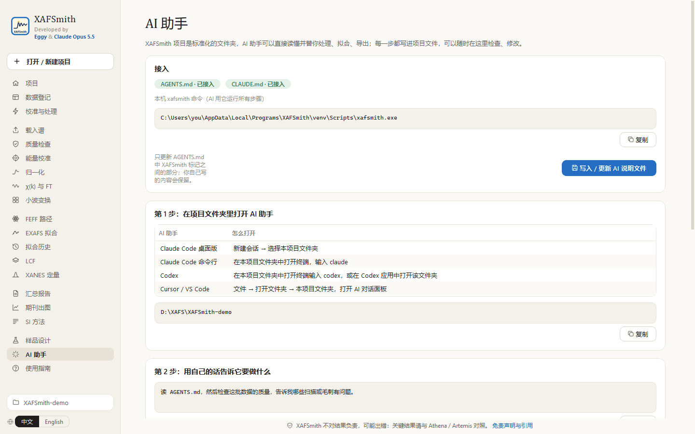

<b>中文</b> | <a href="QUICKSTART_en.md">English</a>

# 快速上手：30 分钟完成第一次 XAFS 处理、拟合与导出

> 面向懂 XAFS 原理、但不写程序、不用命令行的读者。
> 还没安装？先看 [README 的“安装”](README.md#安装)：推荐下载 Windows 安装包（几分钟、不需要联网和 Python）；也可以从源码安装（约 15 分钟）。
> 想先试一试：安装目录里的 `examples\demo_project` 是公开数据的演示项目，复制到自己的文件夹后用“打开”即可。

XAFSmith 有两条路线，结果完全相同，可以随时切换：

- **路线 A：鼠标**——自己在图形界面里点完每一步（第 1–9 步）；
- **路线 B：AI 助手**——在项目文件夹里打开 Claude Code / Codex / Cursor，用自然语言（中文、英文均可）说要做什么，AI 调用 XAFSmith 完成，你在界面里检查（见[路线 B](#路线-bai-助手)）。

建议第一次先走一遍路线 A，了解每一步在做什么；之后的日常分析可以交给路线 B。

本页的例子：**一个机时测了单质参比箔、一个结构已知的标样、几个样品**。目标：处理全部谱 → 用标样确定 S0² → 拟合样品 → 导出图和报告。
左侧导航按流程从上到下排列（准备 → 看数据 → 分析 → 导出 → 工具与帮助，组间留空），下文用页面名称指代各页。
不熟悉 XAFS 原理的，先读 **使用指南 → XAFS 基础讲义**（[在线阅读](src/xafsmith/docs/XAFS基础讲义.md)）。

---

## 准备：手头要有什么

| 需要 | 说明 |
|---|---|
| 原始数据文件 | 束线导出的文本文件（如 BSRF 格式）或 Athena `.prj` |
| **同一机时测的单质参比** | 金属箔或粉末（如 Cu 箔）。**文件名里带 foil / powder / metal**，软件会自动认出它是参比 |
| 一个结构已知的标样 | 如 Cu 箔、CuO。用来确定 S0² 并检验模型 |
| 标样的晶体结构 | CIF 文件（ICSD、Materials Project、COD 等）。软件另内置 Ir、Ta、Co、IrO2、CoO、Co3O4、KTaO3 几种结构 |

---

## 路线 A：鼠标

### 第 1 步　建项目（1 分钟）

“项目”就是一个文件夹，软件把数据、参数、结果都按固定格式放在里面。每个课题建一个。

1. 双击桌面 **XAFSmith** 图标，几秒后窗口打开。
2. 点左上角 **打开 / 新建项目** → **浏览…** 选一个空文件夹 → **新建项目**。

以后打开：在“最近的项目”里**双击**它。打开后进入 **数据登记**；把鼠标移到右上角 **流程与本项目**，弹出流程六步：完成的打勾，下一步用蓝框标出，点任一步直接进入。

### 第 2 步　放入数据并登记（5 分钟）

1. **数据登记**：**批次文件夹** 填这次机时的名字（如 `2026-11-05_Cu`）→ **选择文件并复制到批次…** → 选中本次的全部原始文件（**包括参比箔**）。原文件不动，只复制。
2. 点 **扫描 data/raw，登记新文件**，下面出现登记表，每个文件一行。
3. 在表格里检查并修改，然后点 **保存 meta.csv**：
   - **sample**（样品名）：同一样品扫了几次，这几行用**同一个名字**，软件会自动合并；
   - **role**（角色）：参比箔 `reference`，标样 `standard`，样品 `sample`；
   - **ref_file**（校准参比）：默认已填好同批次参比，一般不用改。
   表格中双击单元格即可修改。
4. 页面下方 **按数据标准检查 → 运行检查**，直到没有“错误”。

### 第 3 步　设定处理参数（3 分钟）

**校准与处理** 页上半部分 **处理参数**：每个吸收边一套（右上角切换），全部样品共用。

- **样品中的全部元素**：如 `Cu, O, C`，软件据此检查邻近吸收边、告诉你 k 最多能用到多少；
- 归一化、背景扣除（rbkg）、傅里叶变换（k 范围、窗函数、k 权重）：先用默认值，第 5 步看过图再调；
- **S0²**：先空着，第 7 步用标样定出来后再填。

点 **保存参数**。

### 第 4 步　批量处理（2 分钟）

同一页下半部分 **批量运行**，依次点（耗时的计算在后台运行，窗口顶部有进度条）：

1. **① 质量检查**：毛刺、I0 掉束、边跳、信噪比可用到的 k（k_snr3）；
2. **② 按参比校准**：用参比箔一阶导数最大值对齐标准能量，同批次所有谱平移同一个 ΔE；
3. **③ 处理全部样品**：校准 → 归一化 → 合并 → χ(k) → 傅里叶变换。

### 第 5 步　看图、检查质量（5 分钟）

1. **载入谱** →“样品”里勾选 → **载入**（参比会一起载入）。
2. 看图（图右上角可平移、框选放大、复位、存图，左上角显示鼠标处坐标）：**归一化**（XANES、边前 / 边后线）、**χ(k) 与 FT**（k¹ / k² / k³，R 轴已标“未相移校正”）、**小波变换**（区分同一 R 处的轻、重散射体；可按 R 区间读出极大值所在 k、一键导出数据，页面下方说明各参数的影响）。

   
3. **质量检查** 页看 QC 表。**有毛刺**时用页面底部的 **去毛刺**：选样品 → 看图确认 → 填能量区间和理由 → **保存并重新载入**（原始文件不会被改动）。

> **k 范围怎么定**：kmax 不超过同组样品中**最差那个**的 k_snr3；同一组样品必须用**同一个** k 范围。改完回 **校准与处理** 保存参数，再点 ③ 重新处理。

### 第 6 步　计算 FEFF 路径（2 分钟）

**FEFF 路径**：

1. 结构来源：**structures/ 文件夹**（把 CIF 放进项目的 `structures` 文件夹，或点本页 **添加结构文件…**），或 **内置结构**；
2. 选吸收原子（默认最重的元素）、吸收边、RMAX（默认 6 Å）；
3. **FEFF 版本**：**FEFF6L**（几秒）或 **FEFF8L**（自洽势，1–3 分钟，通常更准确）。两者可以都算，结果放在不同文件夹；
4. 点 **运行 FEFF**，下方表格列出每条散射路径的距离、简并度、相对振幅。

### 第 7 步　拟合标样，确定 S0²（10 分钟）

**EXAFS 拟合**（右上角 **注意事项与“拟合得好”的标准** 在独立窗口中打开，第一次拟合前先读一遍）。左栏设置、右栏看结果：

1. **数据** 选标样，**FEFF 目录** 选对应结构；
2. **拟合范围**：k 范围用第 5 步定的；R 窗口先只包括第一壳层（如 1.0–2.1 Å）；k 权重 1、2、3 同时勾选。页面显示独立点数 N_idp；
3. **路径**：只勾第一壳层；N 填晶体学配位数（固定）；
4. **参数**：S0²、ΔE0、ΔR、σ² 都可变 → **拟合**；
5. 看结果：
   - 拟合曲线在窗口内是否跟上（|χ(R)| 和 Re χ(R) 都要看）；
   - 右栏 **质量检查** 标签（自动生成）：每一条打 ✓ 还是 ⚠，⚠ 的原因写在后面；
   - **诊断** 标签：残差主要在哪、是否提示毛刺；
   - **稳健性** 标签 → 运行：所有参数应为“稳定”；
   - 想在这次结果的基础上继续调：点 **采纳拟合值到参数**，改参数后再拟合（Ctrl+Enter）；

   

   

6. 把 S0²（如 0.85 ± 0.08）记到 **校准与处理 → 处理参数** 的 S0² 栏并保存；
7. **保存结果**：模型存入 `models/`，以后可一键重跑。

### 第 8 步　拟合样品（批量）

1. **EXAFS 拟合** 页 **数据** 选一个样品，路径与拟合范围同标样；在 **4 参数** 表中把 **s02 的 value 填第 7 步的结果，取消 vary**（固定）。点 **拟合** → 检查 → **保存结果**。
2. **EXAFS 拟合** 页左栏最上方 **运行已保存的模型** → 选这个样品模型 → “样品”里**多选**全部样品 → **运行**。结果都进入 **拟合历史**。
3. 加第二壳层：加路径拟合一次，到 **拟合历史** 选加壳层前后两个拟合 → **F 检验**。**p < 0.05** 才能说这个壳层存在。比较三个以上模型用 **拟合历史** 的 **模型比较表**（勾选拟合 → **比较**）。
4. 几个样品要共享参数（如同一样品的多温度数据共用 N、R）：卡 1 顶部 “拟合方式” 切到 **多个数据集联合**，“数据” 多选，每个数据集一张路径表；同名参数自动共享。有独立先验（如标样定出的 S0² ± 误差）时可在参数表下方加 **软约束**。先读右上角注意事项的 “多数据集联合拟合” 页。

### 第 9 步　导出（2 分钟）

| 想要 | 去哪 |
|---|---|
| 所有结果一张表 + 带图报告 | **报告导出** → 生成报告 → 打开报告文件夹 / 另存 Excel / 在浏览器中打开报告 |
| 论文图（单栏 / 双栏，600 dpi TIFF、SVG、PDF，英文图注；24 种配色） | **图片导出** |
| Origin 工程（统一格式，可继续在 Origin 里改） | **图片导出** → 导出 Origin 工程 (.opju) |
| “实验方法”段落草稿（中英文）与补充材料的拟合参数表 | **方法导出** |
| 小波变换的数据矩阵、极大值表与图 | **小波变换** → 导出数据与图 |
| 在 Athena / Artemis 中对照 | **归一化** 页底部 → 导出 `.prj` |
| XANES 边位置、白线、价态、边前峰 | **XANES 定量** |
| XANES 或 χ(k) 线性组合拟合 | **LCF** |

所有文件也都在项目文件夹的 `output` 里。

---

## 路线 B：AI 助手

AI 助手（如 **Claude Code**、**Codex**、**Cursor**）能在你的电脑上读文件、运行程序。XAFSmith 的每个功能都有对应命令，项目文件都是普通文本，所以 AI 可以替你完成上面的全部步骤。

### B1　准备（一次）

1. 按各自官方说明安装一个 AI 助手：
   - Claude Code：<https://claude.com/claude-code>（有桌面版）
   - Codex：<https://github.com/openai/codex>
   - Cursor：<https://cursor.com>
2. 在 XAFSmith 中建好项目、放好原始数据（路线 A 第 1–2 步的复制文件部分；登记也可以交给 AI）。
3. **AI 助手 → 写入 / 更新 AI 说明文件**。

   

   项目文件夹里会写入 `AGENTS.md`（含本机 xafsmith 命令的完整路径、流程、命令和规则）和 `CLAUDE.md`。

### B2　在项目文件夹里打开 AI

| AI 助手 | 怎么打开 |
|---|---|
| Claude Code 桌面版 | 新建会话 → 选择文件夹：你的项目文件夹 |
| Claude Code 命令行 | 项目文件夹空白处右键 → 在终端中打开 → 输入 `claude` |
| Codex | 在项目文件夹中打开终端 → 输入 `codex`；或在 Codex 应用中打开该文件夹 |
| Cursor | 文件 → 打开文件夹 → 项目文件夹 → 打开 AI 对话面板 |

第一句话可以说：
> 读 AGENTS.md，告诉我这个项目现在的状态：有哪些数据、处理到了哪一步。

### B3　一次完整对话的例子

下面几句话依次对应路线 A 的第 2–9 步，可以分几次说，也可以一次说完：

1. **登记与处理**
   > 登记 data/raw 里的新数据，检查 meta.csv 的样品名、角色和参比是否正确；跑质量检查，告诉我哪些扫描有毛刺或异常，需要的话去毛刺并写明理由；然后校准并处理全部样品。

2. **定 k 范围**
   > 根据质量检查的 k_snr3 和干扰吸收边，给这一组样品选一个统一的 k 范围，说明理由，写进处理参数。

3. **标样与 S0²**
   > 用 Cu 箔标样确定 Cu K 边的 S0²：计算 FEFF（FEFF6 和 FEFF8 都算），拟合第一壳层，做拟合诊断和稳健性检查，把 S0² 写进项目参数。

4. **拟合样品**
   > 把 S0² 固定，建立样品的第一壳层模型，用于样品 A、B、C；再试加第二壳层，做 F 检验；给出配位数、键长、σ² 的表，结论分“实测 / 拟合 / 推测”。

5. **导出**
   > 把 |χ(R)| 和最终拟合导出成双栏期刊图（TIFF + SVG），生成报告、中英文方法段落和补充材料用的拟合参数表，在 notes 里写分析记录，最后告诉我所有文件的位置。

AI 会运行 `xafsmith qc`、`process`、`feff`、`fit`、`diagnose`、`robust`、`ftest`、`figure`、`summary`、`methods` 等命令（命令表见 [README](README.md#第-5-步ai-实际运行的命令)）。

### B4　在界面中检查 AI 的工作

| 检查什么 | 在哪里 |
|---|---|
| AI 写的拟合模型，重跑、看拟合诊断与稳健性 | **EXAFS 拟合** 左栏顶部 → **运行已保存的模型** |
| 模型比较表、F 检验 | **拟合历史** |
| 去毛刺区间与理由 | **质量检查** 页底部“去毛刺” |
| 处理参数 | **校准与处理 → 处理参数** |
| 论文图、报告、方法段落 | **图片导出**、**报告导出**、**方法导出**，或项目的 `output` 文件夹 |
| AI 的分析记录 | 项目的 `notes` 文件夹 |

> AI 也会出错。**关键数字和结论请在界面中核对**；对结论有疑问时，直接问 AI “这个结论的依据是什么、F 检验 p 值是多少、稳健性检查是否通过”。

### 混合使用

两条路线读写同一个项目：可以自己在界面里处理数据，让 AI 做拟合比较；也可以让 AI 处理，自己在界面里微调模型后再让 AI 出图。
软件更新后，在 **AI 助手** 再点一次“写入 / 更新”。

---

## 遇到问题

| 现象 | 原因与处理 |
|---|---|
| 运行安装包时出现“Windows 已保护你的电脑” | 安装包未做代码签名：点 **更多信息 → 仍要运行** |
| 双击 `installer.py`（源码安装）没反应或被记事本打开 | 右键 → 打开方式 → Python；或重装 Python 并勾选 “Add python.exe to PATH” |
| “未指定参比 ref_file，不能校准” | 这批数据缺参比：把同批参比放进来再点 **扫描登记**，或在登记表里选 ref_file |
| χ(k) 或拟合残差里有尖锐小峰 | 毛刺：第 5 步“去毛刺”，以及 EXAFS 拟合页“拟合诊断”的提示 |
| 拟合对不严、R 因子大 | 读 [拟合质量提升教程](src/xafsmith/docs/拟合质量提升教程.md)：先诊断，再按数据 → 处理 → 理论 → 模型排查 |
| FEFF 没有生成路径 | 结构里是否有吸收原子；RMAX 不要超过 8 Å |
| AI 说找不到 xafsmith 命令 | AI 助手 → 再点一次“写入 / 更新 AI 说明文件”，然后让 AI 重新读 AGENTS.md |
| 想换英文界面 | 侧栏底部 **中文 / English** |
| 出错、需要求助 | 帮助 → 关于 → **导出诊断包**（不含原始数据），连同现象发到 [GitHub Issues](https://github.com/Wiolic/XAFSmith/issues) |

## 下一步读什么

- [零基础拟合教程](src/xafsmith/docs/零基础拟合教程.md)：每一步的原理、参数怎么取、怎么判断做对了。
- [多样品联合拟合指南](src/xafsmith/docs/多样品联合拟合指南.md)：一组序列样品的联合拟合，一步一步（先单独、后联合、再做 F 检验、看趋势）。
- [图形界面使用指南](src/xafsmith/docs/图形界面使用指南.md)：每一页、每个按钮的说明。
- [拟合质量提升教程](src/xafsmith/docs/拟合质量提升教程.md)：把拟合做到数据允许的最好。
- [命令行速查](src/xafsmith/docs/命令行速查.md)：会用命令行、想批处理的人。
