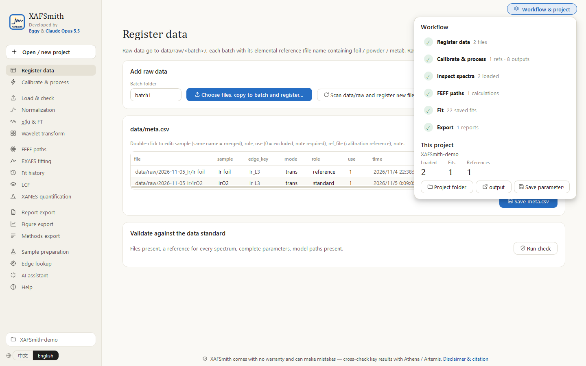
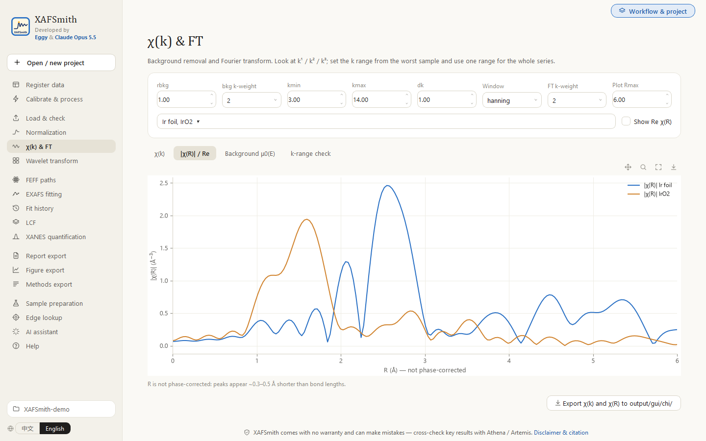
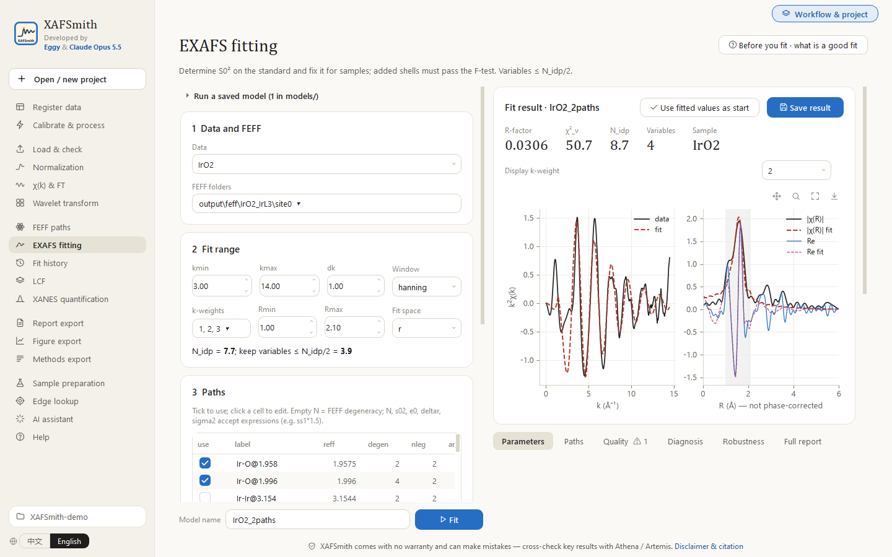
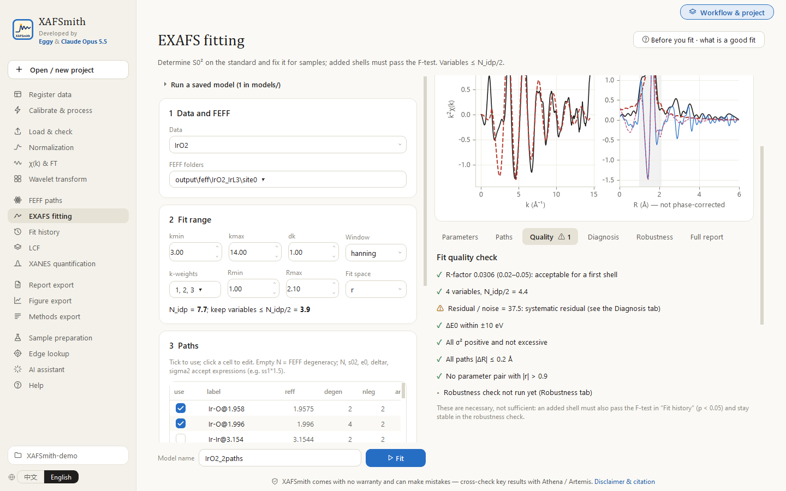
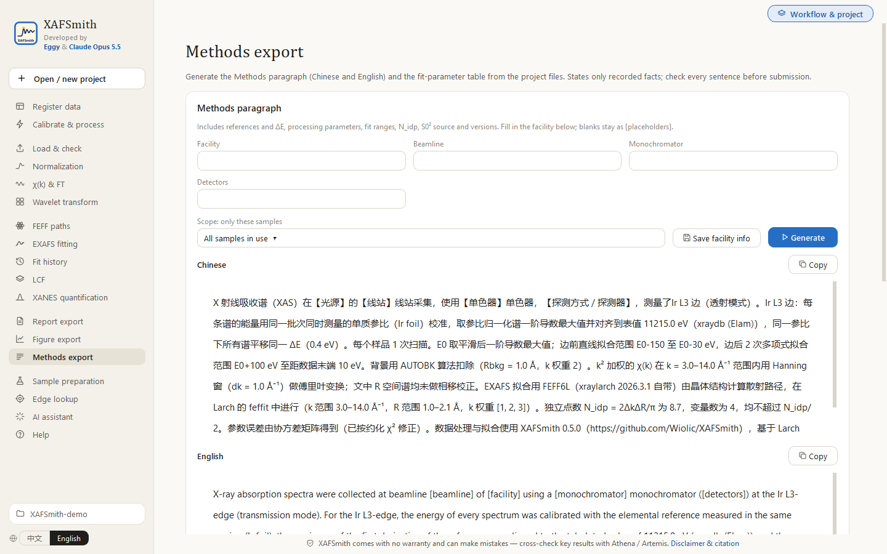
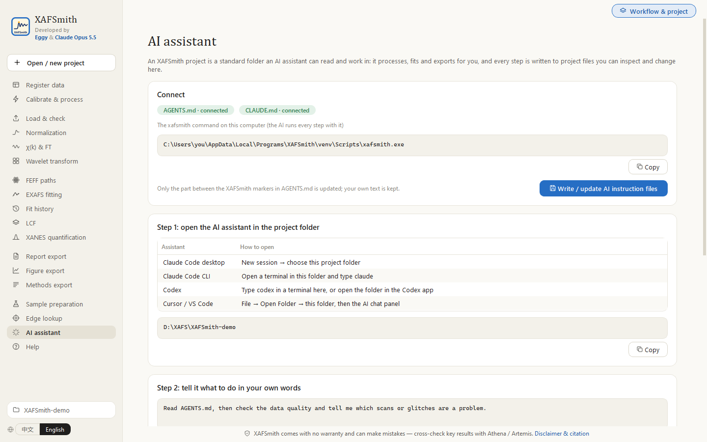

<a href="QUICKSTART.md">中文</a> | <b>English</b>

# Quickstart: your first XAFS processing, fit and export in 30 minutes

> For readers who understand XAFS but do not program or use the command line.
> Not installed yet? See [Installation in the README](README_en.md#installation) (about 15 minutes, once: install Python → double-click `installer.py`).

XAFSmith offers two routes with identical results; switch at any time:

- **Route A — mouse**: click through each step in the GUI yourself (steps 1–9);
- **Route B — AI assistant**: open Claude Code / Codex / Cursor in the project folder, say what you want, the AI drives XAFSmith, and you check the results in the GUI (see [Route B](#route-b-ai-assistant)).

Do route A once to see what each step does; afterwards, routine analysis can go to route B.

Example used here: **one beamtime with an elemental reference foil, one standard of known structure and a few samples**. Goal: process all spectra → determine S0² on the standard → fit the samples → export figures and a report.
The sidebar lists the pages in workflow order (preparation → inspecting data → analysis → export → tools & help, groups separated by space); below, pages are referred to by name. Switch the interface language with **中文 / English** at the bottom of the sidebar.
New to the principles of XAFS? Read **Help → XAFS basics** first ([online](src/xafsmith/docs/XAFS_basics_en.md)).

---

## What you need

| Item | Notes |
|---|---|
| Raw data files | Beamline text files (e.g. BSRF format) or an Athena `.prj` |
| **Elemental reference from the same beamtime** | Metal foil or powder (e.g. Cu foil). **Put foil / powder / metal in the file name** so it is recognized as the reference |
| A standard of known structure | e.g. Cu foil, CuO — to determine S0² and validate the model |
| Its crystal structure | A CIF (ICSD, Materials Project, COD, …). Built in: Ir, Ta, Co, IrO2, CoO, Co3O4, KTaO3 |

---

## Route A: mouse

### Step 1 — Create a project (1 min)

A “project” is a folder in which XAFSmith keeps data, parameters and results in a fixed layout. Make one per study.

1. Double-click the **XAFSmith** icon on the desktop.
2. Click **Open / new project** at the top left → **Browse…** to an empty folder → **Create project**.

To reopen it later, **double-click** it under “Recent projects”. You land on **Register data**; hover **Workflow & project** at the top right for the six workflow steps: finished ones are ticked, the next one is framed in blue, and a click takes you there.

### Step 2 — Add and register the data (5 min)

1. **Register data**: enter a **Batch folder** for this beamtime (e.g. `2026-11-05_Cu`) → **Choose files and copy to batch…** → select all raw files **including the reference foil**. Originals are copied, never changed.
2. Click **Scan data/raw and register new files**; a table appears with one row per file.
3. Check and edit the table, then **Save meta.csv**:
   - **sample**: give repeated scans of one sample **the same name** — they are merged automatically;
   - **role**: `reference` for the foil, `standard` for standards, `sample` for samples;
   - **ref_file**: the calibration reference, pre-filled with the reference of the same batch.
   Double-click a cell to edit it.
4. At the bottom, **Validate against the data standard → Run check** until there are no errors.

### Step 3 — Processing parameters (3 min)

**Calibrate & process → Processing parameters**: one set per edge, shared by all samples.

- **All elements in the sample**, e.g. `Cu, O, C` — used to check neighbouring edges and the usable k range;
- normalization, background removal (rbkg), Fourier transform (k range, window, k-weight): keep the defaults for now and revisit after step 5;
- **S0²**: leave it for now; fill it in after step 7.

Click **Save parameters**.

### Step 4 — Batch processing (2 min)

**Calibrate & process**, in order:

1. **① Quality check**: glitches, I0 drop-outs, edge step, usable k (k_snr3);
2. **② Calibrate with references**: align the first-derivative maximum of the foil to the tabulated energy; every spectrum of the batch gets the same ΔE;
3. **③ Process all samples**: calibration → normalization → merging → χ(k) → Fourier transform.

### Step 5 — Look at the data (5 min)

1. **Load spectra** → tick samples → **Load** (references are loaded too).
2. Plot (pan, zoom to box, reset and save at the top right of each plot; cursor coordinates at the top left): **Normalization** (XANES, pre/post-edge lines), **χ(k) & FT** (k¹ / k² / k³; the R axis is marked “not phase-corrected”), **Wavelet transform** (light vs heavy scatterers at the same R; read the k of the maximum per R window, export data in one click, and read how each parameter changes the map).

   
3. **Quality check**: read the QC table. If there are **glitches**, use **Deglitch** at the bottom: select samples → confirm on the plot → enter energy ranges and a reason → **Save and reload** (raw files are never modified).

> **Choosing the k range**: kmax should not exceed the k_snr3 of the **worst** sample of the series, and all samples of a series must use **the same** k range. Save the parameters under **Calibrate & process** and click ③ again.

### Step 6 — FEFF paths (2 min)

**FEFF paths**:

1. Structure source: **structures/ folder** (put the CIF in the project's `structures` folder, or upload it on this page), or **Built-in structure**;
2. choose absorber (defaults to the heaviest element), edge and RMAX (default 6 Å);
3. **FEFF version**: **FEFF6L** (seconds) or **FEFF8L** (self-consistent potential, 1–3 min, usually more accurate). You can compute both; they go to separate folders;
4. click **Run**; the table lists each scattering path's distance, degeneracy and relative amplitude.

### Step 7 — Fit the standard and determine S0² (10 min)

**EXAFS fitting** (open **Before you fit · what is a good fit** at the top right — a separate window — and read it before your first fit). Settings on the left, result on the right:

1. **Data**: the standard; **FEFF folders**: its structure;
2. **Fit range**: the k range from step 5; an R window covering only the first shell (e.g. 1.0–2.1 Å); tick k-weights 1, 2 and 3. N_idp is shown;
3. **Paths**: only the first shell; N = crystallographic coordination number (fixed);
4. **Parameters**: S0², ΔE0, ΔR and σ² free → **Fit**;
5. check the result:
   - does the fit follow the data inside the window (both |χ(R)| and Re χ(R))?
   - the **Quality** tab on the right (automatic): which points are ✓ and which ⚠, with the reason;
   - the **Diagnosis** tab: where is the residual, any glitch hints?
   - the **Robustness** tab → run: every parameter should be “stable”;
   - to keep refining from this result, click **Use fitted values as start**, change parameters and fit again (Ctrl+Enter);

   

   

6. note S0² (e.g. 0.85 ± 0.08) under **Calibrate & process → Processing parameters** and save;
7. **Save result**: the model goes to `models/` and can be rerun in one click.

### Step 8 — Fit the samples (batch)

1. On **EXAFS fitting** choose one sample as **Data**, with the same paths and ranges as the standard; in **4 Parameters** set **s02's value to the step-7 result and untick vary** (fixed). **Fit** → check → **Save result**.
2. At the top of the left column of **EXAFS fitting** open **Run a saved model** → choose this sample model → select **all samples** → **Run**. Results go to **Fit history**.
3. Second shell: fit once with the extra path, then **Fit history** → select the fits without and with the shell → **F-test**. Only **p < 0.05** lets you say the shell is present.

### Step 9 — Export (2 min)

| You want | Go to |
|---|---|
| All results in one table + a report with figures | **Report export** → Build report → open the folder / save the Excel / open the report in a browser |
| Publication figures (single / double column, 600 dpi TIFF, SVG, PDF, English captions; 24 palettes) | **Figure export** |
| Origin project (one consistent format, editable in Origin) | **Figure export** → Export Origin project (.opju) |
| A draft “Methods” paragraph (English and Chinese) and the fit-parameter table for the SI | **Methods export** |
| Wavelet data matrix, maxima table and figure | **Wavelet transform** → Export data and figure |
| Cross-check in Athena / Artemis | bottom of **Normalization** → export `.prj` |
| Edge position, white line, oxidation state, pre-edge peaks | **XANES quantification** |
| XANES or χ(k) linear combination fitting | **LCF** |

Every file is also in the project's `output` folder.

---

## Route B: AI assistant

AI assistants such as **Claude Code**, **Codex** and **Cursor** can read files and run programs on your computer. Every XAFSmith feature has a command and every project file is plain text, so the AI can do all of the steps above for you.

### B1 — Preparation (once)

1. Install an AI assistant following its own instructions:
   - Claude Code: <https://claude.com/claude-code> (desktop app available)
   - Codex: <https://github.com/openai/codex>
   - Cursor: <https://cursor.com>
2. Create the project in XAFSmith and add the raw data (the file-copy part of route A steps 1–2; registration can be left to the AI).
3. **AI assistant → Write / update AI instruction files**.

   

   This writes `AGENTS.md` (with the full path of the xafsmith command on this computer, workflow, commands and rules) and `CLAUDE.md` into the project folder.

### B2 — Open the AI in the project folder

| AI assistant | How to open |
|---|---|
| Claude Code desktop app | New session → choose folder: your project folder |
| Claude Code CLI | Right-click in the project folder → Open in Terminal → type `claude` |
| Codex | Open a terminal in the project folder → type `codex`, or open the folder in the Codex app |
| Cursor | File → Open Folder → project folder → open the AI chat panel |

A good first message:
> Read AGENTS.md and tell me the current state of this project: what data there are and how far the processing has got.

### B3 — An example conversation

These messages follow route A steps 2–9; send them one by one or together:

1. **Register and process**
   > Register the new data in data/raw, check that sample names, roles and references in meta.csv are right; run the quality check and tell me which scans have glitches or problems, deglitch where needed with a written reason; then calibrate and process all samples.

2. **Choose the k range**
   > From k_snr3 and the interfering edges, choose one k range for this series, explain why, and store it in the processing parameters.

3. **Standard and S0²**
   > Determine S0² for the Cu K edge from the Cu foil standard: compute FEFF (both FEFF6 and FEFF8), fit the first shell, run the fit diagnosis and robustness check, and store S0² in the project parameters.

4. **Fit the samples**
   > With S0² fixed, build a first-shell model for the samples and apply it to A, B and C; then try a second shell and F-test it; give a table of coordination numbers, distances and σ², and label conclusions as measured / fitted / inferred.

5. **Export**
   > Export |χ(R)| and the final fits as double-column journal figures (TIFF + SVG), build the summary report, the methods paragraph and the SI fitting text and table, write an analysis note in notes, and finally tell me where every file is.

The AI runs commands such as `xafsmith qc`, `process`, `feff`, `fit`, `diagnose`, `robust`, `ftest`, `figure`, `summary` and `methods` (see the command table in the [README](README_en.md#step-5-the-commands-the-ai-runs)).

### B4 — Check the AI's work in the GUI

| What to check | Where |
|---|---|
| The AI's fit models; rerun, fit diagnosis, robustness | top of the left column of **EXAFS fitting** → **Run a saved model** |
| Model comparison, F-test | **Fit history** |
| Deglitch ranges and reasons | bottom of **Quality check** |
| Processing parameters | **Calibrate & process → Processing parameters** |
| Figures, report, methods paragraph | **Figure export**, **Report export**, **Methods export**, or the project's `output` folder |
| The AI's analysis notes | the project's `notes` folder |

> AI makes mistakes too. **Verify key numbers and conclusions in the GUI**; when in doubt, ask the AI “what is this conclusion based on, what is the F-test p-value, did the robustness check pass?”

### Mixing the routes

Both routes read and write the same project: process the data yourself and let the AI compare fit models, or let the AI process, refine a model yourself in the GUI, and ask the AI to make the figures.
After updating XAFSmith, click “Write / update” on **AI assistant** again.

---

## Troubleshooting

| Symptom | Cause and fix |
|---|---|
| Double-clicking `installer.py` does nothing or opens a text editor | Right-click → Open with → Python, or reinstall Python with “Add python.exe to PATH” ticked |
| “No reference ref_file, cannot calibrate” | The batch has no reference: add it and **Scan and register** again, or choose ref_file in the table |
| Sharp spikes in χ(k) or in the fit residual | Glitches: step 5 “Deglitch” and the hints in the Fit diagnosis on EXAFS fitting |
| Poor fit, large R-factor | Read [Improving fit quality](src/xafsmith/docs/fit_quality_guide_en.md): diagnose first, then check data → processing → theory → model |
| FEFF produces no paths | Does the structure contain the absorber? Keep RMAX ≤ 8 Å |
| The AI cannot find the xafsmith command | AI assistant → “Write / update AI instruction files” again, then ask the AI to reread AGENTS.md |

## What to read next

- [Beginner fitting tutorial](src/xafsmith/docs/fitting_tutorial_en.md): the principles, parameter choices and checks behind every step.
- [GUI guide](src/xafsmith/docs/GUI_guide_en.md): every page and button.
- [Improving fit quality](src/xafsmith/docs/fit_quality_guide_en.md): getting the best fit your data allow.
