<p align="right"><b>中文</b> | <a href="README_en.md">English</a></p>

# XAFSmith

**可连接 AI 助手（agent）的同步辐射 XAFS 分析软件。**

XAFSmith 处理同步辐射 X 射线吸收谱（XANES + EXAFS）：能量校准、归一化、χ(k)、傅里叶变换、小波变换、FEFF 计算、EXAFS 拟合、线性组合拟合、价态估算、图片导出（可直接导出 Origin 文件）、报告导出。你可以用两种方式使用它，也可以混用：

- **🖱 鼠标**：图形界面覆盖全部功能，不需要写代码、不需要命令行；
- **🤖 AI 助手**：在项目文件夹里打开 Claude Code、Codex、Cursor 等 AI 助手，**用自然语言（中文、英文均可）说出要做的事**，它会调用 XAFSmith 完成处理、拟合、出图和报告，结果写回项目，你在图形界面里逐项检查。

计算核心是同步辐射领域广泛使用的 [Larch](https://xraypy.github.io/xraylarch/)（xraylarch）与 FEFF。本软件面向懂 XAFS 原理、但不写程序的化学与材料研究者。

> [!WARNING]
> **免责声明** —— 本软件按“现状”提供，不附带任何保证；作者不对使用本软件得到的结果负责。
> 请自行核验结果，**关键结果建议与 Athena / Artemis 对比**（软件可一键导出 Athena 工程文件）。AI 助手给出的结论同样需要你核验。

---

## 目录

1. [为什么用 XAFSmith](#为什么用-xafsmith)
2. [界面一览](#界面一览)
3. [安装](#安装)
4. [接入 AI 助手（详细步骤）](#接入-ai-助手详细步骤)
5. [第一次使用](#第一次使用)
6. [支持的数据、验证、引用](#支持的数据)

---

## 为什么用 XAFSmith

和 Athena / Artemis 的常规做法相比：

| 你要做的事 | Athena / Artemis 中通常 | XAFSmith 中 |
|---|---|---|
| **让 AI 助手替你处理和拟合** | — | 项目是标准化文件夹，附带写给 AI 的说明（`AGENTS.md`）；AI 用命令完成每一步，结果全部可在界面中检查、修改、重跑 |
| 一个机时测了几十条谱，要校准、归一化、合并 | 导入后逐组标记参比、对齐、设置参数、合并，再保存工程 | 文件放进文件夹 → **扫描登记** → **一键处理**：按同批次参比自动校准，同一套参数归一化，多次扫描自动合并（异常扫描自动剔除并记录理由） |
| FEFF 计算 | Atoms 由 CIF 生成输入，再运行 FEFF | 选 CIF 或内置结构 → 一键计算；**内置 FEFF6L（几秒）与 FEFF8L（自洽势）**，可直接比较，无需另装 FEFF |
| 小波变换（区分轻 / 重散射体、重叠壳层） | 需借助其他程序 | 直接计算（Morlet / Cauchy），按 R 区间读出极大值所在 k，**一键导出数据与图**，页面内说明每个参数的影响 |
| 出论文图 | 导出数据，再在 Origin 里重画、调格式 | **图片导出**：**可直接导出 Origin 文件（.opju）**，格式统一（字号、线宽、图层尺寸），可继续在 Origin 里改；也可导出单栏 / 双栏、600 dpi 的 TIFF、PNG、SVG、PDF，自动英文图注；24 种配色，标样自动画成灰色 |
| 写论文方法与补充材料（SI） | 方法自己写，参数从 Artemis 报告手工整理 | **方法导出**：由项目记录生成中英文“方法”段落，一键复制拟合参数表（N、R、σ²、ΔE0、R 因子），另存带拟合说明的 .md |
| 保证一组样品用**同一套**处理参数 | 靠自己逐个检查 | 每个吸收边一套参数存在项目文件里，所有样品自动共用；例外必须写明理由 |
| 同一个拟合模型用于一组样品（时间、电位、温度序列） | 通常逐个样品复制、调整 | **运行已保存的模型** → 多选样品 → 一次跑完 |
| 判断拟合好不好、为什么对不上 | 主要看 R 因子与经验 | 每次拟合后**自动质量检查**（R 因子、变量数、残差与噪声之比、误差、边界、ΔE0、σ²、ΔR、相关性逐条判断）；**拟合诊断**（k 空间残差、自动定位毛刺并换算成能量、分段失配、改进建议）；**稳健性检查**；**F 检验** |
| 和 Athena / Artemis 对照 | — | **一键导出 Athena 工程（.prj）**，带本软件的处理参数 |
| 半年后重现结果 | 找工程文件、回忆参数 | 原始数据只读，参数都写在项目文件里，结果随时可从原始数据重新生成 |
| 学 XAFS 原理 | 另找教材 | 软件内 **XAFS 基础讲义**：从 X 射线吸收讲到拟合，公式、实测谱图与算例 |

此外还有：XANES 定量（边位置、白线、价态标定、边前峰拟合）、XANES / χ(k) 线性组合拟合（含组合枚举）、制样指导（压片制样计算器、干扰吸收边筛查）、吸收边查询（同 Hephaestus：吸收边、荧光线、荧光滤片）、可视化去毛刺、中英文界面、软件内一键更新。

---

## 界面一览

原生桌面窗口（PySide6），几秒内打开。左侧按使用流程分组，窗口底部始终显示免责声明。截图来自演示项目（Ir 箔与 IrO₂，Ir L3 边）。

**流程与本项目**：固定在右上角的按钮，悬停弹出流程六步（完成的打勾、下一步蓝框，点击跳转）与本项目信息。

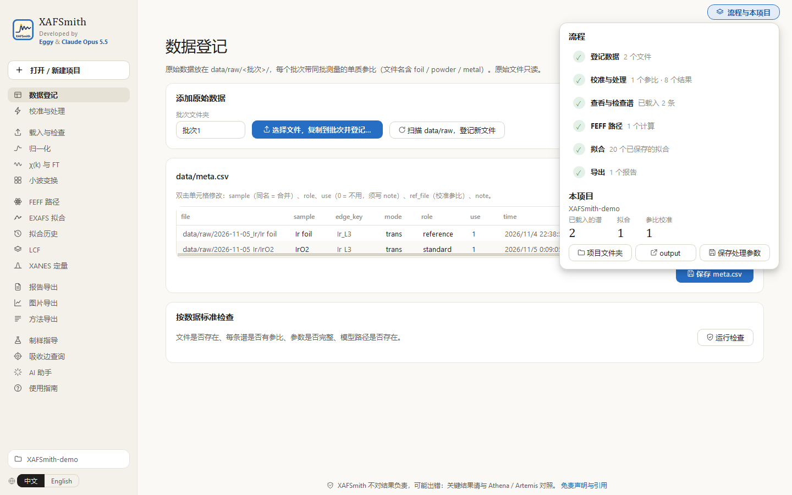

**EXAFS 拟合**：左栏设置（数据、范围、路径、参数，“拟合”按钮固定在底部），右栏始终显示结果，改参数—拟合—看结果不用上下翻；一键把拟合值采纳为下次初值。

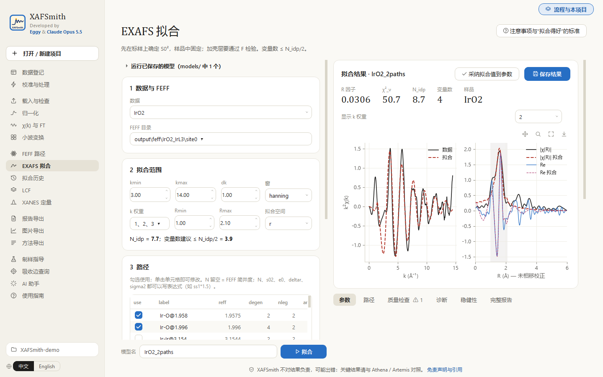

**质量检查**：每次拟合后自动逐条判断（R 因子、变量数、残差与噪声之比、误差、边界、ΔE0、σ²、ΔR、相关性）；诊断、稳健性、完整报告在同一组标签页里。

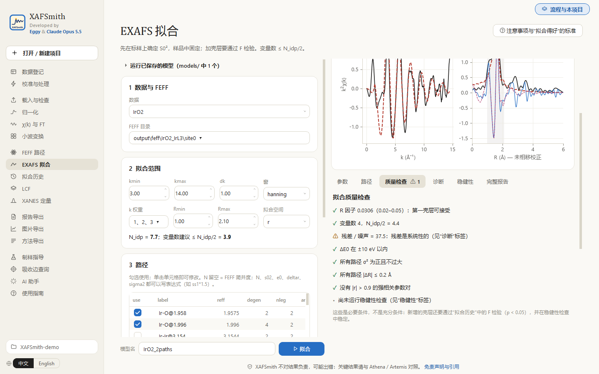

<table>
<tr>
<td width="50%"><b>小波变换</b>：两条谱左右对比、各 R 区间极大值、一键导出数据，附参数说明<br/>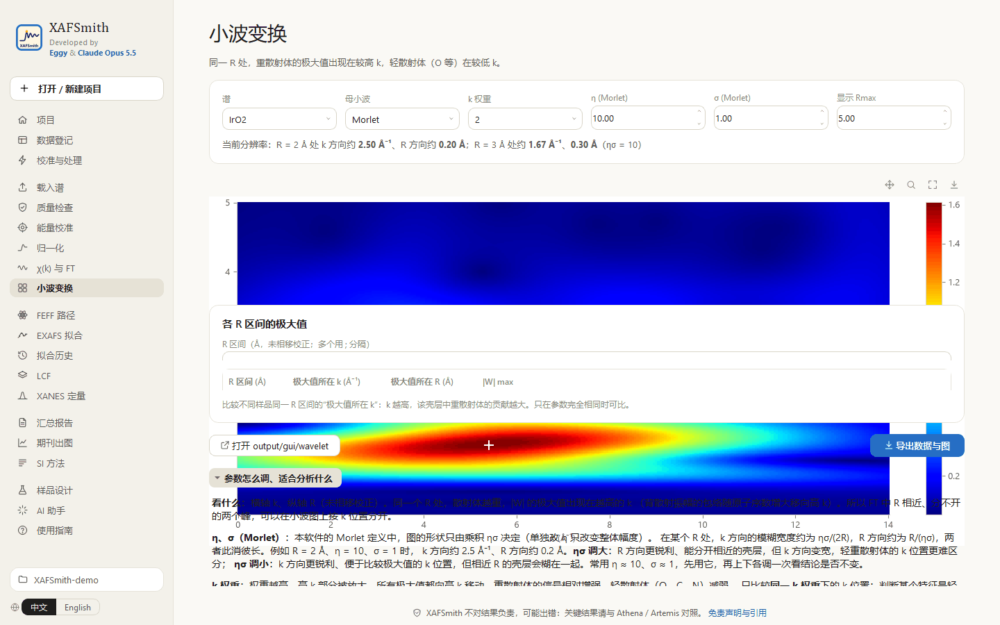</td>
<td width="50%"><b>χ(k) 与 FT</b>：参数改动立即重算<br/>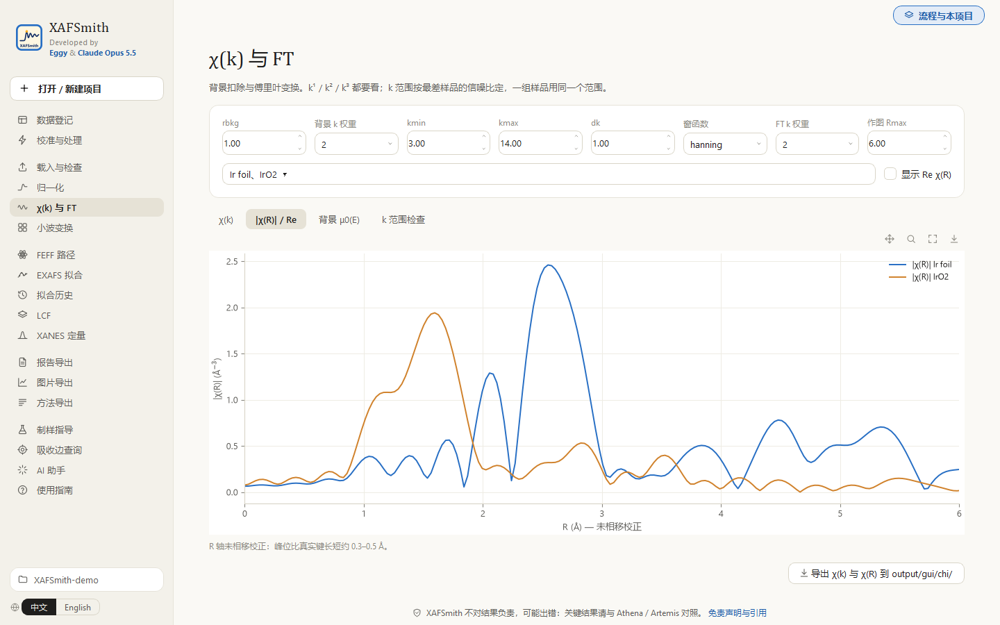</td>
</tr>
<tr>
<td><b>方法导出</b>：中英文“方法”段落与拟合参数表，一键复制<br/>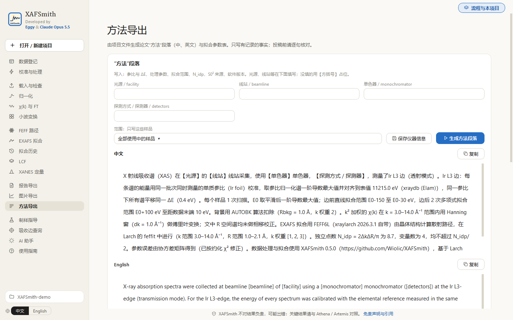</td>
<td><b>AI 助手</b>：一键写入给 AI 的说明文件<br/>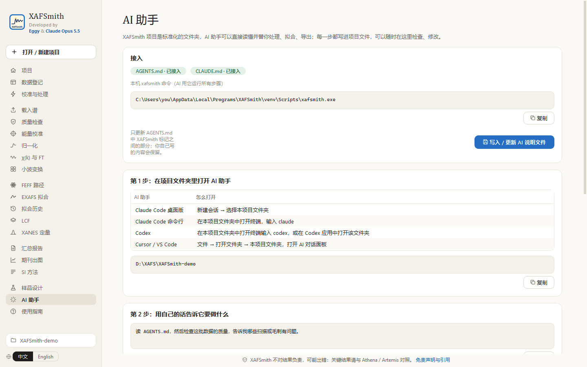</td>
</tr>
<tr>
<td><b>归一化</b>：边前 / 边后线、叠加、导数、合并扫描<br/>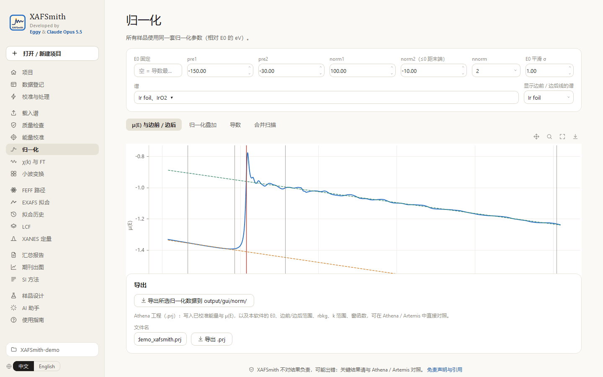</td>
<td><b>图片导出</b>：可直接导出 Origin 文件；24 种配色、600 dpi、英文图注<br/>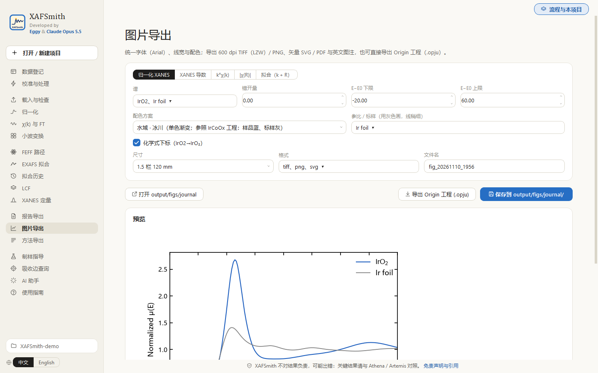</td>
</tr>
<tr>
<td><b>导出的 Origin 工程</b>：图层 25×19 cm、Arial 32 pt、四边框、刻度朝外；Ir foil 1W1B 与 IrO2 Batch 1 的 XANES、k²χ(k)、|χ(R)|（含 EXAFS 拟合，虚线）<br/>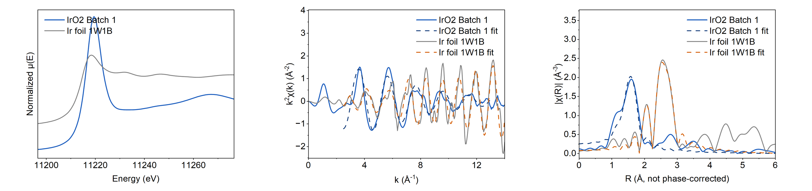</td>
<td><b>吸收边查询</b>：点元素看吸收边、荧光线与荧光滤片<br/>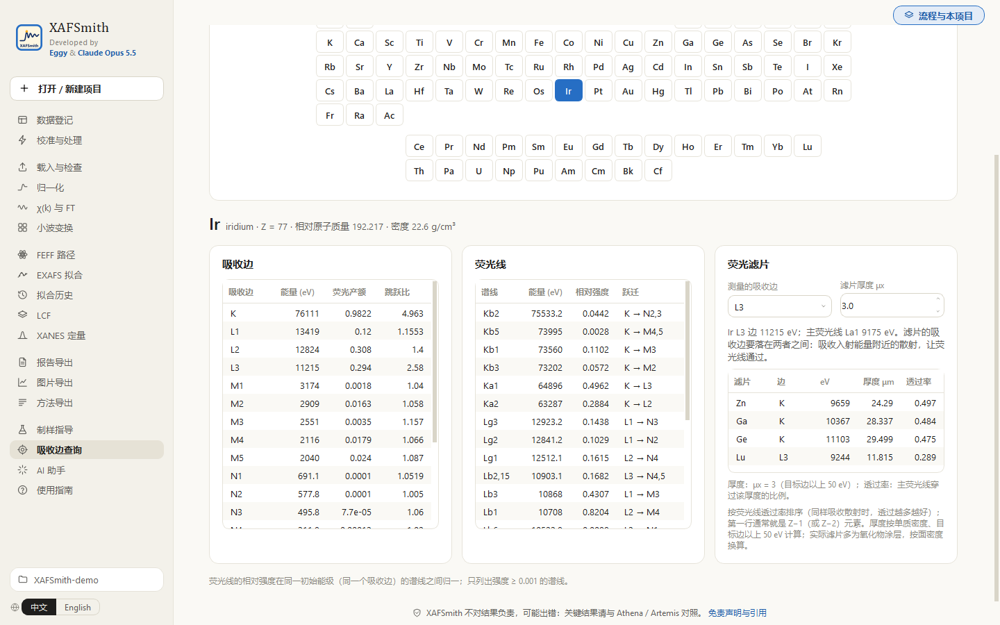</td>
</tr>
</table>

---

## 安装

### 系统要求

| | |
|---|---|
| 操作系统 | **Windows 10 / 11（64 位）**。macOS / Linux 目前只能从源码安装（见下） |
| 磁盘 | 约 0.5 GB |
| 权限 | 不需要管理员权限（装到当前用户） |
| 网络 | 安装包**不需要联网**；只有“检查更新”会访问 github.com（可关闭） |

### 方式一（推荐）：安装包

1. 到 [Releases](https://github.com/Wiolic/XAFSmith/releases/latest) 下载 `XAFSmith-<版本>-Setup.exe`（约 130 MB），双击运行。
   安装包自带 Python、Larch、FEFF6L/FEFF8L 与界面库，**不需要另装 Python，不需要 pip**。
2. 安装包**未做代码签名**：Windows 若提示“Windows 已保护你的电脑”，点 **更多信息 → 仍要运行**。个别杀毒软件可能误报 PyInstaller 打包的程序，可在 Release 页用 `SHA256SUMS.txt` 核对文件后加入信任。
3. 装好后从开始菜单或桌面图标打开 **XAFSmith**。命令行 / AI 助手使用同目录下的 `xafsmith-cli.exe`。
4. 安装目录里的 `examples\demo_project` 是用公开数据做的演示项目：**先复制到自己的文件夹再打开**。

也可以下载免安装的 `XAFSmith-<版本>-win64-portable.zip`，解压后直接运行 `XAFSmith.exe`。

**升级**：直接运行新版本的安装包（覆盖旧版）。**卸载**：Windows 设置 → 应用 → XAFSmith → 卸载。升级和卸载都**不会删除你的项目文件**，也不会删除 `%USERPROFILE%\.xafsmith\` 里的设置与日志。

### 方式二：从源码安装（开发者，或 macOS / Linux）

Windows，约 15 分钟，只需一次：

1. **安装 Python**：打开 <https://www.python.org/downloads/windows/>，下载 Python 3.11 或 3.12。
   安装第一屏**一定要勾选 “Add python.exe to PATH”**，然后点 Install Now。
2. **下载 XAFSmith**：本页上方绿色按钮 **Code → Download ZIP**，解压到任意位置。
3. **双击解压文件夹里的 `installer.py`**，打开中英文安装向导：选安装位置和快捷方式 → 勾选同意免责声明 → **安装**（需要联网，5–15 分钟）。
   双击没有反应、或被记事本打开时：右键 `installer.py` → 打开方式 → Python。
4. 装好后**双击桌面上的 XAFSmith 图标**，软件以原生桌面窗口打开（几秒，不需要浏览器）。解压的文件夹可以删除。

卸载：开始菜单 → XAFSmith → 卸载 XAFSmith（只删软件，不删你的数据）。
macOS / Linux：`pip install "xafsmith @ https://github.com/Wiolic/XAFSmith/archive/refs/heads/main.zip"`，详见 [命令行速查](src/xafsmith/docs/命令行速查.md)。

---

## 接入 AI 助手（详细步骤）

### 它是怎么工作的

AI 助手（agent）是能在你电脑上读文件、运行程序的 AI，例如 **Claude Code**、**Codex**、**Cursor**。
XAFSmith 的每个功能都有对应的命令（例如 `xafsmith fit 模型名`），项目里的数据登记表、处理参数、拟合模型都是普通文本文件。
所以 AI 读完项目里的说明文件 `AGENTS.md`，就知道怎样用 XAFSmith 一步步完成你的要求，而且每一步都留在项目里，你可以在图形界面中检查。

```
你（中文描述需求） → AI 助手 → 运行 xafsmith 命令 → 结果写入项目文件夹 → 你在 XAFSmith 界面中检查 / 修改 / 重跑
```

### 第 1 步：准备一个项目

在 XAFSmith 界面中：**项目 → 打开 / 新建项目**（新建项目时会自动生成给 AI 的说明文件）。
原始数据可以先放好（见 [快速上手](QUICKSTART.md) 第 1–2 步），也可以让 AI 帮你登记。

### 第 2 步：写入 AI 说明文件

**AI 助手 → 写入 / 更新 AI 说明文件**。项目文件夹里会出现或更新：

| 文件 | 给谁看 | 内容 |
|---|---|---|
| `AGENTS.md` | Codex、Cursor 及大多数 AI 助手 | **本机 xafsmith 命令的完整路径**、工作流程、拟合与导出命令、必须遵守的规则（中英文） |
| `CLAUDE.md` | Claude Code | 引用 `AGENTS.md` |

只更新 `AGENTS.md` 中 XAFSmith 标记之间的部分，你自己写在这两个文件里的内容（例如体系介绍、已确定的 S0²）会保留。
更新 XAFSmith 后建议再点一次。会用命令行的话，也可以在项目文件夹中运行 `xafsmith agent --write`。

### 第 3 步：在项目文件夹里打开 AI 助手

| AI 助手 | 怎么打开 |
|---|---|
| **Claude Code 桌面版**（[claude.com/claude-code](https://claude.com/claude-code)） | 新建会话 → 选择文件夹：你的项目文件夹 |
| **Claude Code 命令行** | 在项目文件夹中打开终端（文件夹空白处右键 → 在终端中打开），输入 `claude` |
| **Codex**（[github.com/openai/codex](https://github.com/openai/codex)） | 在项目文件夹中打开终端，输入 `codex`；或在 Codex 应用中打开该文件夹 |
| **Cursor / VS Code + AI 插件** | 文件 → 打开文件夹 → 你的项目文件夹，打开 AI 对话面板 |

AI 助手的安装和账号按各自官方说明完成。用什么语言提问都可以，AI 会用你的语言回答。第一次可以先说一句：“读 AGENTS.md，告诉我这个项目现在的状态。”

### 第 4 步：用自然语言告诉它要做什么

**数据处理**
> 检查这批数据的质量，告诉我哪些扫描有毛刺或异常，需要的话去毛刺并写明理由，然后处理全部样品。

**确定 S0²**
> 用 Cu 箔标样确定 Cu K 边的 S0²：先算 FEFF，拟合第一壳层，做拟合诊断和稳健性检查，结果写进项目参数。

**拟合一个序列**
> 把同一个模型用于样品 A、B、C（S0² 固定），比较第一、二壳层的配位数和 σ²，加第二壳层前后做 F 检验，结论分“实测 / 拟合 / 推测”。

**对比 FEFF6 和 FEFF8**
> 用 FEFF8L 重新计算路径，同一模型分别用 FEFF6 和 FEFF8 拟合，比较参数是否在误差内一致。

**导出**
> 把这个序列的 |χ(R)| 和最终拟合导出成双栏期刊图（TIFF + SVG），再生成报告和中英文方法段落，告诉我文件在哪里。

### 第 5 步：AI 实际运行的命令

你不需要记这些命令，但知道它们能帮你看懂 AI 在做什么：

| 任务 | 命令 | 结果在 |
|---|---|---|
| 登记、检查、处理 | `xafsmith init` → `qc` → `calib` → `process` | `data/meta.csv`、`output/qc/`、`output/processed/` |
| FEFF | `xafsmith feff --structure X.cif --absorber Cu --edge K [--code feff8]` | `output/feff/` |
| 拟合 | `xafsmith fit 模型名`（模型写在 `models/模型名.json`） | `output/fits/` |
| 诊断 / 稳健性 / 显著性 | `xafsmith diagnose 模型名`、`robust 模型名`、`ftest 小模型 大模型` | 屏幕、`output/fits/` |
| LCF / XANES | `xafsmith lcf …`、`xafsmith xanes …` | `output/lcf/`、`output/xanes/` |
| **期刊图** | `xafsmith figure --kind chir --samples A B --size double` | `output/figs/journal/` |
| **报告导出** | `xafsmith summary` | `output/reports/汇总_<时间>/` |
| **方法段落** | `xafsmith methods` | `output/reports/方法段落.md` |
| **SI 拟合方法 + 参数表** | `xafsmith si --lang en` | `output/reports/SI_EXAFS拟合方法.md` |
| **导出 Athena** | `xafsmith export-prj --samples A B` | `output/gui/athena/` |

### 第 6 步：检查 AI 的结果

- **EXAFS 拟合 → 运行已保存的模型**：AI 写的每个模型都在 `models/`，选中就能在界面里重跑，查看拟合曲线、**拟合诊断**、**稳健性检查**；
- **拟合历史**：比较模型；
- **报告导出**、**图片导出**、**方法导出**：查看和重新导出；
- `notes/` 文件夹：AI 按规则写下的分析记录（做了什么、结论、下一步）。

### 安全与规则

`AGENTS.md` 中写明了 AI 必须遵守的规则：原始数据只读；所有结果写入 `output/`；处理参数只改项目参数文件且例外要写理由；S0² 先用标样确定；变量数不超过独立点数的一半；加壳层必须做 F 检验；结论分“实测 / 拟合 / 推测”；不编造数据和文献值。
AI 仍可能出错，**关键结论请在图形界面中核对**，必要时与 Athena / Artemis 对比。

---

## 第一次使用

**→ [快速上手（QUICKSTART）](QUICKSTART.md)**：鼠标路线与 AI 路线各走一遍，从建项目到第一次拟合和导出。

| 文档 | 适合 |
|---|---|
| [XAFS 基础讲义](src/xafsmith/docs/XAFS基础讲义.md) | 只有本科物理、化学基础：同步辐射 XAFS 的原理，由浅入深，有公式、实测谱图和算例 |
| [图形界面使用指南](src/xafsmith/docs/图形界面使用指南.md) | 每一页、每个按钮的用法 |
| [零基础拟合教程](src/xafsmith/docs/零基础拟合教程.md) | 第一次做 EXAFS 拟合：原理、参数怎么取、怎么判断做对了 |
| [拟合质量提升教程](src/xafsmith/docs/拟合质量提升教程.md) | 拟合对不严时：诊断残差、去毛刺、FEFF6/FEFF8、何时加路径、何时停 |
| [数据标准](src/xafsmith/docs/数据标准.md) | 项目文件夹里每个文件的含义 |
| [命令行速查](src/xafsmith/docs/命令行速查.md) | 会用命令行、想批处理，或 macOS / Linux |

这些文档在软件左侧 **使用指南** 中也能看到（中英文）。

---

## 支持的数据

- 自动识别的格式：北京同步辐射装置（BSRF）文本、**XDI**、Athena 文本（`.xmu`）、XDAC、Athena 工程（`.prj`）；
- 通用列文本：**按列名**对应能量 / I0 / It / If / μ（不按列号），认不出时请你指定，不会猜；
- 透射 / 荧光自动判断；文件里同时有原始通道与 μ 列时，统一由通道计算 μ，并与文件 μ 列核对；
- 其他光源的格式：把一个样例文件发给开发者即可加入（`xafsmith inspect <文件>` 可查看识别结果）。

每次测量请**同时测对应的单质参比**（金属箔或粉末），用于能量校准。

## 验证

- 与 Artemis 对照（IrO2，相同 k/R 范围与 k 权重）：S0² 0.80 ± 0.11 vs 0.86 ± 0.09，ΔE0 9.2 vs 10.2 eV，ΔR −0.012 vs −0.010 Å，误差范围内一致。
- 标样多壳层拟合（金红石 IrO2、立方钙钛矿 KTaO3）给出与晶体学一致的配位数与键长。
- 数值基准（自动测试）：Cu 箔第一壳层拟合与 Larch 官方示例结果一致（S0² 0.92、ΔE0 4.4 eV、σ² 0.0087 Ų），并与直接调用 Larch 逐位一致；构建安装包时对打包后的程序再做一次同样的比对。
- 每次发布前运行单元测试、数值基准与图形界面逐页自动测试（中文与英文界面）；公开数据的演示项目随仓库提供（`tests/data/demo_project`）。

## 问题反馈

- 在 [GitHub Issues](https://github.com/Wiolic/XAFSmith/issues) 提交问题，写明版本号（“关于”页）、操作步骤和现象。
- 附上**诊断包**：“关于 → 导出诊断包”，内含日志、版本、环境和项目配置，**不含原始数据和谱**。日志也在 `%USERPROFILE%\.xafsmith\xafsmith.log`。
- 其他光源的数据格式不能识别时，请附一个样例文件（`xafsmith inspect <文件>` 可先看识别结果）。

## 版本与开发

- 更新记录：[CHANGELOG.md](CHANGELOG.md)；版本号遵循语义化版本。
- 软件结构：[ARCHITECTURE.md](ARCHITECTURE.md)；参与开发：[CONTRIBUTING.md](CONTRIBUTING.md)；发布流程：[docs/dev/RELEASING.md](docs/dev/RELEASING.md)。

## 引用

论文中使用本软件，请引用本仓库（GitHub 页面右侧 **Cite this repository**）：

*Eggy & Claude. XAFSmith: XAFS processing and fitting software, version 1.0.0. https://github.com/Wiolic/XAFSmith*

并引用所依赖的程序：
- Larch：M. Newville, *J. Phys.: Conf. Ser.* **430**, 012007 (2013).
- FEFF6：S. I. Zabinsky, J. J. Rehr, A. Ankudinov, R. C. Albers, M. J. Eller, *Phys. Rev. B* **52**, 2995 (1995).
- 使用 FEFF8L 时另引 FEFF8：A. L. Ankudinov, B. Ravel, J. J. Rehr, S. D. Conradson, *Phys. Rev. B* **58**, 7565 (1998).

## 作者与许可

Developed by **Eggy** & **Claude Opus 5.5** (Anthropic).

许可：[PolyForm Noncommercial License 1.0.0](LICENSE)（详见 [NOTICE](NOTICE)）。

- **允许**：个人、学术研究、教学等非商业用途的使用、修改和分发；
- **不允许**：任何商业用途，包括出售本软件或其修改版、收费分发、作为收费产品或服务的一部分；
- **分发时**：必须附上许可条款和 LICENSE 中以 “Required Notice:” 开头的引用说明；论文中使用请按上文引用。

商业使用请联系作者另行授权。0.5.0 及更早版本按当时附带的 MIT 许可发布。
