<p align="right"><a href="README.md">中文</a> | <b>English</b></p>

# XAFSmith

**Agent-ready synchrotron XAFS analysis software.**

XAFSmith processes synchrotron X-ray absorption spectra (XANES + EXAFS): energy calibration, normalization, χ(k), Fourier and wavelet transforms, FEFF calculations, EXAFS fitting, linear combination fitting, oxidation-state estimation, figure export (including Origin files) and reports. Use it in either of two ways, or mix them:

- **🖱 Mouse**: the graphical interface covers every feature — no code, no command line;
- **🤖 AI assistant**: open an AI assistant such as Claude Code, Codex or Cursor in the project folder and **say what you want in plain language**. It drives XAFSmith to process, fit, plot and report, writes everything back into the project, and you check each step in the GUI.

The computational core is [Larch](https://xraypy.github.io/xraylarch/) (xraylarch) and FEFF, both widely used in the synchrotron community. XAFSmith is written for chemists and materials scientists who understand XAFS but do not program.

> [!WARNING]
> **Disclaimer** — XAFSmith is provided “as is”, without warranty of any kind; the authors accept no responsibility for results obtained with it.
> Please verify your results and **cross-check key results against Athena / Artemis** (XAFSmith exports Athena project files in one click). Conclusions drafted by an AI assistant must be verified too.

---

## Contents

1. [Why XAFSmith](#why-xafsmith)
2. [A look at the interface](#a-look-at-the-interface)
3. [Installation](#installation)
4. [Connecting an AI assistant (step by step)](#connecting-an-ai-assistant-step-by-step)
5. [Getting started](#getting-started)
6. [Supported data, validation, citation](#supported-data)

---

## Why XAFSmith

Compared with a typical Athena / Artemis workflow:

| Task | Typically in Athena / Artemis | In XAFSmith |
|---|---|---|
| **Let an AI assistant process and fit for you** | — | Projects are standardized folders with instructions for AI (`AGENTS.md`); the AI performs every step with commands, and everything can be inspected, changed and rerun in the GUI |
| Calibrate, normalize and merge dozens of spectra from one beamtime | Import, mark references, align, set parameters and merge group by group, then save a project | Drop files into a folder → **Scan and register** → **One-click processing**: calibration against the reference of the same batch, one parameter set for normalization, automatic merging (outlier scans removed with a recorded reason) |
| Make sure a sample series uses **one** parameter set | Check each one yourself | One parameter set per edge stored in the project and shared by all samples; exceptions need a written reason |
| Apply one fit model to a series (time, potential, temperature) | Usually copy and adjust per sample | **Run a saved model** → select samples → done |
| FEFF calculations | Atoms builds the input from a CIF, then run FEFF | Pick a CIF or built-in structure → one click; **FEFF6L (seconds) and FEFF8L (self-consistent) built in**, easy to compare, no separate FEFF install |
| Wavelet transform (light vs heavy scatterers, overlapping shells) | Needs other software | Built in (Morlet / Cauchy); k of the maximum per R window, **one-click export of data and figure**, in-page guidance on every parameter |
| Judge a fit and find out why it does not match | Mostly the R-factor and experience | An **automatic quality check** after every fit (R-factor, variables, residual/noise, errors, bounds, ΔE0, σ², ΔR, correlations, point by point); **fit diagnosis** (k-space residual, glitches located and converted to energy, misfit by segment, hints); **robustness check**; **F-test** |
| Methods section and Supporting Information | Write methods by hand, copy parameters from Artemis reports | **Methods export**: a Methods paragraph (English and Chinese) from the project records, one-click copy of the parameter table (N, R, σ², ΔE0, R-factor), .md with the fitting text |
| Publication figures | Export data, redraw and format in Origin | **Figure export**: **exports Origin files (.opju) directly**, in one consistent format (font sizes, line widths, layer size) and editable in Origin; also single / double column, 600 dpi TIFF, PNG, SVG, PDF with English captions; 24 palettes, standards drawn in grey automatically |
| Collect all results | Copy tables by hand | **One-click summary report**: Excel + HTML with figures |
| Cross-check with Athena / Artemis | — | **One-click export of an Athena project (.prj)** with XAFSmith's processing parameters |
| Reproduce results months later | Find the project file, recall the parameters | Raw data are read-only and all parameters live in project files; results can always be regenerated from the raw data |
| Learn the principles of XAFS | Find a textbook | Built-in **XAFS basics** lecture: from X-ray absorption to fitting, with formulas, measured spectra and worked examples |

Also: XANES quantification (edge position, white line, oxidation-state calibration, pre-edge peak fitting), XANES / χ(k) LCF with combination search, sample design (μt, edge step, pellet mass, interfering edges), visual deglitching, Chinese / English interface, in-app updates.

---

## A look at the interface

A native desktop window (PySide6) that opens in seconds. Pages are grouped by workflow on the left; a disclaimer is always visible at the bottom. Screenshots come from a demo project (Ir foil and IrO₂, Ir L3 edge).

**Workflow & project**: a button fixed at the top right; hover for the six workflow steps (finished ones ticked, the next framed in blue, click to go) and project information.

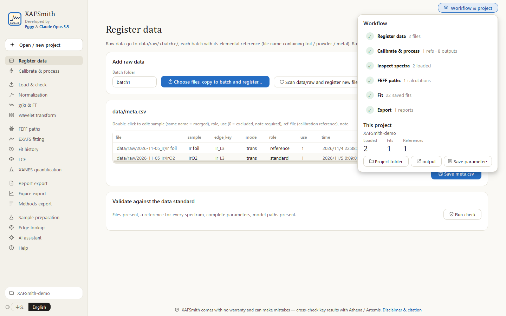

**EXAFS fitting**: settings on the left (data, ranges, paths, parameters; the Fit button pinned at the bottom), the result always on the right — change, fit and read without scrolling; one click adopts the fitted values as the next start values.

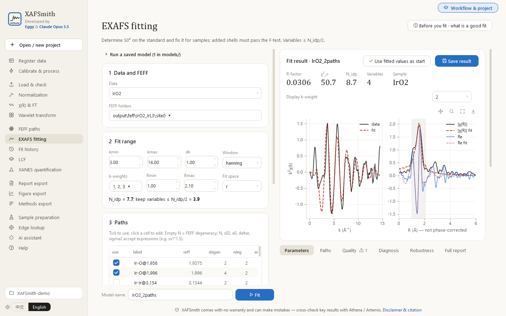

**Quality check**: after every fit, an automatic point-by-point check (R-factor, variables, residual/noise, errors, bounds, ΔE0, σ², ΔR, correlations); diagnosis, robustness and the full report sit in the same set of tabs.

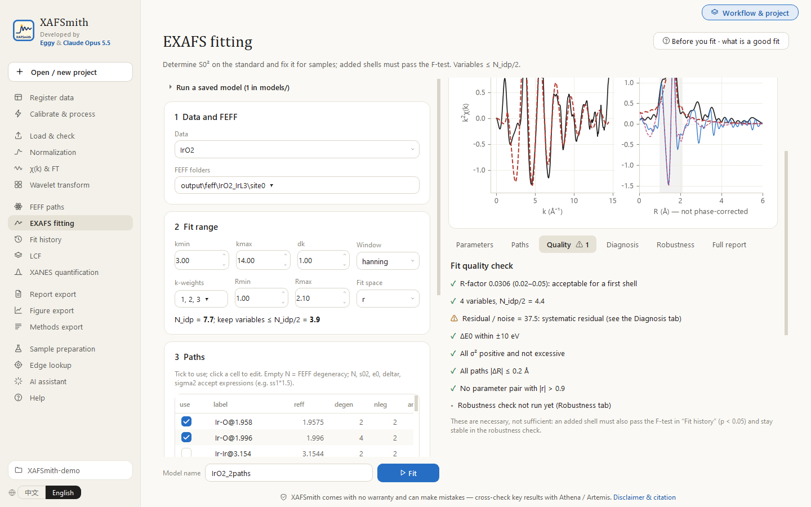

<table>
<tr>
<td width="50%"><b>Wavelet transform</b>: two spectra side by side, maxima per R window, one-click data export, parameter guidance<br/>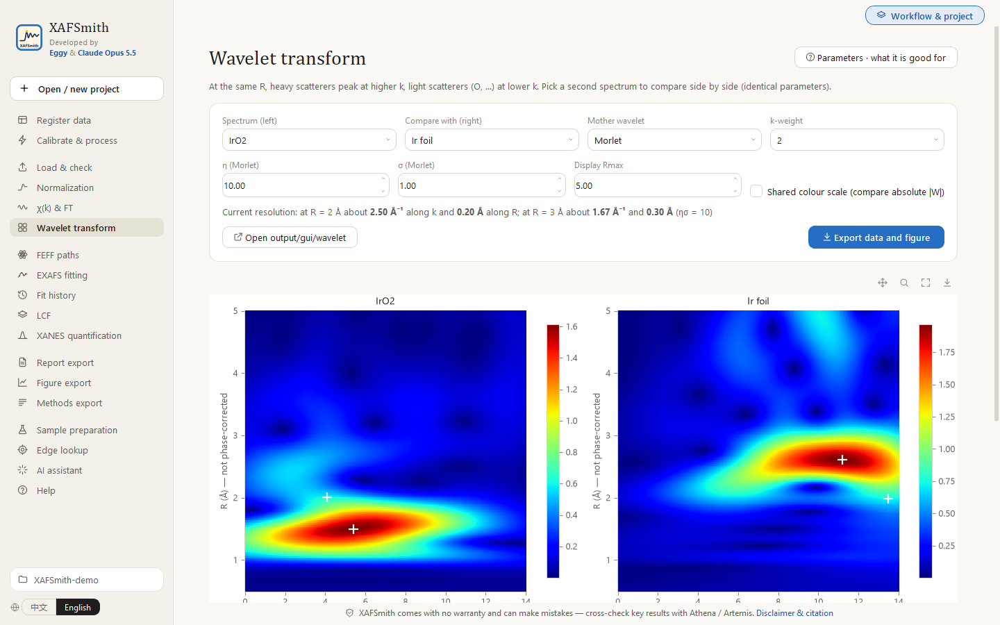</td>
<td width="50%"><b>χ(k) &amp; FT</b>: recomputed as you change parameters<br/>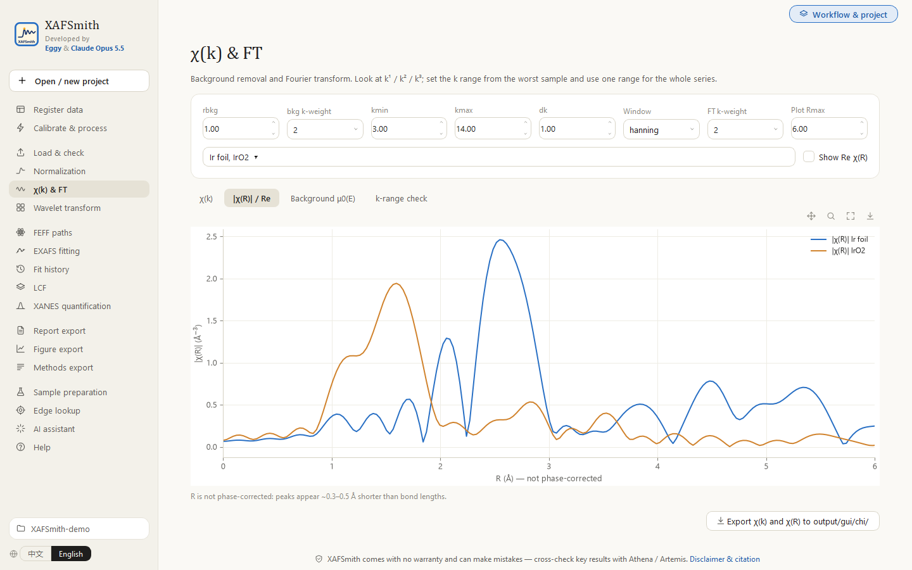</td>
</tr>
<tr>
<td><b>Methods export</b>: Methods paragraph and fit-parameter table, one-click copy<br/>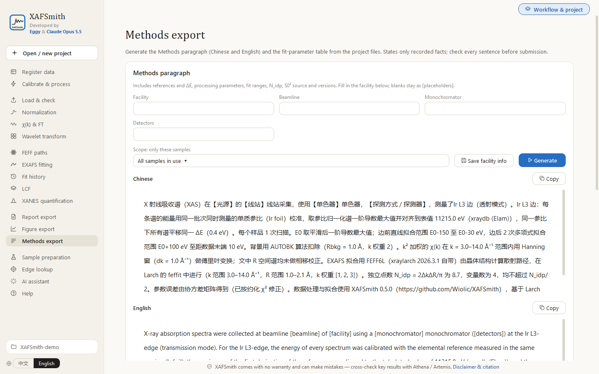</td>
<td><b>AI assistant</b>: one click writes the instruction files for the AI<br/>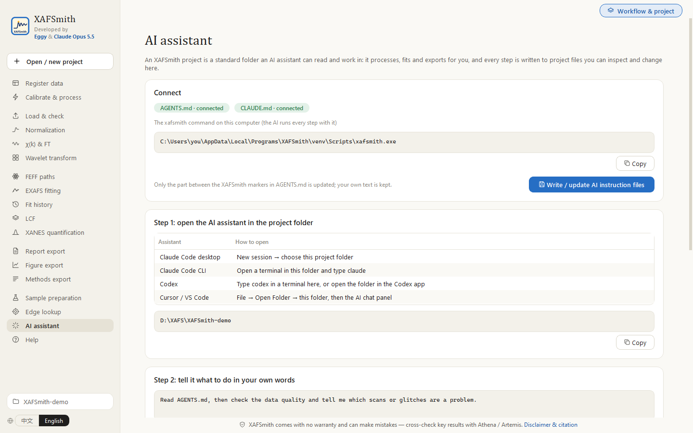</td>
</tr>
<tr>
<td><b>Normalization</b>: pre/post-edge lines, overlay, derivative, merging<br/>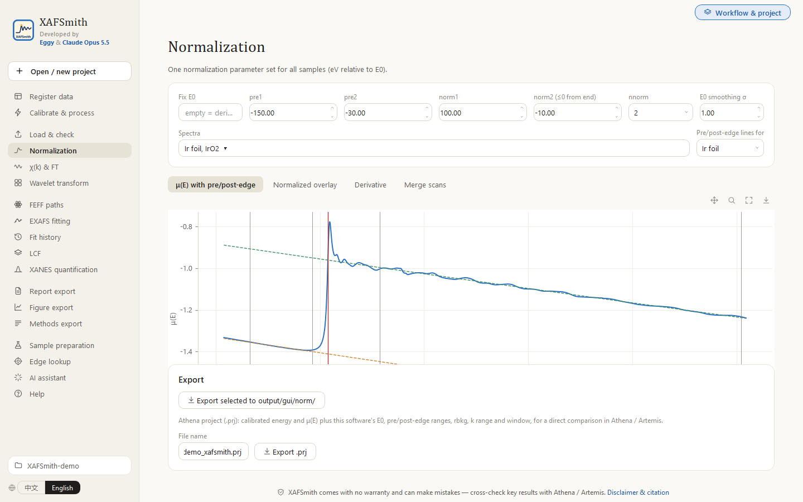</td>
<td><b>Figure export</b>: exports Origin files directly; 24 palettes, 600 dpi, English captions<br/>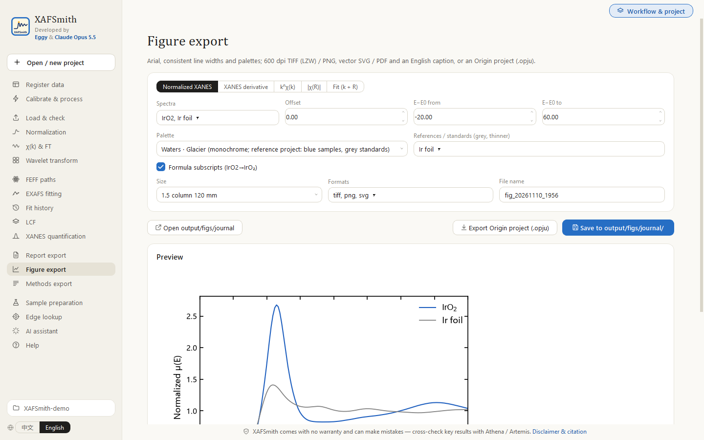</td>
</tr>
<tr>
<td><b>Exported Origin project</b>: 25×19 cm layer, Arial 32 pt, boxed frame, outward ticks; XANES, k²χ(k) and |χ(R)| of Ir foil 1W1B and IrO2 Batch 1 with EXAFS fits (dashed)<br/>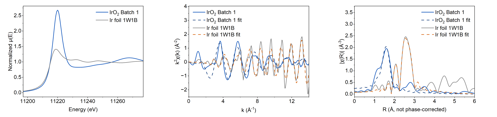</td>
<td><b>Edge lookup</b>: click an element for edges, fluorescence lines and a filter<br/>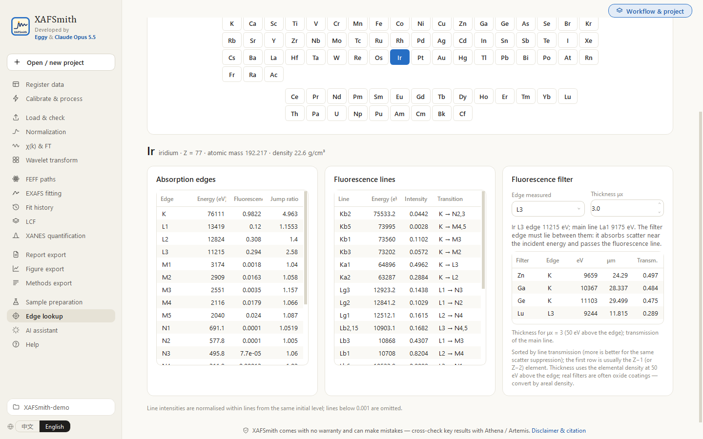</td>
</tr>
</table>

---

## Installation

### System requirements

| | |
|---|---|
| Operating system | **Windows 10 / 11 (64-bit)**. macOS / Linux: install from source for now (see below) |
| Disk | about 0.5 GB |
| Permissions | no administrator rights needed (per-user install) |
| Network | the installer works **offline**; only “Check for updates” contacts github.com (can be switched off) |

### Option 1 (recommended): installer

1. Download `XAFSmith-<version>-Setup.exe` (about 130 MB) from [Releases](https://github.com/Wiolic/XAFSmith/releases/latest) and run it.
   It bundles Python, Larch, FEFF6L/FEFF8L and the GUI libraries — **no separate Python, no pip**.
2. The installer is **not code-signed**: if Windows shows “Windows protected your PC”, click **More info → Run anyway**. Some antivirus programs flag PyInstaller-built programs by mistake; verify the file against `SHA256SUMS.txt` on the Release page and allow it.
3. Start **XAFSmith** from the Start menu or the desktop icon. For the command line / AI assistants use `xafsmith-cli.exe` in the same folder.
4. `examples\demo_project` in the install folder is a demo project built from public data: **copy it to your own folder before opening it**.

A no-install `XAFSmith-<version>-win64-portable.zip` is also provided: unzip and run `XAFSmith.exe`.

**Upgrade**: run the new installer (it replaces the old version). **Uninstall**: Windows Settings → Apps → XAFSmith → Uninstall. Neither touches your project files or the settings and logs in `%USERPROFILE%\.xafsmith\`.

### Option 2: from source (developers, macOS / Linux)

Windows, about 15 minutes, once:

1. **Install Python**: go to <https://www.python.org/downloads/windows/> and download Python 3.11 or 3.12.
   On the first screen of the installer **tick “Add python.exe to PATH”**, then click Install Now.
2. **Download XAFSmith**: green **Code → Download ZIP** button at the top of this page; unzip anywhere.
3. **Double-click `installer.py`** in the unzipped folder to open the bilingual setup wizard: choose the location and shortcuts → tick the disclaimer → **Install** (internet needed, 5–15 minutes).
   If double-clicking does nothing or opens a text editor: right-click `installer.py` → Open with → Python.
4. **Double-click the XAFSmith icon on the desktop**; it opens as a native desktop window (seconds, no web browser). The unzipped folder can be deleted.

Uninstall: Start menu → XAFSmith → Uninstall XAFSmith (your data are kept).
macOS / Linux: `pip install "xafsmith @ https://github.com/Wiolic/XAFSmith/archive/refs/heads/main.zip"`; see the [command-line reference](src/xafsmith/docs/命令行速查.md) (Chinese; commands are self-explanatory).

---

## Connecting an AI assistant (step by step)

### How it works

An AI assistant (agent) is an AI that can read files and run programs on your computer, for example **Claude Code**, **Codex** or **Cursor**.
Every XAFSmith feature has a command (e.g. `xafsmith fit model_name`), and the data register, processing parameters and fit models are plain text files.
After reading the project's `AGENTS.md`, the AI knows how to use XAFSmith step by step, and every step is left in the project for you to check in the GUI.

```
You (describe the task) → AI assistant → runs xafsmith commands → results in the project folder → you check / change / rerun in XAFSmith
```

### Step 1: have a project

In XAFSmith: **Project → Open / create project** (a new project gets the AI instruction files automatically).
Put the raw data in first (see [Quickstart](QUICKSTART_en.md) steps 1–2), or ask the AI to register them.

### Step 2: write the AI instruction files

**AI assistant → Write / update AI instruction files**. This creates or updates:

| File | Read by | Content |
|---|---|---|
| `AGENTS.md` | Codex, Cursor and most AI assistants | **Full path of the xafsmith command on this computer**, workflow, fitting and export commands, mandatory rules (Chinese and English) |
| `CLAUDE.md` | Claude Code | Refers to `AGENTS.md` |

Only the part between the XAFSmith markers in `AGENTS.md` is updated; anything you wrote yourself (system description, established S0², …) is kept.
Click again after updating XAFSmith. From a terminal: `xafsmith agent --write` in the project folder.

### Step 3: open the AI assistant in the project folder

| AI assistant | How to open |
|---|---|
| **Claude Code desktop app** ([claude.com/claude-code](https://claude.com/claude-code)) | New session → choose folder: your project folder |
| **Claude Code CLI** | Open a terminal in the project folder (right-click in the folder → Open in Terminal) and type `claude` |
| **Codex** ([github.com/openai/codex](https://github.com/openai/codex)) | Open a terminal in the project folder and type `codex`, or open the folder in the Codex app |
| **Cursor / VS Code with an AI extension** | File → Open Folder → your project folder, then open the AI chat panel |

Install and sign in to the assistant following its own instructions. You can write in any language; the assistant replies in yours. A good first message: “Read AGENTS.md and tell me the current state of this project.”

### Step 4: tell it what to do

**Processing**
> Check the data quality, tell me which scans have glitches or problems, deglitch where needed with a written reason, then process all samples.

**Determine S0²**
> Determine S0² for the Cu K edge from the Cu foil standard: run FEFF, fit the first shell, run the fit diagnosis and robustness check, and store the result in the project parameters.

**Fit a series**
> Apply the same model to samples A, B and C (S0² fixed), compare coordination numbers and σ² of the first and second shells, F-test the second shell, and label conclusions as measured / fitted / inferred.

**FEFF6 vs FEFF8**
> Recompute the paths with FEFF8L, fit the same model with FEFF6 and FEFF8 paths, and check whether the parameters agree within errors.

**Export**
> Export |χ(R)| and the final fits of the series as double-column journal figures (TIFF + SVG), then build the summary report and the methods paragraph, and tell me where the files are.

### Step 5: the commands the AI runs

You do not need to remember them, but they help you follow what the AI does:

| Task | Command | Output |
|---|---|---|
| Register, check, process | `xafsmith init` → `qc` → `calib` → `process` | `data/meta.csv`, `output/qc/`, `output/processed/` |
| FEFF | `xafsmith feff --structure X.cif --absorber Cu --edge K [--code feff8]` | `output/feff/` |
| Fit | `xafsmith fit model_name` (model in `models/model_name.json`) | `output/fits/` |
| Diagnosis / robustness / significance | `xafsmith diagnose model`, `robust model`, `ftest small large` | screen, `output/fits/` |
| LCF / XANES | `xafsmith lcf …`, `xafsmith xanes …` | `output/lcf/`, `output/xanes/` |
| **Figure export** | `xafsmith figure --kind chir --samples A B --size double` | `output/figs/journal/` |
| **Report export** | `xafsmith summary` | `output/reports/汇总_<time>/` |
| **Methods paragraph** | `xafsmith methods` | `output/reports/方法段落.md` |
| **SI fitting text + table** | `xafsmith si --lang en` | `output/reports/SI_EXAFS拟合方法.md` |
| **Athena export** | `xafsmith export-prj --samples A B` | `output/gui/athena/` |

### Step 6: check the AI's results

- **EXAFS fitting → Run a saved model**: every model the AI writes is in `models/`; rerun it in the GUI and inspect the fit, the **fit diagnosis** and the **robustness check**;
- **Fit history**: compare models;
- **Report export**, **Figure export**, **Methods export**: view and re-export;
- `notes/`: the analysis notes the AI writes (what was done, conclusions, next step).

### Safety and rules

`AGENTS.md` lists the rules the AI must follow: raw data are read-only; all results go to `output/`; processing parameters are changed only in the project parameter file, with a reason for any exception; S0² is determined on a standard first; variables ≤ half the number of independent points; every added shell needs an F-test; conclusions are labelled measured / fitted / inferred; no invented data or literature values.
AI can still make mistakes — **verify key conclusions in the GUI** and, where needed, against Athena / Artemis.

---

## Getting started

**→ [Quickstart](QUICKSTART_en.md)**: the mouse route and the AI route, from creating a project to the first fit and export.

| Guide | For |
|---|---|
| [XAFS basics](src/xafsmith/docs/XAFS_basics_en.md) | Undergraduate physics and chemistry only: how synchrotron XAFS works, step by step, with formulas, measured spectra and worked examples |
| [GUI guide](src/xafsmith/docs/GUI_guide_en.md) | Every page and button |
| [Beginner fitting tutorial](src/xafsmith/docs/fitting_tutorial_en.md) | Your first EXAFS fit: principles, parameter choices, how to judge success |
| [Improving fit quality](src/xafsmith/docs/fit_quality_guide_en.md) | When the fit does not match: residual diagnosis, deglitching, FEFF6/FEFF8, when to add paths, when to stop |
| [Data standard](src/xafsmith/docs/数据标准.md) (Chinese) | What every file in a project means |

All guides are also available in the app under **Help** (Chinese and English).

---

## Supported data

- Auto-detected formats: Beijing SR Facility (BSRF) text, **XDI**, Athena text (`.xmu`), XDAC, Athena projects (`.prj`);
- generic column text: energy / I0 / It / If / μ are matched **by column name** (not position); if a name is not recognised you are asked to map it — the software does not guess;
- transmission / fluorescence is detected automatically; when a file has both raw channels and a μ column, μ is always computed from the channels and cross-checked against the file's μ column;
- other facilities' formats: send a sample file to the developer to have it added (`xafsmith inspect <file>` shows how a file is recognised).

Always measure the **elemental reference** (metal foil or powder) in the same session; it is used for energy calibration.

## Validation

- Against Artemis (IrO2, same k/R ranges and k-weights): S0² 0.80 ± 0.11 vs 0.86 ± 0.09, ΔE0 9.2 vs 10.2 eV, ΔR −0.012 vs −0.010 Å — consistent within errors.
- Multi-shell fits of standards (rutile IrO2, cubic perovskite KTaO3) give coordination numbers and distances consistent with crystallography.
- Numerical benchmark (automated): the Cu-foil first-shell fit reproduces Larch's official example (S0² 0.92, ΔE0 4.4 eV, σ² 0.0087 Ų) and is bit-identical to a direct Larch call; the installer build repeats the same check on the packaged program.
- Every release runs unit tests, the numerical benchmarks and a page-by-page automatic GUI test (Chinese and English interface); a demo project built from public data ships with the repository (`tests/data/demo_project`).

## Reporting problems

- Open an issue on [GitHub Issues](https://github.com/Wiolic/XAFSmith/issues) with the version (About page), the steps and what happened.
- Attach a **diagnostics bundle**: About → Export diagnostics. It contains the log, version, environment and project configuration — **no raw data or spectra**. The log is also at `%USERPROFILE%\.xafsmith\xafsmith.log`.
- If a file from another facility is not recognised, attach one sample file (`xafsmith inspect <file>` shows how it is read).

## Releases and development

- Change log: [CHANGELOG.md](CHANGELOG.md); versions follow semantic versioning.
- Architecture: [ARCHITECTURE.md](ARCHITECTURE.md); contributing: [CONTRIBUTING.md](CONTRIBUTING.md); release procedure: [docs/dev/RELEASING.md](docs/dev/RELEASING.md).

## Citation

If you use XAFSmith in a publication, please cite this repository (**Cite this repository** on the right of the GitHub page):

*Eggy & Claude. XAFSmith: XAFS processing and fitting software, version 1.1.0. https://github.com/Wiolic/XAFSmith*

and the programs it builds on:
- Larch: M. Newville, *J. Phys.: Conf. Ser.* **430**, 012007 (2013).
- FEFF6: S. I. Zabinsky, J. J. Rehr, A. Ankudinov, R. C. Albers, M. J. Eller, *Phys. Rev. B* **52**, 2995 (1995).
- When FEFF8L is used, also FEFF8: A. L. Ankudinov, B. Ravel, J. J. Rehr, S. D. Conradson, *Phys. Rev. B* **58**, 7565 (1998).

## Authors and license

Developed by **Eggy** & **Claude Opus 5.5** (Anthropic).

License: [PolyForm Noncommercial License 1.0.0](LICENSE) (see also [NOTICE](NOTICE)).

- **Allowed**: personal, academic, teaching and other noncommercial use, modification and distribution;
- **Not allowed**: any commercial use, including selling the software or a modified version, paid distribution, or use as part of a paid product or service;
- **When distributing**: include the license terms and the “Required Notice:” citation line from LICENSE; cite as above in publications.

For commercial use, contact the author for a separate license. Versions 0.5.0 and earlier were released under the MIT License that accompanied them.
