<p align="right"><a href="README.md">中文</a> | <b>English</b></p>

# XAFSmith

**Agent-ready synchrotron XAFS analysis software.**

XAFSmith takes synchrotron X-ray absorption spectra (XANES + EXAFS) all the way from raw data to journal figures and the methods section: energy calibration, normalization, χ(k), Fourier and wavelet transforms, FEFF calculations, EXAFS fitting (Quick fit and Detailed fit), linear combination fitting, oxidation-state estimation, figure export (including Origin files), reports and methods text. Use it in either of two ways, or mix them:

- **🖱 Mouse**: the graphical interface covers every feature — no code, no command line;
- **🤖 AI assistant**: open an AI assistant such as Claude Code, Codex or Cursor in the project folder and **say what you want in plain language**. It drives XAFSmith to process, fit, plot and report, writes everything back into the project, and you check each step in the GUI.

The computational core is [Larch](https://xraypy.github.io/xraylarch/) (xraylarch) and FEFF, both widely used in the synchrotron community. XAFSmith is written for chemists and materials scientists who understand XAFS but do not program; if you have never fitted EXAFS before, start with **Quick fit**.

> [!WARNING]
> **Disclaimer** — XAFSmith is provided without any warranty that its results are correct; please verify them yourself. The authors accept no responsibility for results obtained with it.
> **Cross-check key results against Athena / Artemis** (XAFSmith exports Athena project files in one click). Conclusions drafted by an AI assistant must be verified too.

---

## Contents

1. [Why XAFSmith](#why-xafsmith)
2. [A look at the interface](#a-look-at-the-interface)
3. [Installation](#installation)
4. [Connecting an AI assistant (step by step)](#connecting-an-ai-assistant-step-by-step)
5. [Getting started](#getting-started)
6. [Supported data, validation, citation](#supported-data)

---

## Why XAFSmith

### ① Quick fit: EXAFS fitting without prior experience

Choose the samples and a FEFF calculation, then click **Start fit**. Quick fit fits the first shell only: the fitting window is set automatically and the parameters start from sensible values and ranges. Afterwards every result is checked and the conclusion is stated in plain words: **trustworthy**, or what is wrong and what to try next.

- Fit a standard first to get S0²; when fitting a sample, **Pick standard value…** takes it over and records where it came from;
- fit a whole series (time, potential, temperature) jointly in one go and get **trend plots of coordination number and bond length** straight away, with an adjustable sample order;
- for a two-phase sample (e.g. metal + oxide), add a second phase and get the coordination number of each phase;
- when you need more shells or multiple scattering, **Continue in Detailed fit** carries the paths and parameters over unchanged.

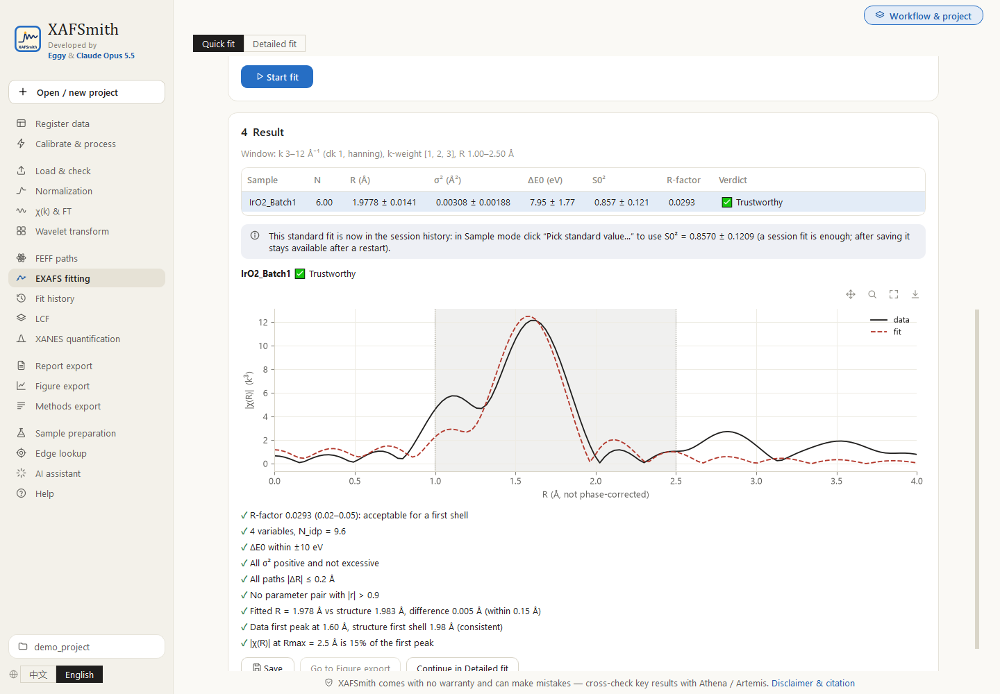

### ② Normalize many spectra in one click

A beamtime gave you dozens of spectra: put the files in a folder, **Scan and register** them, then click **One-click processing**.

- Each spectrum is energy-calibrated against the reference measured in the same batch;
- one set of normalization parameters per absorption edge is shared by all samples, and an exception has to state its reason;
- repeated scans of a sample are merged automatically; outlier scans are rejected with the reason recorded;
- all parameters live in the project files, so every result can be regenerated from the raw data months later.

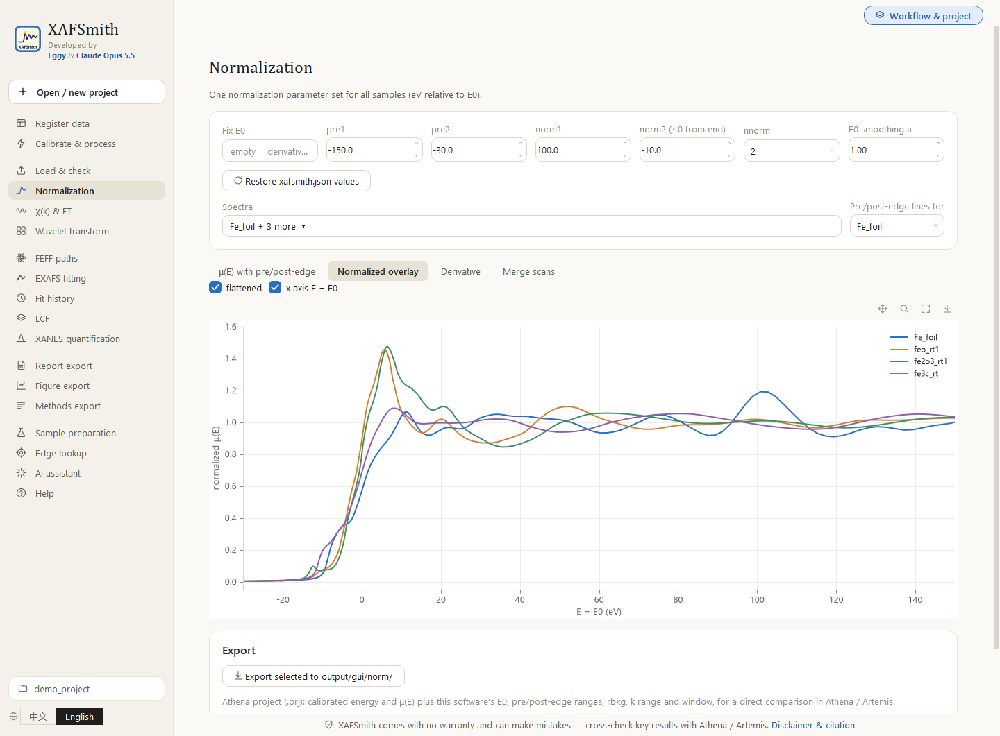

### ③ Direct export to Origin

On the **Figure export** page, choose the spectra and the plot type (XANES, χ(k), |χ(R)|, fit overlays, trend plots …) and XAFSmith writes an Origin project (.opju) with journal formatting: layer size, font sizes, line widths and ticks are consistent, and you can keep editing in Origin. Without Origin, export single- or double-column TIFF, PNG, SVG or PDF at 600 dpi with an English caption drafted for you; 24 palettes, and standards are drawn in grey automatically.

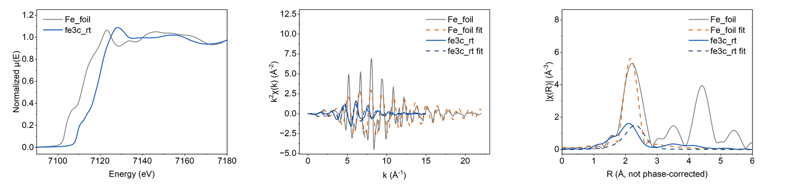

### ④ Methods section and Supporting Information (SI)

**Methods export** drafts the methods paragraph in English and Chinese from the project records: reference and energy calibration, processing parameters, fitting ranges, N_idp, the source of S0², software versions. It states only what is recorded and marks missing details in [brackets] for you to fill in. The fit-parameter table (N, R, σ², ΔE0, R-factor, errors in parentheses) is copied to Excel / Word in one click or saved as .csv or as a .md with fit notes, ready for an SI table.

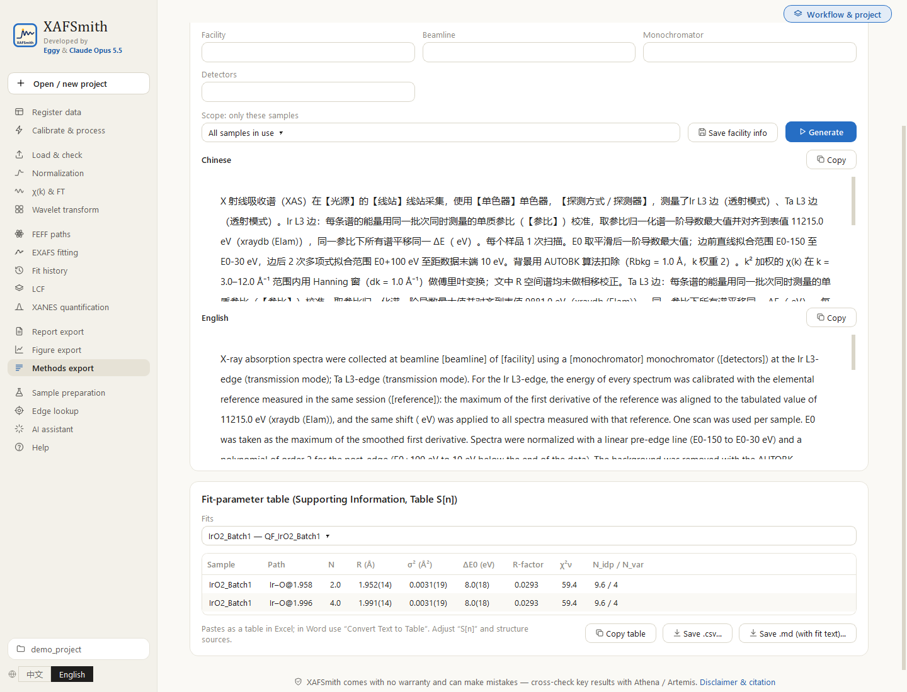

### And more

- **AI assistant**: a project is a standard folder with instructions written for AI (`AGENTS.md`). The AI runs each step as a command, and every result can be checked, edited and rerun in the GUI. See [Connecting an AI assistant](#connecting-an-ai-assistant-step-by-step) below.
- **FEFF**: one-click calculation from a CIF or a built-in structure; FEFF6L (seconds) and FEFF8L (self-consistent potentials) are built in and can be compared directly, with no separate FEFF installation.
- **Detailed fit**: Artemis-style path and parameter tables, with the coordination number N among the first columns so it is easy to change. Multi-dataset joint fits (parameters with the same name are shared); restraints (priors such as a known S0² or two similar σ²); multiple-scattering ΔR / σ² constraints suggested from the FEFF path geometry; Debye / Einstein σ² temperature models; a saved model runs over a whole set of samples at once.
- **Fit quality**: every fit is checked item by item (R-factor, number of variables, residual vs noise, errors, bounds, ΔE0, σ², ΔR, correlations); plus fit diagnostics (k-space residual, automatic glitch location, segment mismatch), robustness checks, F-tests and a model-comparison table.
- **Series of samples**: trend page and trend figure of a joint fit (N, R, σ², ΔE0, edge position with 1σ error bars, exportable to Origin).
- **Wavelet transform** (Morlet / Cauchy): separate light and heavy scatterers and overlapping shells, read the k of the maximum in each R range, export data and figures in one click.
- **XANES**: edge position, white line, oxidation-state calibration, pre-edge peak fitting; XANES / χ(k) linear combination fitting (with combinatorial search).
- **Cross-check with Athena / Artemis**: one-click Athena project export (.prj) carrying XAFSmith's processing parameters.
- **Also**: sample-preparation planner (pellet calculator, interfering-edge screening), edge lookup (edges, fluorescence lines, filters), visual deglitching, a built-in XAFS primer, Chinese and English interface, in-app updates.

---

## A look at the interface

A native desktop window (PySide6) that opens in seconds. The left bar follows the workflow; the disclaimer is always shown at the bottom. The screenshots use Ir foil and IrO₂ standards (Ir L3 edge).

**Joint quick fit**: two IrO₂ samples fitted together, with the batch verdict, a per-sample result table and the coordination-number trend on one page.

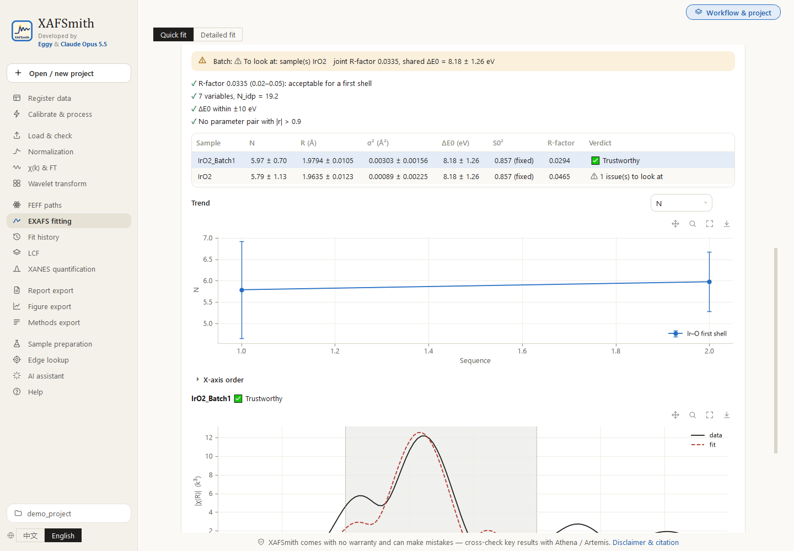

**Detailed fit**: settings (data, ranges, paths, parameters) on the left, results always on the right; change, fit and inspect without scrolling.

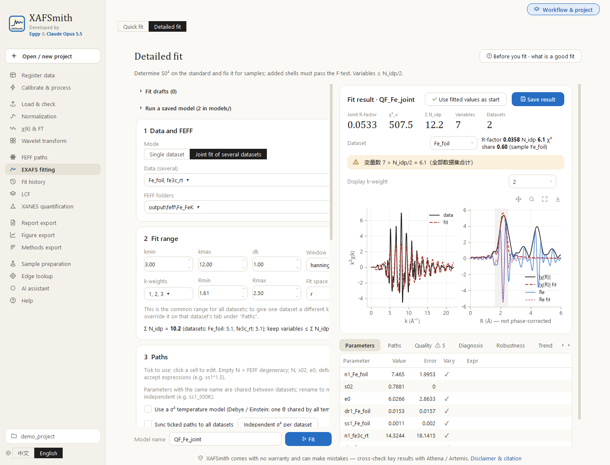

<table>
<tr>
<td width="50%"><b>Fit quality checks</b>: every fit is checked item by item; diagnostics, robustness and the full report sit in the same tabs<br/>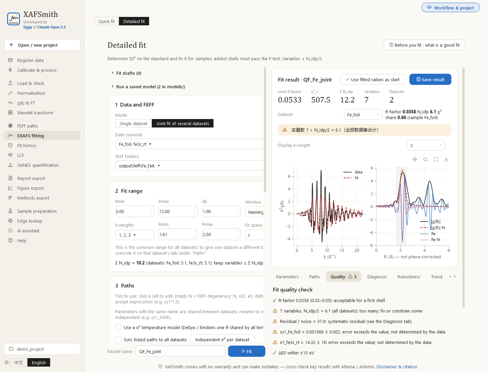</td>
<td width="50%"><b>Trend figure export</b>: choose which quantity to export and the sample order; exports Origin projects<br/>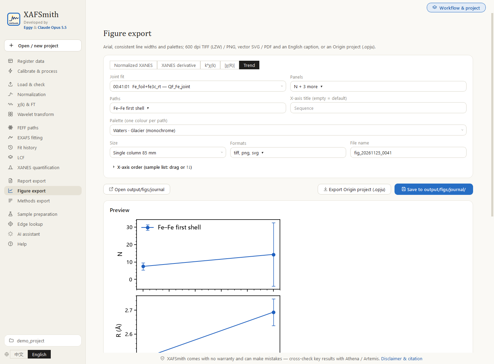</td>
</tr>
<tr>
<td><b>Figure export</b>: |χ(R)| with fit overlay; 24 palettes, 600 dpi, English captions<br/>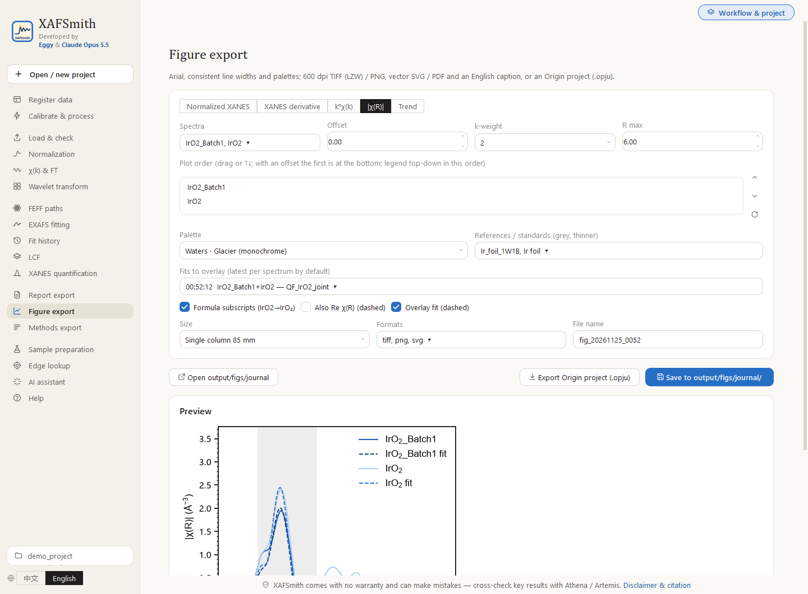</td>
<td><b>χ(k) and FT</b>: recalculated as soon as a parameter changes<br/>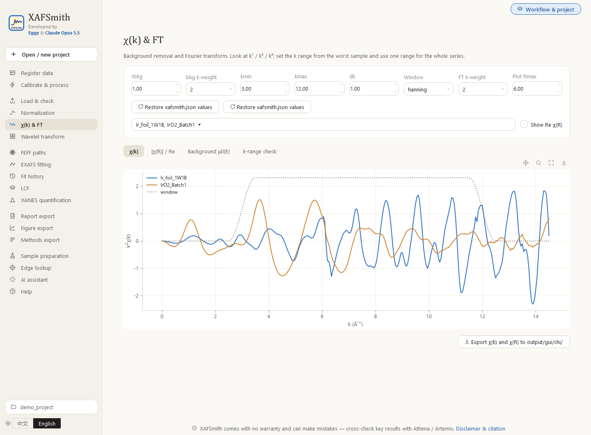</td>
</tr>
<tr>
<td><b>Wavelet transform</b>: two spectra side by side, maxima per R range, one-click data export, with notes on every parameter<br/>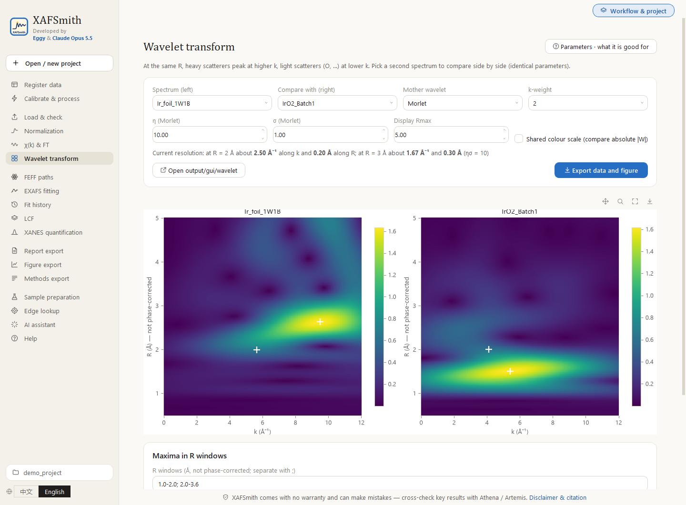</td>
<td><b>AI assistant</b>: writes the instruction files for AI in one click<br/>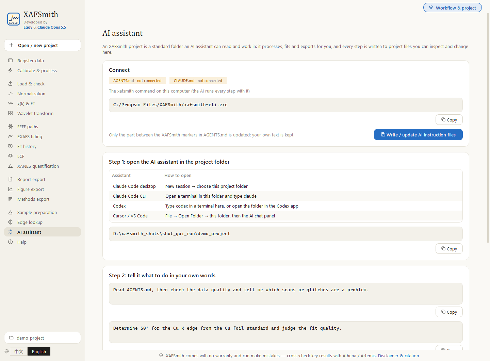</td>
</tr>
<tr>
<td><b>Workflow &amp; project</b>: the button at the top right pops up the six workflow steps (done ticked, next one framed, click to jump) and the project summary<br/>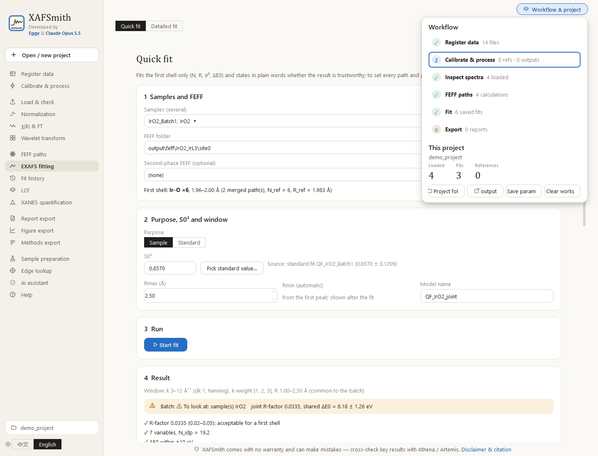</td>
<td><b>Edge lookup</b>: click an element for its edges, fluorescence lines and filters<br/>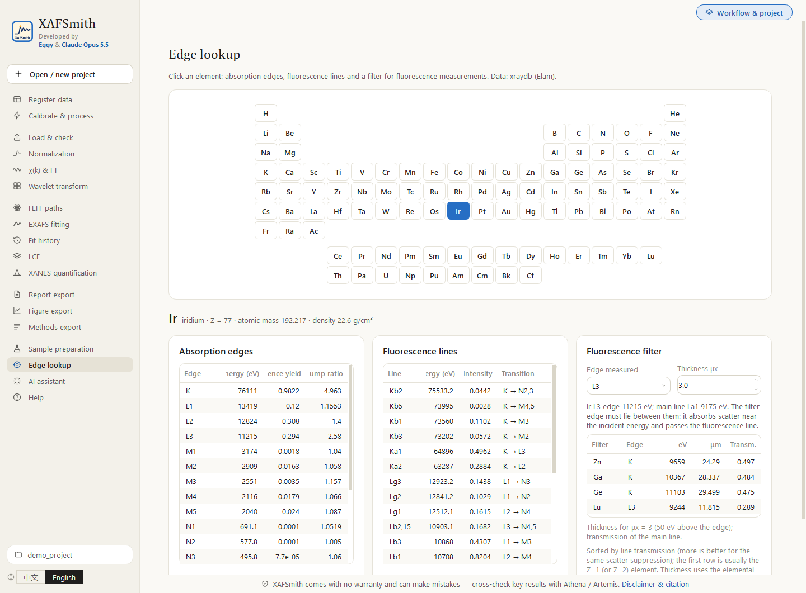</td>
</tr>
</table>

---

## Installation

### System requirements

| | |
|---|---|
| Operating system | **Windows 10 / 11 (64-bit)**. macOS / Linux: install from source for now (see below) |
| Disk | about 0.5 GB |
| Permissions | no administrator rights needed (per-user install) |
| Network | the installer works **offline**; only “Check for updates” contacts github.com (can be switched off) |

### Option 1 (recommended): installer

1. Download `XAFSmith-<version>-Setup.exe` (about 130 MB) from [Releases](https://github.com/Wiolic/XAFSmith/releases/latest) and run it.
   It bundles Python, Larch, FEFF6L/FEFF8L and the GUI libraries — **no separate Python, no pip**.
2. The installer is **not code-signed**: if Windows shows “Windows protected your PC”, click **More info → Run anyway**. Some antivirus programs flag PyInstaller-built programs by mistake; verify the file against `SHA256SUMS.txt` on the Release page and allow it.
3. Start **XAFSmith** from the Start menu or the desktop icon. For the command line / AI assistants use `xafsmith-cli.exe` in the same folder.
4. `examples\demo_project` in the install folder is a demo project built from public data: **copy it to your own folder before opening it**.

A no-install `XAFSmith-<version>-win64-portable.zip` is also provided: unzip and run `XAFSmith.exe`.

**Upgrade**: run the new installer (it replaces the old version). **Uninstall**: Windows Settings → Apps → XAFSmith → Uninstall. Neither touches your project files or the settings and logs in `%USERPROFILE%\.xafsmith\`.

### Option 2: from source (developers, macOS / Linux)

Windows, about 15 minutes, once:

1. **Install Python**: go to <https://www.python.org/downloads/windows/> and download Python 3.11 or 3.12.
   On the first screen of the installer **tick “Add python.exe to PATH”**, then click Install Now.
2. **Download XAFSmith**: green **Code → Download ZIP** button at the top of this page; unzip anywhere.
3. **Double-click `installer.py`** in the unzipped folder to open the bilingual setup wizard: choose the location and shortcuts → tick the disclaimer → **Install** (internet needed, 5–15 minutes).
   If double-clicking does nothing or opens a text editor: right-click `installer.py` → Open with → Python.
4. **Double-click the XAFSmith icon on the desktop**; it opens as a native desktop window (seconds, no web browser). The unzipped folder can be deleted.

Uninstall: Start menu → XAFSmith → Uninstall XAFSmith (your data are kept).
macOS / Linux: `pip install "xafsmith @ https://github.com/Wiolic/XAFSmith/archive/refs/heads/main.zip"`; see the [command-line reference](src/xafsmith/docs/命令行速查.md) (Chinese; commands are self-explanatory).

---

## Connecting an AI assistant (step by step)

### How it works

An AI assistant (agent) is an AI that can read files and run programs on your computer, for example **Claude Code**, **Codex** or **Cursor**.
Every XAFSmith feature has a command (e.g. `xafsmith fit model_name`), and the data register, processing parameters and fit models are plain text files.
After reading the project's `AGENTS.md`, the AI knows how to use XAFSmith step by step, and every step is left in the project for you to check in the GUI.

```
You (describe the task) → AI assistant → runs xafsmith commands → results in the project folder → you check / change / rerun in XAFSmith
```

### Step 1: have a project

In XAFSmith: **Project → Open / create project** (a new project gets the AI instruction files automatically).
Put the raw data in first (see [Quickstart](QUICKSTART_en.md) steps 1–2), or ask the AI to register them.

### Step 2: write the AI instruction files

**AI assistant → Write / update AI instruction files**. This creates or updates:

| File | Read by | Content |
|---|---|---|
| `AGENTS.md` | Codex, Cursor and most AI assistants | **Full path of the xafsmith command on this computer**, workflow, fitting and export commands, mandatory rules (Chinese and English) |
| `CLAUDE.md` | Claude Code | Refers to `AGENTS.md` |

Only the part between the XAFSmith markers in `AGENTS.md` is updated; anything you wrote yourself (system description, established S0², …) is kept.
Click again after updating XAFSmith. From a terminal: `xafsmith agent --write` in the project folder.

### Step 3: open the AI assistant in the project folder

| AI assistant | How to open |
|---|---|
| **Claude Code desktop app** ([claude.com/claude-code](https://claude.com/claude-code)) | New session → choose folder: your project folder |
| **Claude Code CLI** | Open a terminal in the project folder (right-click in the folder → Open in Terminal) and type `claude` |
| **Codex** ([github.com/openai/codex](https://github.com/openai/codex)) | Open a terminal in the project folder and type `codex`, or open the folder in the Codex app |
| **Cursor / VS Code with an AI extension** | File → Open Folder → your project folder, then open the AI chat panel |

Install and sign in to the assistant following its own instructions. You can write in any language; the assistant replies in yours. A good first message: “Read AGENTS.md and tell me the current state of this project.”

### Step 4: tell it what to do

**Processing**
> Check the data quality, tell me which scans have glitches or problems, deglitch where needed with a written reason, then process all samples.

**Determine S0²**
> Determine S0² for the Cu K edge from the Cu foil standard: run FEFF, fit the first shell, run the fit diagnosis and robustness check, and store the result in the project parameters.

**Fit a series**
> Apply the same model to samples A, B and C (S0² fixed), compare coordination numbers and σ² of the first and second shells, F-test the second shell, and label conclusions as measured / fitted / inferred.

**FEFF6 vs FEFF8**
> Recompute the paths with FEFF8L, fit the same model with FEFF6 and FEFF8 paths, and check whether the parameters agree within errors.

**Export**
> Export |χ(R)| and the final fits of the series as double-column journal figures (TIFF + SVG), then build the summary report and the methods paragraph, and tell me where the files are.

### Step 5: the commands the AI runs

You do not need to remember them, but they help you follow what the AI does:

| Task | Command | Output |
|---|---|---|
| Register, check, process | `xafsmith init` → `qc` → `calib` → `process` | `data/meta.csv`, `output/qc/`, `output/processed/` |
| FEFF | `xafsmith feff --structure X.cif --absorber Cu --edge K [--code feff8]` | `output/feff/` |
| Fit | `xafsmith fit model_name` (model in `models/model_name.json`) | `output/fits/` |
| Diagnosis / robustness / significance | `xafsmith diagnose model`, `robust model`, `ftest small large` | screen, `output/fits/` |
| Model comparison | `xafsmith compare model1 model2 [model3 …]` | `output/fits/model_compare.csv` |
| Multiple-scattering binding / σ²(T) / series trend | `xafsmith msbind model`, `sigma2 feff0001.dat --model debye --theta 300 --temps 10,100,300`, `trend joint_model` | screen, `output/fits/<model>_trend.csv` |
| LCF / XANES | `xafsmith lcf …`, `xafsmith xanes …` | `output/lcf/`, `output/xanes/` |
| **Figure export** | `xafsmith figure --kind chir --samples A B --size double` | `output/figs/journal/` |
| **Report export** | `xafsmith summary` | `output/reports/汇总_<time>/` |
| **Methods paragraph** | `xafsmith methods` | `output/reports/方法段落.md` |
| **SI fitting text + table** | `xafsmith si --lang en` | `output/reports/SI_EXAFS拟合方法.md` |
| **Athena export** | `xafsmith export-prj --samples A B` | `output/gui/athena/` |

### Step 6: check the AI's results

- **EXAFS fitting › Detailed fit → Run a saved model**: every model the AI writes is in `models/`; rerun it in the GUI and inspect the fit, the **fit diagnosis** and the **robustness check**;
- **Fit history**: compare models;
- **Report export**, **Figure export**, **Methods export**: view and re-export;
- `notes/`: the analysis notes the AI writes (what was done, conclusions, next step).

### Safety and rules

`AGENTS.md` lists the rules the AI must follow: raw data are read-only; all results go to `output/`; processing parameters are changed only in the project parameter file, with a reason for any exception; S0² is determined on a standard first; variables ≤ half the number of independent points; every added shell needs an F-test; conclusions are labelled measured / fitted / inferred; no invented data or literature values.
AI can still make mistakes — **verify key conclusions in the GUI** and, where needed, against Athena / Artemis.

---

## Getting started

**→ [Quickstart](QUICKSTART_en.md)**: the mouse route and the AI route, from creating a project to the first fit and export.

| Guide | For |
|---|---|
| [XAFS basics](src/xafsmith/docs/XAFS_basics_en.md) | Undergraduate physics and chemistry only: how synchrotron XAFS works, step by step, with formulas, measured spectra and worked examples |
| [GUI guide](src/xafsmith/docs/GUI_guide_en.md) | Every page and button |
| [Beginner fitting tutorial](src/xafsmith/docs/fitting_tutorial_en.md) | Your first EXAFS fit: principles, parameter choices, how to judge success |
| [Joint fitting of a series](src/xafsmith/docs/joint_fit_guide_en.md) | A series of samples (time, potential, temperature): separate fits first, then the joint fit, F-tests of the sharing assumptions, trends, step by step |
| [Improving fit quality](src/xafsmith/docs/fit_quality_guide_en.md) | When the fit does not match: residual diagnosis, deglitching, FEFF6/FEFF8, when to add paths, when to stop |
| [Data standard](src/xafsmith/docs/数据标准.md) (Chinese) | What every file in a project means |

All guides are also available in the app under **Help** (Chinese and English).

---

## Supported data

- Auto-detected formats: Beijing SR Facility (BSRF) text, **XDI**, Athena text (`.xmu`), XDAC, Athena projects (`.prj`);
- generic column text: energy / I0 / It / If / μ are matched **by column name** (not position); if a name is not recognised you are asked to map it — the software does not guess;
- transmission / fluorescence is detected automatically; when a file has both raw channels and a μ column, μ is always computed from the channels and cross-checked against the file's μ column;
- other facilities' formats: send a sample file to the developer to have it added (`xafsmith inspect <file>` shows how a file is recognised).

Always measure the **elemental reference** (metal foil or powder) in the same session; it is used for energy calibration.

## Validation

- Against Artemis (IrO2, same k/R ranges and k-weights): S0² 0.80 ± 0.11 vs 0.86 ± 0.09, ΔE0 9.2 vs 10.2 eV, ΔR −0.012 vs −0.010 Å — consistent within errors.
- Multi-shell fits of standards (rutile IrO2, cubic perovskite KTaO3) give coordination numbers and distances consistent with crystallography.
- Numerical benchmark (automated): the Cu-foil first-shell fit reproduces Larch's official example (S0² 0.92, ΔE0 4.4 eV, σ² 0.0087 Ų) and is bit-identical to a direct Larch call; the installer build repeats the same check on the packaged program. Joint multi-dataset fits and restraints: bit-identical to v1.1 for a single dataset without restraints; error calibration and statistics checked on synthetic spectra.
- Every release runs unit tests, the numerical benchmarks and a page-by-page automatic GUI test (Chinese and English interface); a demo project built from public data ships with the repository (`tests/data/demo_project`).

## Reporting problems

- Open an issue on [GitHub Issues](https://github.com/Wiolic/XAFSmith/issues) with the version (About page), the steps and what happened.
- Attach a **diagnostics bundle**: About → Export diagnostics. It contains the log, version, environment and project configuration — **no raw data or spectra**. The log is also at `%USERPROFILE%\.xafsmith\xafsmith.log`.
- If a file from another facility is not recognised, attach one sample file (`xafsmith inspect <file>` shows how it is read).

## Releases and development

- Change log: [CHANGELOG.md](CHANGELOG.md); versions follow semantic versioning.
- Architecture: [ARCHITECTURE.md](ARCHITECTURE.md); contributing: [CONTRIBUTING.md](CONTRIBUTING.md); release procedure: [docs/dev/RELEASING.md](docs/dev/RELEASING.md).

## Citation

If you use XAFSmith in a publication, please cite this repository (**Cite this repository** on the right of the GitHub page):

*Eggy & Claude. XAFSmith: XAFS processing and fitting software, version 1.4.0. https://github.com/Wiolic/XAFSmith*

and the programs it builds on:
- Larch: M. Newville, *J. Phys.: Conf. Ser.* **430**, 012007 (2013).
- FEFF6: S. I. Zabinsky, J. J. Rehr, A. Ankudinov, R. C. Albers, M. J. Eller, *Phys. Rev. B* **52**, 2995 (1995).
- When FEFF8L is used, also FEFF8: A. L. Ankudinov, B. Ravel, J. J. Rehr, S. D. Conradson, *Phys. Rev. B* **58**, 7565 (1998).

## Authors and license

Developed by **Eggy** & **Claude Opus 5.5** (Anthropic).

License: [GPL-3.0-only](LICENSE) since v1.3.1 (see also [NOTICE](NOTICE)). A commercial license for closed-source use is available from the author.

- **Citation request (not a license condition)**: please cite XAFSmith, Larch and FEFF as above in publications;
- **History**: v0.5.1 through v1.3.0 were released under PolyForm Noncommercial 1.0.0, v0.5.0 and earlier under MIT; versions already released are unaffected by the change.
