# Synchrotron XAFS: the basics

> For readers with undergraduate physics and chemistry: from “what is an X-ray” to “how to read a fit”.
> Every spectrum shown is measured data (Ir foil and IrO₂, Ir L3 edge, transmission, BSRF beamline 1W1B) or computed with xraydb / FEFF;
> schematics say so in their titles. “In XAFSmith” at the end of a section tells you where that step lives in the software.

**Contents**

1. [X-rays and matter: absorption](#1-x-rays-and-matter-absorption)
2. [Absorption edges: an element's fingerprint](#2-absorption-edges-an-elements-fingerprint)
3. [Why a synchrotron: source and beamline](#3-why-a-synchrotron-source-and-beamline)
4. [What an XAFS spectrum looks like](#4-what-an-xafs-spectrum-looks-like)
5. [XANES: oxidation state, empty orbitals, symmetry](#5-xanes-oxidation-state-empty-orbitals-symmetry)
6. [The physical picture of EXAFS: photoelectron interference](#6-the-physical-picture-of-exafs-photoelectron-interference)
7. [The EXAFS equation, term by term](#7-the-exafs-equation-term-by-term)
8. [From μ(E) to χ(k): data processing](#8-from-μe-to-χk-data-processing)
9. [Fourier transform: from oscillations to a “radial distribution”](#9-fourier-transform-from-oscillations-to-a-radial-distribution)
10. [FEFF and fitting: getting the numbers](#10-feff-and-fitting-getting-the-numbers)
11. [Wavelet transform and linear combination fitting](#11-wavelet-transform-and-linear-combination-fitting)
12. [What XAFS can and cannot tell you](#12-what-xafs-can-and-cannot-tell-you)
13. [Glossary and further reading](#13-glossary-and-further-reading)

---

## 1. X-rays and matter: absorption

### 1.1 X-rays are high-energy photons

X-rays are electromagnetic waves like visible light, with much shorter wavelengths (about 0.1–10 Å; 1 Å = 0.1 nm), so each
photon carries much more energy:

$$E = h\nu = \frac{hc}{\lambda},\qquad E\,[\mathrm{eV}] \approx \frac{12398.4}{\lambda\,[\mathrm{\AA}]}$$

**Example**: the Ir L3 edge is at 11 215 eV, i.e. λ = 12398.4 / 11215 ≈ **1.106 Å** — the same order as chemical bond lengths
(1–3 Å). This is no coincidence: XAFS senses neighbouring atoms with an electron wave whose wavelength is comparable to bond lengths.

### 1.2 Absorption: the Beer–Lambert law

A beam of intensity I₀ passing through a sample of thickness t leaves with intensity I₁, decaying exponentially:

$$I_1 = I_0\, e^{-\mu t}\qquad\Longrightarrow\qquad \mu t = \ln\frac{I_0}{I_1}$$

μ is the **linear absorption coefficient** (cm⁻¹); μt is the dimensionless “absorption thickness”. μt = 1 leaves e⁻¹ ≈ 37 % of
the beam.

μ depends on composition and density. For a mixture (e.g. a sample + BN pellet):

$$\mu = \rho \sum_i w_i \left(\frac{\mu}{\rho}\right)_i$$

with density ρ, mass fraction wᵢ of element i, and its **mass absorption coefficient** (μ/ρ)ᵢ, which depends only on the element
and the photon energy (tabulated; XAFSmith uses the Elam tables in xraydb).

Around 10 keV, absorption is dominated by the **photoelectric effect**: a photon gives all its energy to one electron of an atom
and ejects it. Scattering (elastic, Compton) is a small part.

### 1.3 Absorption versus energy

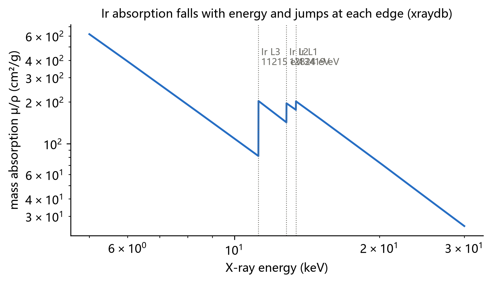

Overall, higher energy penetrates more (μ/ρ falls roughly as E⁻³), but at certain energies absorption **jumps** — these are the
absorption edges.

**Example (sample design)**: Ir has μ/ρ ≈ 82 cm²/g 50 eV below the L3 edge and ≈ 201 cm²/g 50 eV above it, a jump of about 2.4×.
Pressing 14.2 mg IrO₂ with 100 mg BN into a φ13 mm pellet (1.327 cm²) gives a total μt ≈ 2.0 above the edge and an edge step
Δμt ≈ 1.09 — right in the ideal window for transmission (total μt 1.5–2.6, Δμt ≥ 0.2).

> **In XAFSmith**: “Sample preparation” recommends the pellet mass from formula, area and target μt (pellet calculator) and lists interfering edges (interfering-edge screening); “Edge lookup” shows the edges, fluorescence lines and filters of any element.

---

## 2. Absorption edges: an element's fingerprint

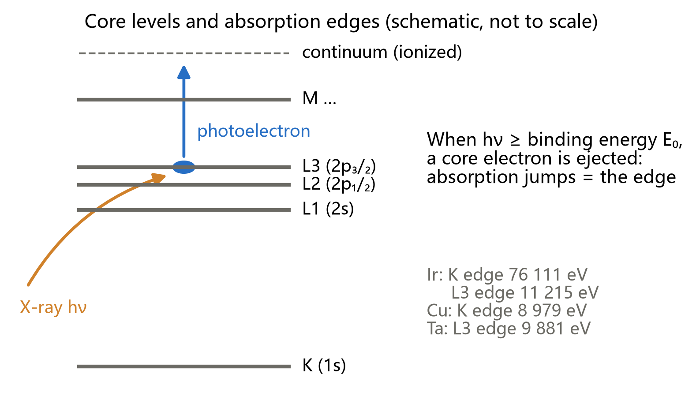

Electrons occupy shells: innermost K (1s), then L (2s, 2p₁/₂, 2p₃/₂ — the L1, L2, L3 edges), then M, … Each core electron has a
definite **binding energy**.

- Below the binding energy of a shell, its electrons cannot be ejected and the shell does not absorb;
- just above it, they can — absorption rises abruptly, forming an **absorption edge** at energy E₀.

Binding energies are set by the nuclear charge, so **every element and shell has its own edge energy**:

| Element | Edge | Energy (eV) |
|---|---|---|
| Fe | K | 7 112 |
| Co | K | 7 709 |
| Cu | K | 8 979 |
| Ta | L3 | 9 881 |
| Ir | L3 | 11 215 |
| Pt | L3 | 11 564 |
| Ir | K | 76 111 |

Tuning the X-ray energy to one element's edge therefore **selects that element**; the others contribute only a smooth background.
This is the **element selectivity** of XAFS: in a mixed oxide such as IrCoOx you can measure at the Ir L3 and Co K edges and get the
surroundings of Ir and of Co separately.

**Interfering edges**: if another edge falls inside the scan (e.g. Ir's own L2 edge 1 609 eV above L3, k ≈ 20.6 Å⁻¹), the data can
only be used up to it.

> **In XAFSmith**: “χ(k) & FT → k-range check” and “Sample preparation → Interfering-edge screening” list these edges and convert them to a
> usable k limit.

---

## 3. Why a synchrotron: source and beamline

### 3.1 The source

XAFS needs X-rays that are **continuously tunable and intense**. Laboratory tubes give a few characteristic lines on a weak
continuum; a synchrotron gives exactly what is needed:

- electrons circulate in a storage ring close to the speed of light (BSRF 2.5 GeV, SSRF 3.5 GeV) and emit a **continuous
  spectrum** from infrared to hard X-rays as they are bent by dipole magnets or insertion devices (undulators, wigglers);
- brightness is many orders of magnitude above an X-ray tube, with a small, well-collimated beam; a spectrum takes minutes.

### 3.2 The monochromator picks one energy

A **double-crystal monochromator** of perfect silicon (commonly Si(111)) passes one wavelength by Bragg's law:

$$\lambda = 2d\,\sin\theta$$

**Example**: Si(111) has d = 3.1356 Å. For the Ir L3 edge at 11 215 eV (λ = 1.1055 Å), sin θ = 1.1055 / 6.2712, so θ ≈ **10.15°**.
Scanning the energy means stepping the crystal angle.

### 3.3 Detection: transmission, fluorescence and the reference

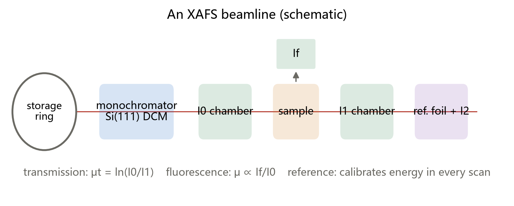

- **Transmission**: ion chambers before and after the sample measure I₀ and I₁; μt = ln(I₀/I₁). Best for concentrated samples
  that can be pressed into uniform pellets.
- **Fluorescence**: after a core electron is ejected, an outer electron fills the hole and emits characteristic fluorescence whose
  intensity I_f is proportional to that element's absorption:

  $$\mu(E) \propto \frac{I_f}{I_0}$$

  Best for dilute samples, thin films and supported catalysts. Thick or concentrated samples suffer **self-absorption**: the
  fluorescence is reabsorbed on its way out, damping the white line and EXAFS amplitude (by 25 % or more in practice).
- **Reference foil**: a metal foil of the same element and a third ion chamber (I₂) behind the sample record a reference in every
  scan to **calibrate the energy**. Monochromator angles drift by a few tenths of an eV; without a reference, edge positions of
  different samples cannot be compared.

> **In XAFSmith**: every batch carries its elemental reference (file name containing foil / powder / metal); “Calibrate & process
> → ② Calibrate with references” aligns the reference's first-derivative maximum to the tabulated energy and applies the same ΔE
> to every spectrum of the batch.

---

## 4. What an XAFS spectrum looks like

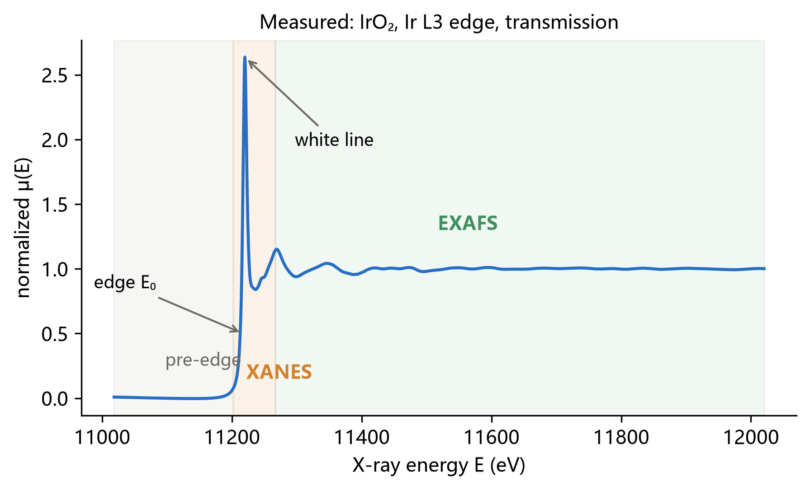

Plotting μ against E, three regions appear:

| Region | Range | What happens | What it tells |
|---|---|---|---|
| **Pre-edge** | below E₀ | the shell cannot be ionized yet | background; K-edge pre-edge peaks (section 5) |
| **XANES** (X-ray absorption near-edge structure) | E₀ −10 to +50 eV | the electron goes to empty orbitals or just leaves the atom; strong multiple scattering | **oxidation state, empty orbitals, symmetry** |
| **EXAFS** (extended X-ray absorption fine structure) | E₀ +50 to +1000 eV | the photoelectron is (mostly singly) scattered by neighbours | **type, number, distance and disorder of neighbours** |

XANES + EXAFS together are **XAFS** (also called XAS).

“Normalization” sets the pre-edge to 0 and the post-edge to 1, so spectra of different samples, concentrations and thicknesses
can be compared directly (section 8). The figure above is normalized: the IrO₂ white line reaches about 2.7.

---

## 5. XANES: oxidation state, empty orbitals, symmetry

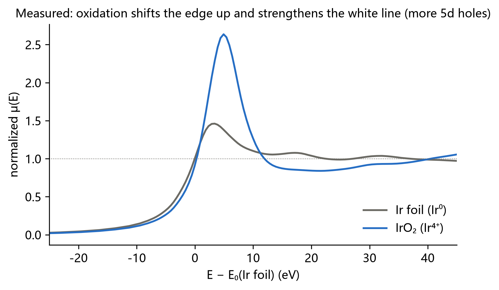

### 5.1 Edge position ↔ oxidation state

When an atom loses electrons (is oxidized), the remaining electrons feel the nucleus more strongly and core binding energies rise:
**the edge moves to higher energy**, typically by about 1 to several eV per oxidation state depending on element and ligands. Above,
IrO₂ (Ir⁴⁺) has its edge above Ir metal (Ir⁰); with the derivative-maximum definition, their E₀ differ by about 2.0 eV.

With several standards of **known oxidation state, the same ligands and similar structures**, a straight line of edge position
versus oxidation state lets you estimate the average oxidation state of an unknown.

### 5.2 White line ↔ empty orbitals

L3 absorption is mainly 2p₃/₂ → 5d (dipole selection rule Δl = ±1). The emptier the 5d orbitals, the more final states are
available and the stronger the sharp peak at the edge — the **white line**. Oxidized Ir has fewer 5d electrons, so the IrO₂ white
line is much stronger than that of Ir metal. White-line areas are used to compare d-hole counts.

### 5.3 Pre-edge peaks ↔ symmetry

Transition-metal K edges (mainly 1s → 4p) often show small pre-edge peaks from 1s → 3d transitions. These are dipole-forbidden in
pure form, but in sites **without an inversion centre** (e.g. tetrahedral) p–d mixing makes them much stronger, so pre-edge
intensity and position distinguish tetrahedral from octahedral coordination.

> **In XAFSmith**: “XANES quantification” computes edge position (derivative maximum / half height), white-line position, height
> and area, calibrates oxidation state and fits pre-edge peaks; “LCF” does linear combinations.

---

## 6. The physical picture of EXAFS: photoelectron interference

### 6.1 The photoelectron is a wave

Above E₀, the excess energy E − E₀ becomes the photoelectron's kinetic energy. By de Broglie, the electron is a wave with
**wavenumber** k:

$$k = \sqrt{\frac{2m_e\,(E-E_0)}{\hbar^2}} \approx \sqrt{0.2625\,(E-E_0)\,[\mathrm{eV}]}\ \ \mathrm{\AA}^{-1}$$

**Example**:

| E − E₀ (eV) | k (Å⁻¹) | electron wavelength 2π/k (Å) |
|---|---|---|
| 100 | 5.12 | 1.23 |
| 400 | 10.2 | 0.61 |
| 747 | 14.0 | 0.45 |

The electron wavelength is comparable to bond lengths, so neighbouring atoms scatter it strongly.

### 6.2 Outgoing and returning waves interfere

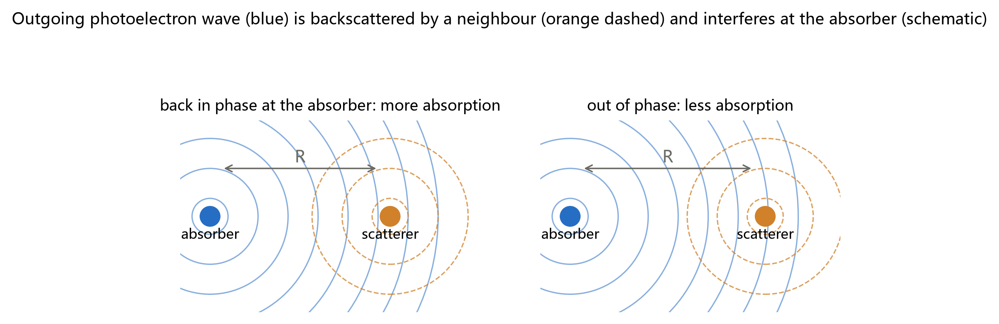

The photoelectron wave travels out from the absorber and is **backscattered** by a neighbour at distance R. Back at the absorber,
the returning wave differs in phase from the outgoing one by

$$\Delta\phi = 2kR + \delta(k)$$

2kR from the round trip 2R, and δ(k) from the extra phase given by the atomic potentials (the **phase shift**).

- A phase difference of a multiple of 2π: the waves are **in phase**, the electron amplitude at the absorber is larger and
  absorption **increases slightly**;
- a difference of π: **out of phase**, absorption **decreases slightly**.

As the energy is scanned, k grows and in-phase / out-of-phase alternate: μ(E) carries a **small oscillation** — the EXAFS. Its
frequency is set by R (larger R, faster oscillation in k), its amplitude by the number and type of neighbours.

### 6.3 Why EXAFS is local

The photoelectron loses coherence through inelastic scattering (**mean free path** λ(k) ≈ 5–10 Å) and the core hole lives only
briefly, so only neighbours within R ≲ 6–8 Å are seen. EXAFS is a **local-structure** method: **no crystallinity required** —
amorphous solids, solutions, nanoparticles and single-atom catalysts can all be measured.

---

## 7. The EXAFS equation, term by term

The picture above as a formula (single-scattering approximation, summed over neighbour “shells” j):

$$\chi(k) = S_0^2 \sum_j \frac{N_j\, f_j(k)}{k\,R_j^2}\; e^{-2k^2\sigma_j^2}\; e^{-2R_j/\lambda(k)}\;\sin\!\left[2kR_j + \delta_j(k)\right]$$

| Term | Name | Meaning | Source |
|---|---|---|---|
| N_j | coordination number | number of equivalent neighbours in shell j | **fit** |
| R_j | distance | absorber–shell distance | **fit** (ΔR relative to the model) |
| σ_j² | Debye–Waller factor | mean-square spread of distances (thermal + static) | **fit** |
| ΔE₀ | energy-origin correction | offset between theoretical and experimental E₀ | **fit** |
| S₀² | amplitude reduction factor | many-electron effects, usually 0.7–1.0 | fitted on a **standard of known structure**, then fixed |
| f_j(k) | backscattering amplitude | depends on the scatterer: **heavy atoms are stronger at high k** | **FEFF** |
| δ_j(k) | phase shift | phase change from absorber and scatterer | **FEFF** |
| λ(k) | mean free path | coherence length of the photoelectron | **FEFF** |

Intuition:

- **1/R²**: spherical waves spread out; distant atoms contribute little;
- **σ² damping**:

  $$e^{-2k^2\sigma^2},\qquad \sigma^2 = \sigma^2_{static} + \sigma^2_{thermal}$$

  with a spread of positions, contributions from slightly different distances drift out of phase and cancel at high k; larger σ²
  damps high k faster. First shells at room temperature typically have σ² = 0.002–0.010 Ų;
- **N and S₀²** appear as a product and are **fully correlated**: they cannot both vary in one fit — hence S₀² is determined on a
  standard first.

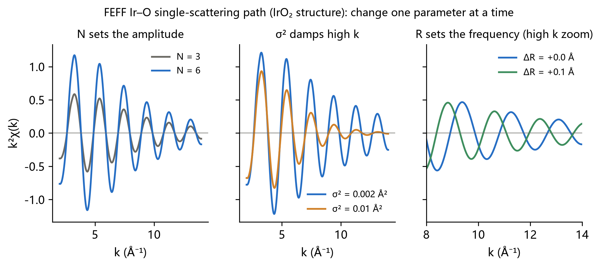

The FEFF Ir–O path of IrO₂, changing one parameter at a time: doubling N doubles the amplitude; larger σ² damps high k; R + 0.1 Å
makes the oscillation faster, clearly out of phase at high k. **Fitting runs this backwards: from the measured oscillation to the
parameters.**

---

## 8. From μ(E) to χ(k): data processing

The EXAFS oscillation is only a few to ~15 % of the total absorption; it must be extracted first.

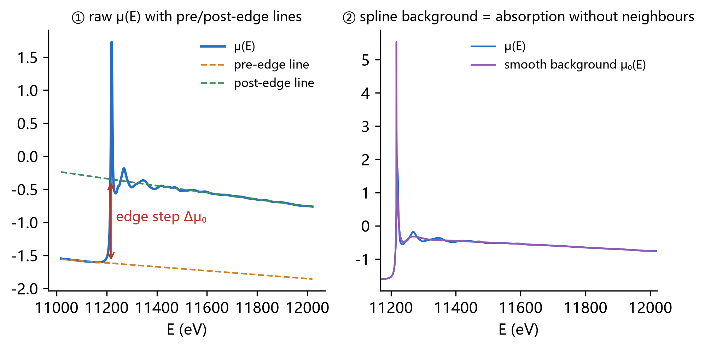

**Step 1 — energy calibration** with the reference of the same batch (section 3.3).

**Step 2 — E₀**, defined one way for the whole project; XAFSmith uses the maximum of the smoothed first derivative.

**Step 3 — normalization**: fit a line to the pre-edge (e.g. E₀ −150 to −30 eV) and a quadratic to the post-edge (e.g. E₀ +100 eV
to the end); their difference at E₀ is the **edge step Δμ₀**. Subtract the pre-edge line and divide by the step: pre-edge 0,
post-edge 1.

**Step 4 — background**: without neighbours, μ(E) would be a smooth curve μ₀(E). A spline is fitted to it (the AUTOBK algorithm
requires χ(R) to be as small as possible below R_bkg, typically 1.0 Å, where no neighbour can be). Then

$$\chi(E) = \frac{\mu(E) - \mu_0(E)}{\Delta\mu_0(E_0)}$$

**Step 5 — convert to k and weight**: change the axis to k (section 6.1). High-k oscillations are weak, so χ is multiplied by k,
k² or k³:

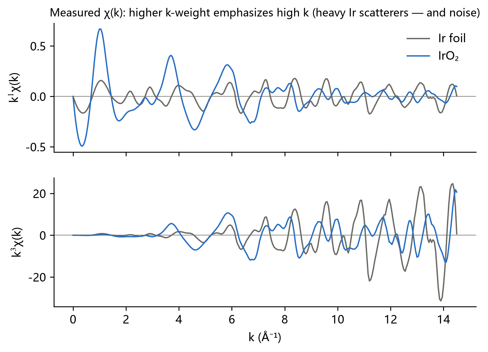

Higher weights emphasize high k — mostly heavy-atom scattering, and more noise. **Look at k¹, k² and k³.**

**Consistency**: a series of samples must share the E₀ definition, normalization ranges, R_bkg and k range; otherwise differences
may come from processing rather than from the samples.

> **In XAFSmith**: “Calibrate & process” keeps one parameter set per edge and processes everything; “Normalization” and “χ(k) & FT”
> let you inspect and adjust spectrum by spectrum.

---

## 9. Fourier transform: from oscillations to a “radial distribution”

χ(k) is a sum of sine waves, one frequency (≈ 2R) per shell. A Fourier transform separates the frequencies into a “radial
distribution”-like |χ(R)|:

$$\chi(R) = \frac{1}{\sqrt{2\pi}} \int_{k_{min}}^{k_{max}} w(k)\, k^n \chi(k)\, e^{2ikR}\, dk$$

w(k) is a window (e.g. Hanning) that brings the data smoothly to zero at both ends, reducing truncation ripples.

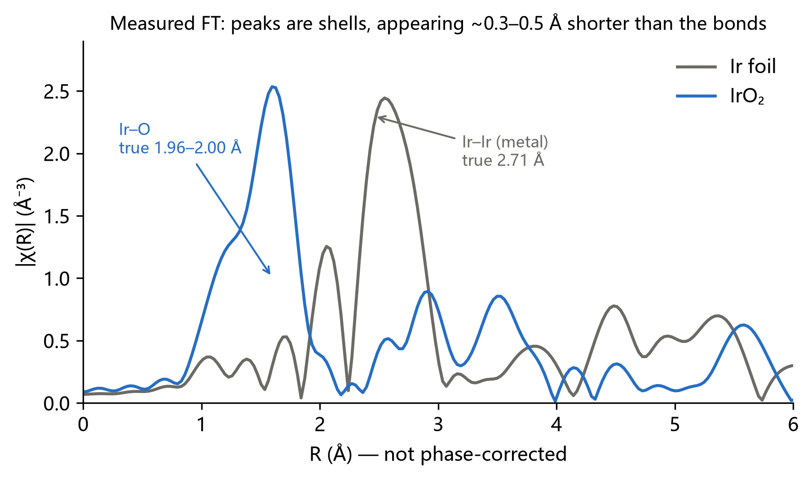

Reading the plot:

1. **Each peak roughly corresponds to a coordination shell**: IrO₂'s peak near 1.6 Å is Ir–O; Ir metal's near 2.5 Å is Ir–Ir.
2. **Peaks sit ~0.3–0.5 Å below the true distances** because the phase includes δ(k), which the FT does not remove. The true Ir–O
   distance is 1.96–2.00 Å; the peak is near 1.6 Å. Hence the R axis is labelled “**not phase-corrected**”.
3. **A peak is not necessarily a shell**: small peaks can come from noise, background residue, window ripples or multiple
   scattering; neighbours of different type at similar distances can merge into one peak.

**Resolution and information content**:

$$\Delta R \approx \frac{\pi}{2\,\Delta k}$$

$$N_{idp} \approx \frac{2\,\Delta k\,\Delta R}{\pi}$$

**Example**: k = 3–14 Å⁻¹ (Δk = 11) gives ΔR ≈ π/22 ≈ **0.14 Å** — shells closer than that cannot be separated in |χ(R)|. In an
R window of 1.0–2.1 Å, N_idp ≈ 2 × 11 × 1.1 / π ≈ **7.7** (Larch counts one more, ≈ 8.7). A fit should not have more than about
half as many free parameters, i.e. about 4.

---

## 10. FEFF and fitting: getting the numbers

### 10.1 FEFF computes the theory

f(k), δ(k) and λ(k) cannot be guessed. **FEFF** starts from a structural model (e.g. a crystal structure CIF) and computes them for
every scattering **path** around the absorber (single scattering A→B→A, multiple scattering A→B→C→A, …).

- **FEFF6L**: non-self-consistent potentials, seconds;
- **FEFF8L**: self-consistent potentials, 1–3 minutes; ΔE₀ is usually closer to 0, more reliable with strong charge transfer.

### 10.2 Fitting

Fitting adjusts N, ΔR, σ² and ΔE₀ until χ from the EXAFS equation matches the data (usually in R space, inside a fit window). One
measure is the R-factor:

$$\mathcal{R} = \frac{\sum_i \left[\chi_{data}(R_i) - \chi_{fit}(R_i)\right]^2}{\sum_i \chi_{data}(R_i)^2}$$

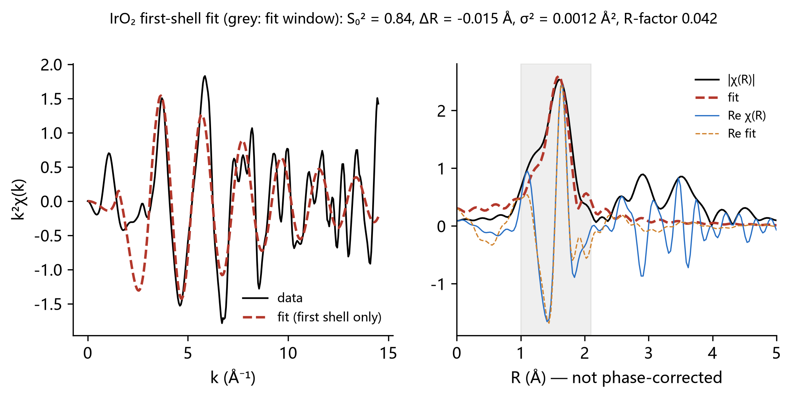

**Example**: IrO₂ first shell (2 + 4 O, FEFF6L, k = 3–14 Å⁻¹, R = 1.0–2.1 Å, k¹/k²/k³ together, 4 variables) gives S₀² = 0.88 ± 0.14,
ΔE₀ = 7.6 ± 2.1 eV, ΔR = −0.007 ± 0.017 Å (Ir–O distances 1.951 and 1.989 Å), σ² = 0.0036 ± 0.0021 Ų, R-factor 0.031.

The example also shows why one number is not enough: all parameters are physical (σ² positive and typical, |ΔE₀| < 10 eV, no
strong correlations) and the R-factor is “acceptable”, yet XAFSmith's fit quality check reports a residual about 38× the noise
inside the window. The cleaner the data, the more clearly this ratio exposes what the model is missing: a first-shell-only model
describes neither the |χ(R)| shoulder near 1.1 Å nor the signal leaking into the window from outer shells (Ir–Ir, …). The next
step is to add outer paths in a wider R window and F-test each new path. **A fit gives the best parameters for that model; whether the model is right is a separate question.**

### 10.3 Ground rules

1. Fit a **standard of known structure** first, determine S₀², fix it for samples;
2. **variables ≤ N_idp / 2**; when short of information, constrain (shared ΔE₀, tied σ², …);
3. an added shell needs an **F-test** with p < 0.05 before you say it is “observed”;
4. both |χ(R)| and Re χ(R) must match, parameters must be physical (|ΔE₀| ≤ 10 eV, σ² > 0, ΔR not far from the structure), and
   conclusions must hold for different k ranges and k-weights.

> **In XAFSmith**: “FEFF paths” computes paths; “EXAFS fitting” builds and runs models and, below each result, runs the fit
> quality check, fit diagnosis and robustness check; “Fit history” does F-tests. See the Beginner fitting tutorial and Improving
> fit quality.

---

## 11. Wavelet transform and linear combination fitting

### 11.1 Wavelets: k and R at once

The Fourier transform tells you “at which R” but discards “at which k”. A wavelet transform spreads χ(k) over the k–R plane:

$$W(k,R) = \int \chi(k')\,k'^n\,\psi^*\!\left(\frac{k'-k}{s}\right) dk',\qquad s=\frac{\eta}{2R}$$

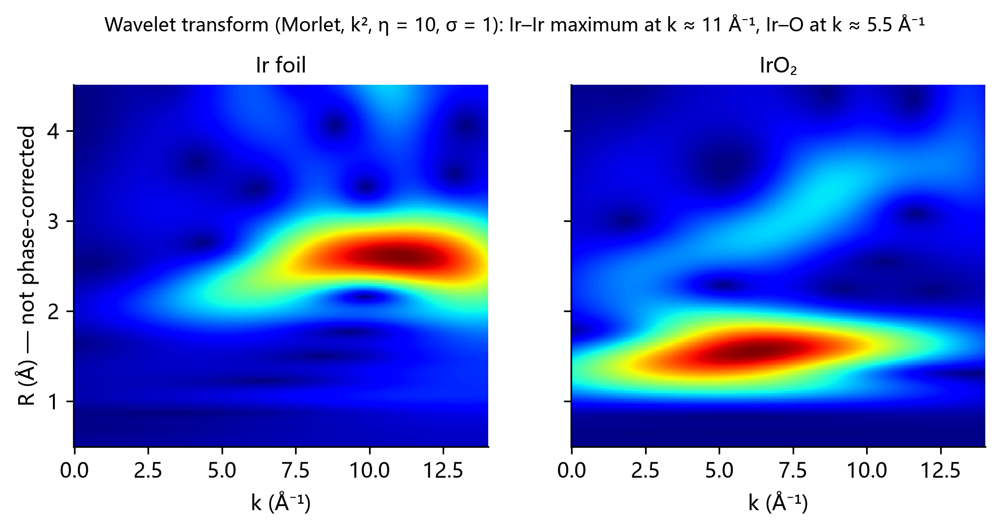

Because heavy atoms backscatter more strongly at high k, **at the same R heavy scatterers peak at higher k, light ones at lower
k**. Above, the Ir–Ir maximum of Ir metal is at k ≈ 11 Å⁻¹ (R ≈ 2.6 Å) and the Ir–O maximum of IrO₂ at k ≈ 5.5 Å⁻¹ (R ≈ 1.5 Å).
Wavelets are used to tell whether a second shell is metal–metal or metal–oxygen, or whether metal clusters are present (common in
single-atom catalysis). They give a **qualitative** criterion; coordination numbers and distances still come from fitting.

### 11.2 Linear combination fitting (LCF)

If a sample is a mixture of known phases, its spectrum is approximately a weighted sum of theirs:

$$\mu_{sample}(E) \approx \sum_i w_i\, \mu_i(E),\qquad \sum_i w_i = 1$$

For a mixture of Ir metal and IrO₂, the weights approximate the fractions of the two Ir species (per Ir atom). End-members must be
**measured standards**, and the result should be compared with single-standard fits.

---

## 12. What XAFS can and cannot tell you

**It can tell you**:

- an element's average oxidation state and relative d-hole count (XANES);
- the type (light / heavy), average coordination number, average distance (±0.01–0.02 Å) and disorder of its neighbours (EXAFS);
- how these change with time, potential or temperature (in situ / operando).

**It cannot directly tell you, or needs care**:

- XAFS **averages over all atoms of the element**: half the Ir in a metal and half in an oxide gives an average;
- **coordination numbers carry 10–25 % errors** and correlate with σ² and S₀²;
- neighbours at similar distances with similar atomic numbers (O vs N, Co vs Ni) are hard to tell apart;
- a small R-space peak is not a shell just because it is visible;
- fluorescence and transmission data cannot be compared side by side (self-absorption).

When writing conclusions, keep three kinds of statements apart: **measured** (visible in the data, e.g. “the edge shifts by
1.2 eV”), **fitted** (model-dependent, e.g. “Ir–O coordination number 5.6 ± 0.8”) and **inferred** (needs other evidence, e.g.
“Ir–O–Co linkages form”).

---

## 13. Glossary and further reading

| Term | Meaning |
|---|---|
| E₀ | edge energy (XAFSmith: first-derivative maximum) |
| edge step Δμ₀ | absorption difference across the edge, used for normalization |
| white line | sharp peak at the edge, transitions into empty orbitals |
| k | photoelectron wavenumber, k ≈ √(0.2625 (E − E₀)) Å⁻¹ |
| χ(k) | normalized EXAFS oscillation |
| |χ(R)| | magnitude of the Fourier transform of χ(k) (not phase-corrected) |
| N, R, σ² | coordination number, distance, Debye–Waller factor |
| S₀² | amplitude reduction factor, from a standard |
| ΔE₀ | energy-origin correction |
| path | a route of the photoelectron from the absorber, via scatterers, back (from FEFF) |
| N_idp | number of independent data points; limits the number of fit parameters |
| R-factor | fraction of the data not matched by the fit |

**Further reading**

- M. Newville, “Fundamentals of XAFS”, Rev. Mineral. Geochem. 78, 33 (2014) (by the author of Larch; freely available online).
- G. Bunker, *Introduction to XAFS*, Cambridge University Press (2010).
- S. Calvin, *XAFS for Everyone*, CRC Press (2013).
- J. J. Rehr, R. C. Albers, “Theoretical approaches to x-ray absorption fine structure”, Rev. Mod. Phys. 72, 621 (2000).

Next: work through the Beginner fitting tutorial with your own data, starting from a standard.
