# 同步辐射 XAFS 基础讲义

> 写给只有本科物理、化学基础的读者：从“X 射线是什么”讲到“拟合结果怎么读”。
> 文中的谱图都是实测数据（Ir 金属箔与 IrO₂，Ir L3 边，透射模式，北京同步辐射装置 1W1B 线站），或由 xraydb、FEFF 算出；示意图在图题中注明。
> 每一节末尾的“在 XAFSmith 中”告诉你这一步在软件的哪一页。

**目录**

1. [X 射线与物质：吸收](#1-x-射线与物质吸收)
2. [吸收边：元素的“指纹”](#2-吸收边元素的指纹)
3. [为什么要用同步辐射：光源与线站](#3-为什么要用同步辐射光源与线站)
4. [一条 XAFS 谱长什么样](#4-一条-xafs-谱长什么样)
5. [XANES：价态、空轨道与对称性](#5-xanes价态空轨道与对称性)
6. [EXAFS 的物理图像：光电子的干涉](#6-exafs-的物理图像光电子的干涉)
7. [EXAFS 方程：每一项在说什么](#7-exafs-方程每一项在说什么)
8. [从 μ(E) 到 χ(k)：数据处理](#8-从-μe-到-χk数据处理)
9. [傅里叶变换：从振荡到“径向分布”](#9-傅里叶变换从振荡到径向分布)
10. [FEFF 与拟合：把数字算出来](#10-feff-与拟合把数字算出来)
11. [小波变换与线性组合拟合](#11-小波变换与线性组合拟合)
12. [XAFS 能回答什么、不能回答什么](#12-xafs-能回答什么不能回答什么)
13. [术语表与延伸阅读](#13-术语表与延伸阅读)

---

## 1. X 射线与物质：吸收

### 1.1 X 射线是高能光子

X 射线和可见光一样是电磁波，只是波长短得多（约 0.1–10 Å，1 Å = 0.1 nm），所以每个光子的能量大得多：

$$E = h\nu = \frac{hc}{\lambda},\qquad E\,[\mathrm{eV}] \approx \frac{12398.4}{\lambda\,[\mathrm{\AA}]}$$

**例**：Ir 的 L3 吸收边在 11 215 eV，对应波长 λ = 12398.4 / 11215 ≈ **1.106 Å**——和化学键长（1–3 Å）同一个量级。这不是巧合：后面会看到，XAFS 正是靠“波长与键长相当”的电子波来感知近邻原子的。

### 1.2 吸收：朗伯–比尔定律

一束强度为 I₀ 的 X 射线穿过厚度为 t 的样品，出射强度 I₁ 按指数衰减：

$$I_1 = I_0\, e^{-\mu t}\qquad\Longrightarrow\qquad \mu t = \ln\frac{I_0}{I_1}$$

μ 叫**线吸收系数**（单位 cm⁻¹），μt 是无量纲的“吸收厚度”。μt = 1 表示只剩 e⁻¹ ≈ 37% 的光透过。

μ 由样品的成分和密度决定。对混合物（例如样品 + 稀释剂 BN 压片）：

$$\mu = \rho \sum_i w_i \left(\frac{\mu}{\rho}\right)_i$$

其中 ρ 是密度，wᵢ 是元素 i 的质量分数，(μ/ρ)ᵢ 是它的**质量吸收系数**（只与元素和光子能量有关，查表即可，本软件用 xraydb 的 Elam 表）。

在 10 keV 量级，X 射线被吸收主要是因为**光电效应**：光子把能量全部交给原子里的一个电子，把它打出去。散射（弹性、康普顿）占很小一部分。

### 1.3 吸收系数随能量变化

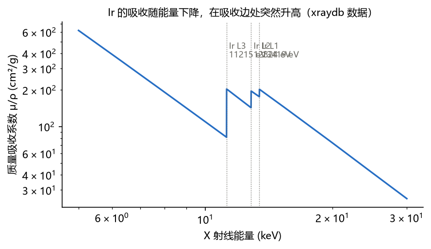

总体上能量越高越“穿透”（μ/ρ 大致按 E⁻³ 下降），但在某些能量处会**突然跳高**——这就是吸收边。

**例（样品设计）**：Ir 在 L3 边下方 50 eV 处 μ/ρ ≈ 82 cm²/g，上方 50 eV 处 ≈ 201 cm²/g，跳了约 2.4 倍。把 14.2 mg IrO₂ 与 100 mg BN 压成 φ13 mm 的片（面积 1.327 cm²），边后总 μt ≈ 2.0、边跳 Δμt ≈ 1.09——正好落在透射测量的理想区间（总 μt 1.5–2.6，Δμt ≥ 0.2）。

> **在 XAFSmith 中**：“制样指导”页由化学式、面积、目标 μt 推荐压片质量（压片制样计算器），并列出会干扰的其他吸收边（干扰吸收边筛查）；“吸收边查询”可查任一元素的吸收边、荧光线与荧光滤片。

---

## 2. 吸收边：元素的“指纹”

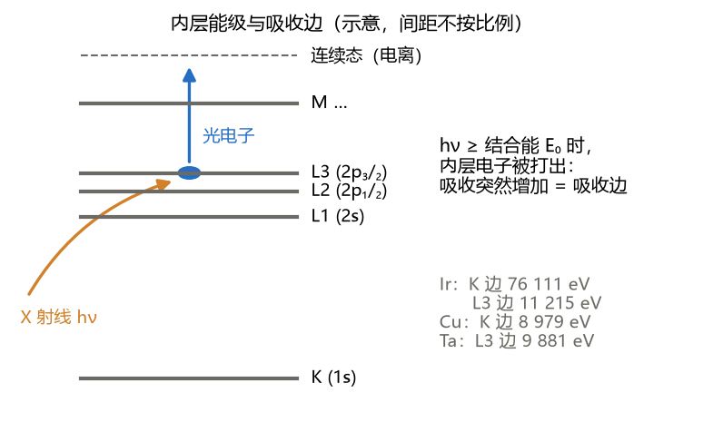

原子里的电子按壳层排布：最内层是 K 层（1s），其次是 L 层（2s、2p₁/₂、2p₃/₂，分别对应 L1、L2、L3 边），再往外是 M 层……每个内层电子有确定的**结合能**。

- 光子能量**低于**某层的结合能时，打不出这一层的电子，这一层不参与吸收；
- 能量**刚刚超过**结合能，这一层的电子开始被打出——吸收突然增加，形成**吸收边**，边的能量记作 E₀。

结合能由原子核电荷决定，**每种元素、每个壳层的边能量都不同**：

| 元素 | 吸收边 | 能量 (eV) |
|---|---|---|
| Fe | K | 7 112 |
| Co | K | 7 709 |
| Cu | K | 8 979 |
| Ta | L3 | 9 881 |
| Ir | L3 | 11 215 |
| Pt | L3 | 11 564 |
| Ir | K | 76 111 |

所以只要把 X 射线能量调到某元素的边附近，就**只看这一种元素**，其他元素只贡献平缓的背景。这就是 XAFS **元素选择性**的来源：在 IrCoOx 这样的混合物中，可以分别在 Ir L3 边和 Co K 边各测一次，分别得到 Ir 和 Co 周围的环境。

**注意干扰边**：如果样品里另一种元素的边落在扫描范围内（例如 Ir L3 之后 1 609 eV 处是 Ir 自己的 L2 边，换算成 k ≈ 20.6 Å⁻¹），那么数据只能用到那条边之前。

> **在 XAFSmith 中**：“χ(k) 与 FT → k 范围检查”与“制样指导 → 干扰吸收边筛查”自动列出这些边并换算成可用的 k 上限。

---

## 3. 为什么要用同步辐射：光源与线站

### 3.1 光源

做 XAFS 需要**能量可以连续调节、强度很高**的 X 射线。实验室 X 光管只有几条特征谱线、连续谱很弱；同步辐射正好满足要求：

- 电子在储存环里以接近光速运动（北京同步辐射装置 BSRF 2.5 GeV，上海光源 SSRF 3.5 GeV），在弯转磁铁或插入件（波荡器、扭摆器）中拐弯时，沿切线方向发出从红外到硬 X 射线的**连续谱**；
- 亮度比 X 光管高很多个数量级，光斑小、准直好，一条谱几分钟到几十分钟就能测完。

### 3.2 单色器：挑出一个能量

线站用两块完美的硅单晶（常用 Si(111) 晶面）做**双晶单色器**，按布拉格条件只让一个波长通过：

$$\lambda = 2d\,\sin\theta$$

**例**：Si(111) 的晶面间距 d = 3.1356 Å。要得到 Ir L3 边的 11 215 eV（λ = 1.1055 Å），sin θ = 1.1055 / 6.2712，θ ≈ **10.15°**。扫描能量就是一步步转动晶体角度。

### 3.3 探测：透射、荧光与参比

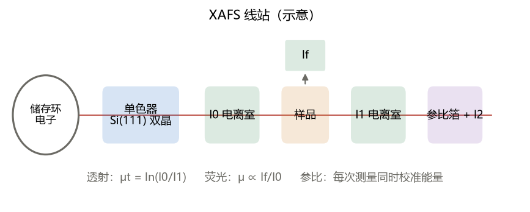

- **透射模式**：样品前后各放一个电离室测 I₀ 和 I₁，μt = ln(I₀/I₁)。适合浓度较高、能压成均匀片的样品。
- **荧光模式**：内层电子被打出后，外层电子填补空位，放出该元素的特征荧光，强度 I_f 正比于该元素的吸收：

  $$\mu(E) \propto \frac{I_f}{I_0}$$

  适合稀样品、薄膜、负载型催化剂。但样品太厚或太浓时会**自吸收**：荧光在出射途中被样品自己吸收，白线和 EXAFS 振幅都被压低（实测中可低 25% 以上）。
- **参比箔**：在样品后面再放一片同元素的金属箔和第三个电离室（I₂），每次扫描同时测参比，用来**校准能量**。单色器的角度会有零点几 eV 的漂移，没有参比就无法比较不同样品的边位置。

> **在 XAFSmith 中**：每个批次都要带单质参比（文件名含 foil / powder / metal）；“校准与处理 → ② 按参比校准”把参比一阶导数最大值对齐到表值，同一批次的谱加同一个 ΔE。

---

## 4. 一条 XAFS 谱长什么样

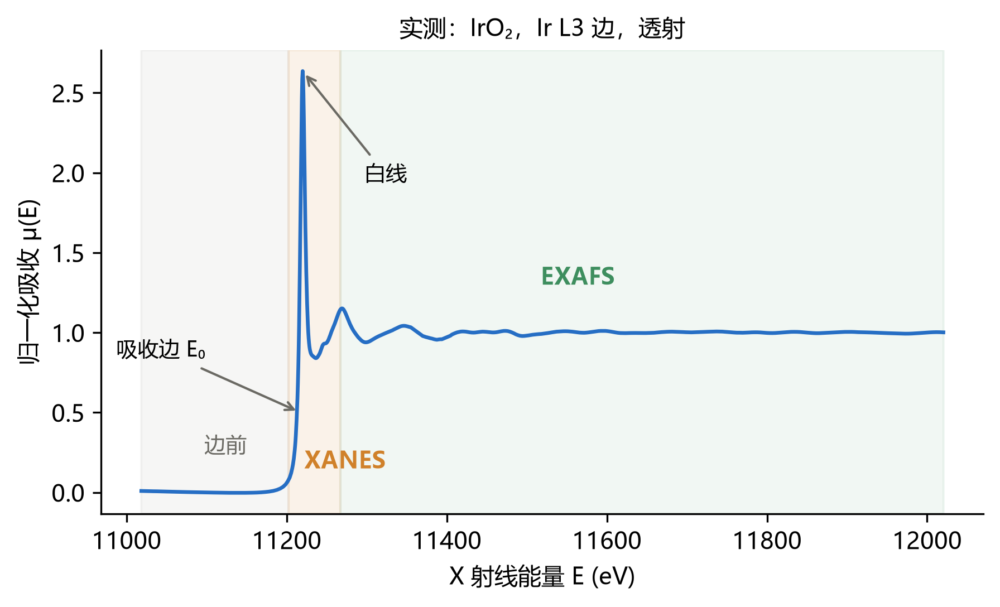

把吸收 μ 对能量 E 作图，按能量分成三段：

| 区域 | 大致范围 | 物理过程 | 能告诉我们 |
|---|---|---|---|
| **边前** | E₀ 以下 | 还打不出这一层电子 | 背景；K 边的边前峰（见第 5 节） |
| **XANES**（X 射线吸收近边结构） | E₀ −10 到 +50 eV | 电子被激发到空轨道或刚刚离开原子，受多次散射影响强 | **价态、空轨道、配位对称性** |
| **EXAFS**（扩展 X 射线吸收精细结构） | E₀ +50 到 +1000 eV | 光电子被近邻原子单次散射为主 | **近邻原子的种类、数目、距离、无序度** |

XANES + EXAFS 合称 **XAFS**（X 射线吸收精细结构），有时也叫 XAS。

“归一化”把边前拉成 0、边后拉成 1，这样不同样品、不同浓度、不同厚度的谱可以直接比较（第 8 节）。上图的纵轴已经归一化：IrO₂ 的白线峰高约 2.7。

---

## 5. XANES：价态、空轨道与对称性

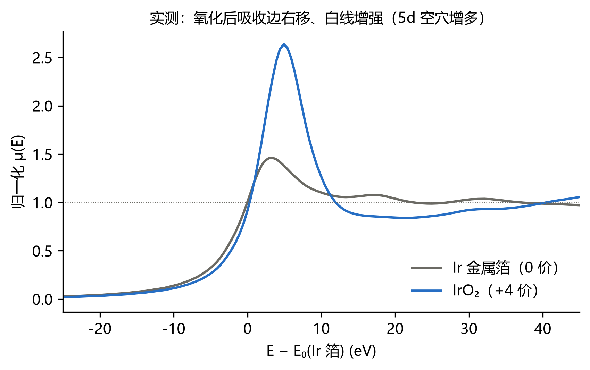

### 5.1 吸收边位置 ↔ 价态

原子失去电子（被氧化）后，剩下的电子受到更强的核吸引，内层结合能升高，**吸收边向高能方向移动**。通常每升高一价移动约 1 eV 到数 eV，具体与元素和配体有关。上图：IrO₂（Ir⁴⁺）的吸收边比 Ir 金属（Ir⁰）高；按导数最大值定义，两者的 E₀ 相差约 2.0 eV。

用几个**价态已知、配体相同、结构相近**的标样，把边位置对价态作直线，就可以估算未知样品的平均价态。

### 5.2 白线 ↔ 空轨道

L3 边的吸收主要是 2p₃/₂ → 5d 的跃迁（偶极选择定则 Δl = ±1）。5d 轨道越空，能接收电子的“空位”越多，边上的尖峰——**白线**——越强。Ir 被氧化后失去 5d 电子，所以 IrO₂ 的白线明显强于 Ir 金属。白线面积常用来比较 d 空穴数。

### 5.3 边前峰 ↔ 对称性

过渡金属 K 边（1s → 4p 为主）的边前常有小峰，来自 1s → 3d 跃迁。纯偶极下它是禁戒的，但在**没有反演中心**的配位（如四面体）里 p–d 轨道混合，边前峰会显著增强。所以边前峰的强度和位置可以区分四面体与八面体配位。

> **在 XAFSmith 中**：“XANES 定量”页计算边位置（导数最大值 / 半高点）、白线位置、高度与面积，做价态标定，拟合边前峰；“LCF”页做线性组合。

---

## 6. EXAFS 的物理图像：光电子的干涉

### 6.1 光电子是一个波

光子能量超过 E₀ 后，多出的能量 E − E₀ 变成光电子的动能。按德布罗意关系，电子也是波，其**波数** k 为：

$$k = \sqrt{\frac{2m_e\,(E-E_0)}{\hbar^2}} \approx \sqrt{0.2625\,(E-E_0)\,[\mathrm{eV}]}\ \ \mathrm{\AA}^{-1}$$

**例**：

| E − E₀ (eV) | k (Å⁻¹) | 电子波长 2π/k (Å) |
|---|---|---|
| 100 | 5.12 | 1.23 |
| 400 | 10.2 | 0.61 |
| 747 | 14.0 | 0.45 |

电子波长和键长同一量级，所以会被近邻原子明显散射。

### 6.2 回来的波与出去的波干涉

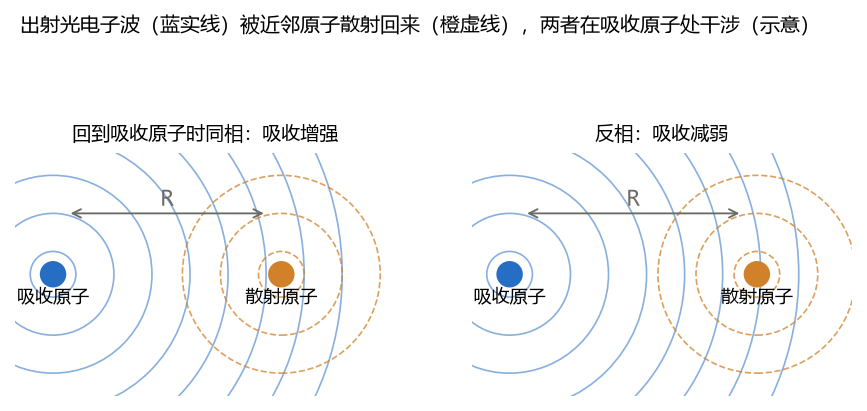

光电子波从吸收原子向外传播，遇到距离为 R 的近邻原子被**背散射**回来。回到吸收原子时，回波与出射波**相位差**为：

$$\Delta\phi = 2kR + \delta(k)$$

2kR 来自来回走了 2R 的路程，δ(k) 是两个原子的势对电子相位的附加改变（**相移**）。

- 相位差是 2π 的整数倍：回波与出射波**同相**，叠加后吸收原子处电子波幅增大，吸收**略增**；
- 相差 π：**反相**，吸收**略减**。

扫描能量时 k 连续增加，同相、反相交替出现，μ(E) 上就叠加了一个**小振荡**——这就是 EXAFS。振荡频率由 R 决定（R 越大，随 k 振得越快），振幅由近邻的数目和种类决定。

### 6.3 为什么 EXAFS 只看“局部”

光电子在固体中传播时会非弹性散射、逐渐失去相干（**平均自由程** λ(k) 约 5–10 Å），内层空穴也有有限寿命。所以只有 R ≲ 6–8 Å 的近邻能被看到。EXAFS 是一种**局域结构**方法：**不需要样品是晶体**，非晶、溶液、纳米颗粒、单原子催化剂都可以测。

---

## 7. EXAFS 方程：每一项在说什么

把上面的图像写成公式（单次散射近似，对每一个近邻“壳层” j 求和）：

$$\chi(k) = S_0^2 \sum_j \frac{N_j\, f_j(k)}{k\,R_j^2}\; e^{-2k^2\sigma_j^2}\; e^{-2R_j/\lambda(k)}\;\sin\!\left[2kR_j + \delta_j(k)\right]$$

| 项 | 名称 | 含义 | 从哪里来 |
|---|---|---|---|
| N_j | 配位数 | 第 j 壳层有几个相同的近邻 | **拟合** |
| R_j | 距离 | 吸收原子到该壳层的距离 | **拟合**（ΔR 相对结构模型） |
| σ_j² | 德拜–沃勒因子 | 距离的均方偏差（热振动 + 静态无序） | **拟合** |
| ΔE₀ | 能量零点修正 | 理论与实验 E₀ 的差 | **拟合** |
| S₀² | 振幅衰减因子 | 多电子效应，通常 0.7–1.0 | 在**已知结构的标样**上拟合后固定 |
| f_j(k) | 背散射振幅 | 随散射原子种类变化：**重原子在高 k 更强** | **FEFF 计算** |
| δ_j(k) | 相移 | 吸收与散射原子的相位改变 | **FEFF 计算** |
| λ(k) | 平均自由程 | 光电子的相干距离 | **FEFF 计算** |

几点直观理解：

- **1/R²**：球面波向外扩散，远处的原子贡献小；
- **σ² 的阻尼项**：

  $$e^{-2k^2\sigma^2},\qquad \sigma^2 = \sigma^2_{static} + \sigma^2_{thermal}$$

  原子位置有分布时，不同距离的贡献相位略有不同，在高 k 处互相抵消。σ² 越大，高 k 的振荡衰减越快。室温下第一壳层的 σ² 通常是 0.002–0.010 Ų；
- **N 与 S₀²** 以乘积出现，**完全相关**：同一次拟合不能同时让二者都自由，这就是为什么要先在标样上定 S₀²。

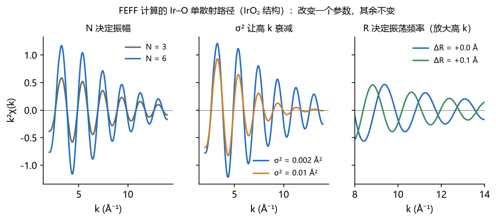

上图用 FEFF 算出的 IrO₂ 中 Ir–O 路径，一次只改一个参数：N 加倍，振幅加倍；σ² 增大，高 k 衰减；R 增加 0.1 Å，振荡变快，高 k 处的相位明显错开。**拟合就是反过来，从测到的振荡推出这些参数。**

### 7.1 σ²（Debye–Waller 因子）到底是什么

**一句话**：σ² 是“吸收原子到某一壳层散射原子的距离”的**均方涨落**，单位 Ų。每条路径一个 σ²。σ = √σ² 大致就是这些距离彼此相差多少：σ² = 0.004 Ų 对应 σ ≈ 0.06 Å。

**它来自两部分**：

| 来源 | 是什么 | 随温度变吗 |
|---|---|---|
| 热振动 σ²_thermal | 原子一直在振动，每次“拍照”距离都略有不同；温度越高振得越厉害，0 K 也不为零（零点振动） | 变 |
| 静态无序 σ²_static | 不同位置的同种键本来就不一样长：畸变、缺陷、无定形、纳米颗粒表面、两种相混在一起 | 不变 |

数据里只看得到两者之和。**同一温度下测的一组样品，σ² 的变化来自静态无序**，也就是结构在变。

**它对谱做了什么**：振幅乘上 e^(−2k²σ²)。这个因子在低 k 接近 1，在高 k 很小。例如 k = 12 Å⁻¹ 时，σ² = 0.005 Ų → 0.24，σ² = 0.010 Ų → 0.06。所以 σ² 越大：

- χ(k) 高 k 的振荡越快消失；
- |χ(R)| 里该壳层的峰越**矮、越宽**。

**最容易犯的错**：峰变矮不一定是配位数 N 变小，也可能是 σ² 变大（更无序）。N 让所有 k 的振幅按同一比例变，σ² 主要压高 k，拟合靠这点差别把两者分开。但分开得并不干净，二者**强相关**。所以：

- 用尽量长的 k 范围，并比较 k¹、k²、k³ 权重下的结果；
- 看相关系数，N 与 σ² 的相关超过约 0.8 时，单独报告其中一个都不可靠；
- 比较一个序列时，常把 N 固定（或与已知结构绑定），只让 σ² 变；或者反过来。说明你做了哪个假设。

**典型值**：室温第一壳层多在 0.002–0.010 Ų；外壳层、轻原子、无序材料更大。拟合出 **σ² < 0 没有物理意义**，通常说明模型有问题（N 或 S₀² 设大了，或路径不对）。

**多个温度：Debye / Einstein 模型**。热振动部分随温度的变化可以用一个“特征温度” θ 描述（Debye 模型用 θ_D，Einstein 模型用 θ_E）：σ² = σ²_thermal(T, θ) + σ²_static。同一样品在几个温度下测量时，拟合页勾选“使用 σ² 温度模型”，就能用一个 θ 加一个静态项代替每个温度各一个 σ²。至少要 2–3 个温度；只有一个温度时，热振动与静态无序分不开。

**时间序列（原位、随时间变化）不是这种情况**。温度不变时，σ² 的变化就是结构无序的变化，不要用温度模型，每个时间点照常拟合 σ² 即可（也可以用联合拟合让不变的量共用，例如 S₀²、ΔE₀）。第二壳层尤其要小心：

- 它的信号比第一壳层弱，σ² 误差大；
- 第二壳层常是几种路径叠在一起（例如金属–金属与金属–氧–金属），σ² 与 N 互相牵连。

所以要看的是 σ² **相对第一个时间点的变化趋势和误差棒**，不要只看单个数值。

---

## 8. 从 μ(E) 到 χ(k)：数据处理

EXAFS 振荡只占总吸收的百分之几到百分之十几，要先把它从 μ(E) 中“取出来”。

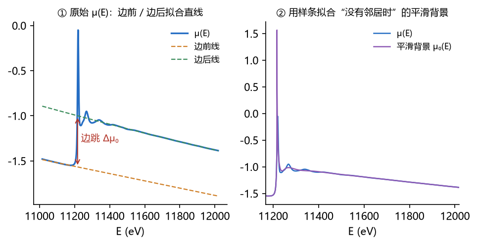

**第 1 步：能量校准**。用同批次参比箔的一阶导数最大值对齐到表值（第 3.3 节）。

**第 2 步：确定 E₀**。全项目统一一种定义，本软件用平滑后的一阶导数最大值。

**第 3 步：归一化**。在边前（如 E₀ −150 到 −30 eV）拟合一条直线，在边后（如 E₀ +100 eV 到末端）拟合一条二次曲线，两线在 E₀ 处的差就是**边跳 Δμ₀**。把谱减去边前线再除以边跳，边前变成 0、边后变成 1。

**第 4 步：扣背景**。假想吸收原子周围没有邻居时，μ(E) 应该是一条平滑曲线 μ₀(E)。用样条拟合这条平滑背景（AUTOBK 算法：要求 χ(R) 在很小的 R（< R_bkg，常取 1.0 Å）处尽量为零，因为那里不可能有近邻）。于是：

$$\chi(E) = \frac{\mu(E) - \mu_0(E)}{\Delta\mu_0(E_0)}$$

**第 5 步：换到 k 空间并加权**。按第 6.1 节的公式把横轴换成 k。高 k 处振荡很弱，常乘以 k、k² 或 k³ 放大：

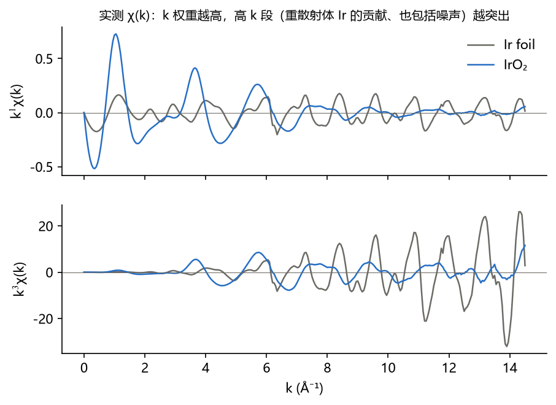

k 权重越高，高 k 段越突出——高 k 段主要来自重原子散射，也带来更多噪声。**k¹、k²、k³ 都要看**。

**处理参数的一致性**：同一组样品必须用同一套 E₀ 定义、归一化范围、R_bkg、k 范围，否则差别可能来自处理而不是样品。

> **在 XAFSmith 中**：“校准与处理”保存每条吸收边的一套参数并批量处理；“归一化”“χ(k) 与 FT”两页可以逐条查看、调整。

---

## 9. 傅里叶变换：从振荡到“径向分布”

χ(k) 是几个正弦振荡的叠加，每个壳层一个频率（≈ 2R）。对它做傅里叶变换，就把不同频率分开，得到类似“径向分布”的 |χ(R)|：

$$\chi(R) = \frac{1}{\sqrt{2\pi}} \int_{k_{min}}^{k_{max}} w(k)\, k^n \chi(k)\, e^{2ikR}\, dk$$

w(k) 是窗函数（如 Hanning），让数据两端平滑地降到 0，减少截断引起的旁瓣。

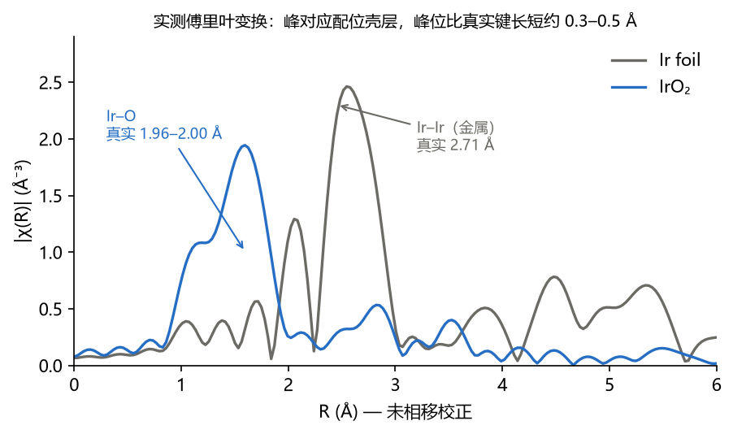

读图要点：

1. **每个峰大致对应一个配位壳层**：IrO₂ 在 1.6 Å 附近的峰是 Ir–O，Ir 金属在 2.5 Å 附近的峰是 Ir–Ir。
2. **峰位比真实键长短约 0.3–0.5 Å**：因为相位里有 δ(k)，FT 没有扣除它。Ir–O 真实键长 1.96–2.00 Å，图上峰在约 1.6 Å。所以 R 轴要标注“**未相移校正**”。
3. **一个峰 ≠ 一个壳层**：小峰也可能来自噪声、背景扣除残余、窗函数旁瓣或多重散射；距离相近的不同原子也会叠成一个峰。

**分辨率与信息量**：

$$\Delta R \approx \frac{\pi}{2\,\Delta k}$$

$$N_{idp} \approx \frac{2\,\Delta k\,\Delta R}{\pi}$$

**例**：k 范围 3–14 Å⁻¹（Δk = 11），ΔR ≈ π/22 ≈ **0.14 Å**——距离差小于 0.14 Å 的两个壳层在 |χ(R)| 中分不开。在 R = 1.0–2.1 Å 窗口内，独立点数 N_idp ≈ 2 × 11 × 1.1 / π ≈ **7.7**（Larch 的计数再加 1，约 8.7）。拟合的自由参数不应超过它的一半，即约 4 个。

---

## 10. FEFF 与拟合：把数字算出来

### 10.1 FEFF 算理论

f(k)、δ(k)、λ(k) 不能凭空知道。**FEFF** 程序从一个结构模型（如晶体结构 CIF）出发，计算吸收原子周围每一条散射**路径**（单次散射 A→B→A，以及多次散射 A→B→C→A……）的这些量。

- **FEFF6L**：非自洽势，几秒钟；
- **FEFF8L**：自洽势，1–3 分钟，ΔE₀ 通常更接近 0，对电荷转移明显的体系更可靠。

### 10.2 拟合

拟合就是调整 N、ΔR、σ²、ΔE₀，让 EXAFS 方程算出的 χ 与数据最接近（通常在 R 空间、拟合窗口内比较）。判据之一是 R 因子：

$$\mathcal{R} = \frac{\sum_i \left[\chi_{data}(R_i) - \chi_{fit}(R_i)\right]^2}{\sum_i \chi_{data}(R_i)^2}$$

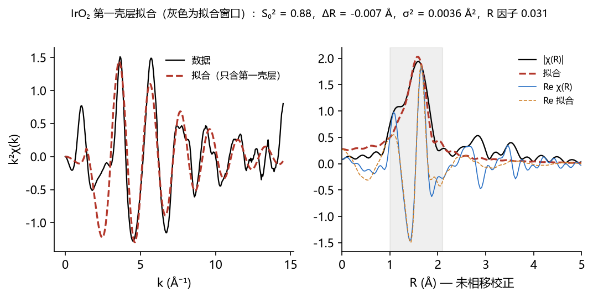

**例**：IrO₂ 第一壳层（2 + 4 个 O，FEFF6L，k = 3–14 Å⁻¹，R = 1.0–2.1 Å，k¹/k²/k³ 同时拟合，4 个变量），结果为 S₀² = 0.88 ± 0.14、ΔE₀ = 7.6 ± 2.1 eV、ΔR = −0.007 ± 0.017 Å（两个 Ir–O 距离为 1.951 与 1.989 Å）、σ² = 0.0036 ± 0.0021 Ų，R 因子 0.031。

这个例子也说明为什么要看不止一个指标：参数都物理合理（σ² 为正且在常见范围，|ΔE₀| < 10 eV，没有强相关），R 因子也“可接受”；但软件的拟合质量检查指出，窗口内的残差约为噪声的 38 倍。数据越干净，这个比值越能暴露模型的不足：只含第一壳层的模型没有描述 |χ(R)| 在 1.1 Å 附近的肩峰，也没有描述从外层（Ir–Ir 等）漏进窗口的信号。下一步应在更宽的 R 窗口里加入外层路径，并用 F 检验判断每条新路径是否必要。**拟合给出的是“在这个模型下最好的参数”，模型本身对不对要另外判断。**

### 10.3 拟合的基本规矩

1. 先拟合**已知结构的标样**，定出 S₀²，样品中固定；
2. **变量数 ≤ N_idp / 2**；参数不够时用约束（共用 ΔE₀、σ² 绑定等）；
3. 加一个壳层要做 **F 检验**，p < 0.05 才能说“观察到”这个壳层；
4. |χ(R)| 与 Re χ(R) 都要对上，参数要物理合理（|ΔE₀| ≤ 10 eV，σ² > 0，ΔR 不应偏离结构太多），结论在不同 k 范围、k 权重下要稳定。

> **在 XAFSmith 中**：“FEFF 路径”计算路径；“EXAFS 拟合”建立模型并拟合，结果下方自动做拟合质量检查、拟合诊断与稳健性检查；“拟合历史”做 F 检验。详见《零基础拟合教程》与《拟合质量提升教程》。

---

## 11. 小波变换与线性组合拟合

### 11.1 小波变换：同时看 k 和 R

傅里叶变换只告诉你“在哪个 R”，丢掉了“在哪个 k”。小波变换把 χ(k) 展开在 k–R 平面上：

$$W(k,R) = \int \chi(k')\,k'^n\,\psi^*\!\left(\frac{k'-k}{s}\right) dk',\qquad s=\frac{\eta}{2R}$$

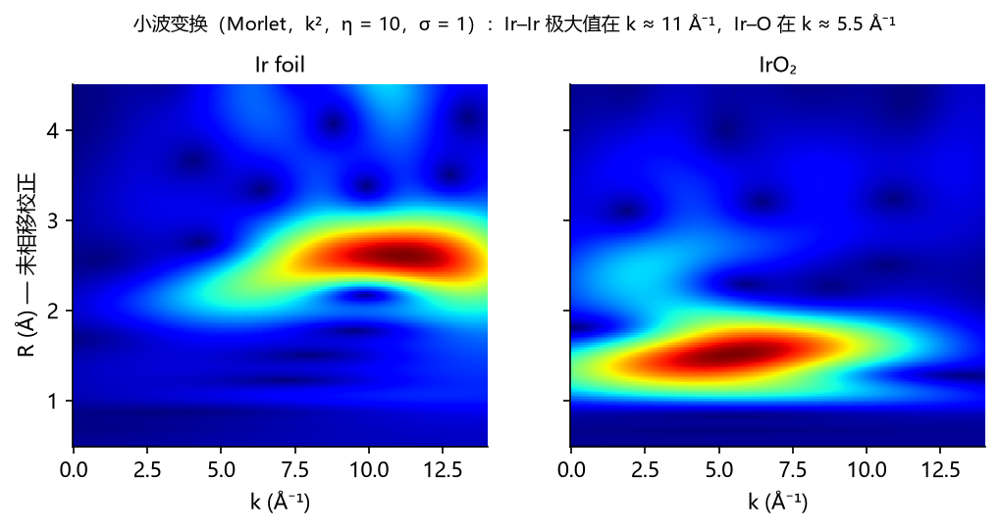

因为重原子的背散射振幅在高 k 更强，**同一 R 处，重散射体的极大值在高 k，轻散射体在低 k**。上图：Ir 金属的 Ir–Ir 极大值在 k ≈ 11 Å⁻¹（R ≈ 2.6 Å），IrO₂ 的 Ir–O 极大值在 k ≈ 5.5 Å⁻¹（R ≈ 1.5 Å）。小波常用来判断第二壳层是金属–金属还是金属–氧，或判断有没有金属团簇（单原子催化剂中常用）。它给的是**定性**判据，配位数和距离仍要靠拟合。

### 11.2 线性组合拟合（LCF）

如果样品是几种已知物相的混合物，它的谱近似是这些物相谱的加权和：

$$\mu_{sample}(E) \approx \sum_i w_i\, \mu_i(E),\qquad \sum_i w_i = 1$$

例如 Ir 金属与 IrO₂ 的混合物，拟合得到的权重近似是两种 Ir 物种的比例（按 Ir 原子计）。端点必须是**实测标样**，并要与“只用一个标样”的拟合比较。

---

## 12. XAFS 能回答什么、不能回答什么

**能回答**：

- 某元素的平均价态、d 空穴的相对多少（XANES）；
- 某元素周围近邻的种类（轻 / 重）、平均配位数、平均距离（精度约 ±0.01–0.02 Å）、无序度（EXAFS）；
- 这些量随时间、电位、温度的变化（原位 / 工况测量）。

**不能直接回答，或要格外小心**：

- XAFS 给的是**该元素所有原子的平均**：如果一半 Ir 在金属里、一半在氧化物里，看到的是平均；
- **配位数的误差常有 10–25%**，并与 σ²、S₀² 相关；
- 相近距离、相近原子序数的近邻（如 O 与 N、Co 与 Ni）很难区分；
- R 空间的小峰不能单凭“看见”就当作一个壳层；
- 荧光数据与透射数据不能直接并列比较（自吸收）。

写结论时，把陈述分成三类：**实测**（数据直接可见，例如“吸收边右移 1.2 eV”）、**拟合结果**（依赖模型，例如“Ir–O 配位数 5.6 ± 0.8”）、**推测**（需要其他证据，例如“形成了 Ir–O–Co 连接”）。

---

## 13. 术语表与延伸阅读

| 术语 | 含义 |
|---|---|
| E₀ | 吸收边能量（本软件取一阶导数最大值） |
| 边跳 Δμ₀ | 吸收边上下吸收之差，归一化用 |
| 白线 | 吸收边上的尖峰，对应向空轨道的跃迁 |
| k | 光电子波数，k ≈ √(0.2625 (E − E₀)) Å⁻¹ |
| χ(k) | 归一化后的 EXAFS 振荡 |
| |χ(R)| | χ(k) 的傅里叶变换幅值（未相移校正） |
| N、R、σ² | 配位数、距离、德拜–沃勒因子 |
| S₀² | 振幅衰减因子，标样上确定 |
| ΔE₀ | 能量零点修正 |
| 路径 | 光电子从吸收原子出发、经散射回来的一条路线（FEFF 计算） |
| N_idp | 数据中独立信息的个数，限制可拟合的参数数 |
| R 因子 | 拟合残差占数据的比例 |

**延伸阅读**

- M. Newville, *Fundamentals of XAFS*（Larch 作者写的免费讲义，网上可下载），Rev. Mineral. Geochem. 78, 33 (2014)。
- G. Bunker, *Introduction to XAFS*, Cambridge University Press (2010)。
- S. Calvin, *XAFS for Everyone*, CRC Press (2013)。
- J. J. Rehr, R. C. Albers, “Theoretical approaches to x-ray absorption fine structure”, Rev. Mod. Phys. 72, 621 (2000)。

下一步：读《零基础拟合教程》，用自己的数据从标样开始走一遍。
